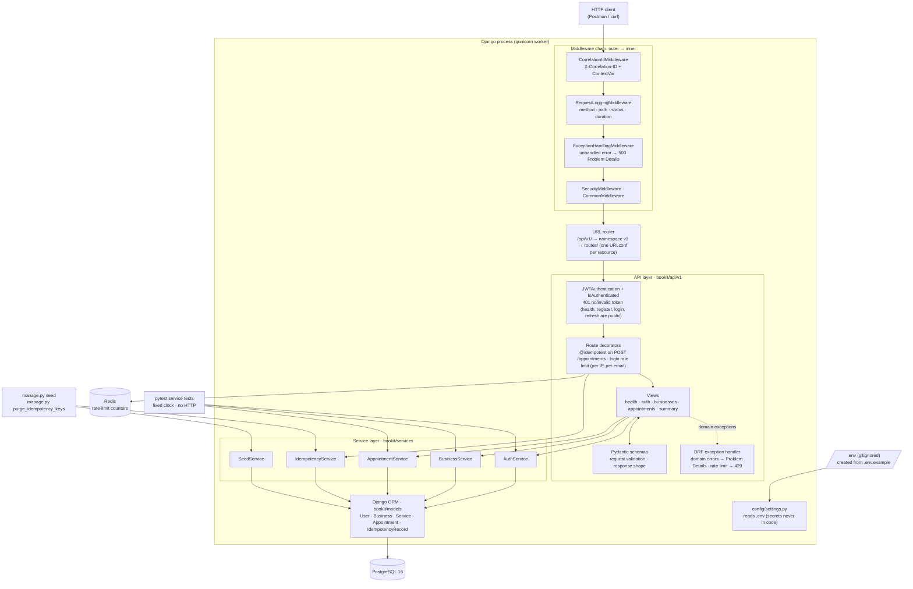
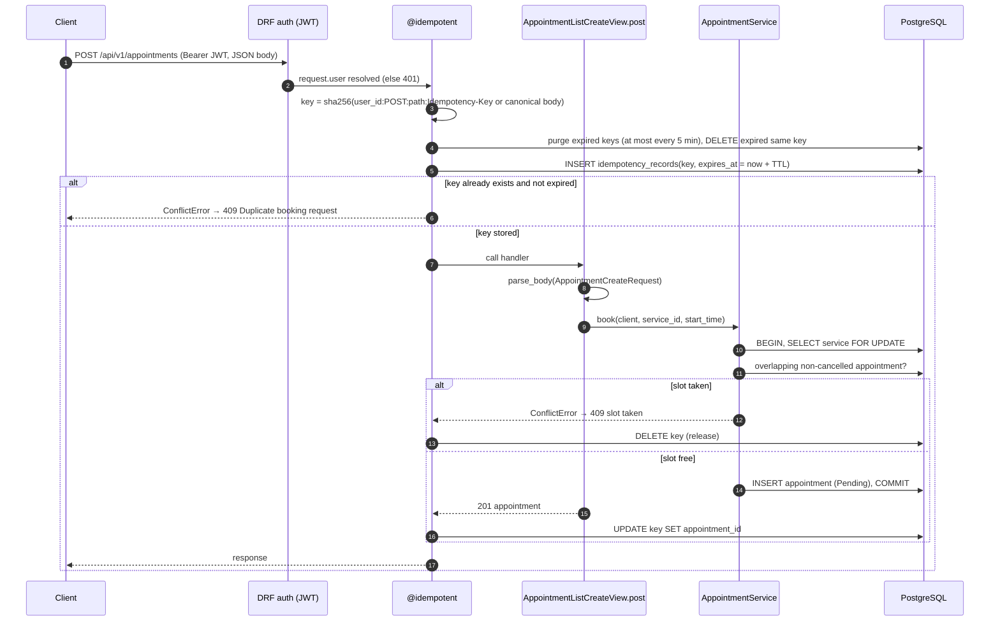
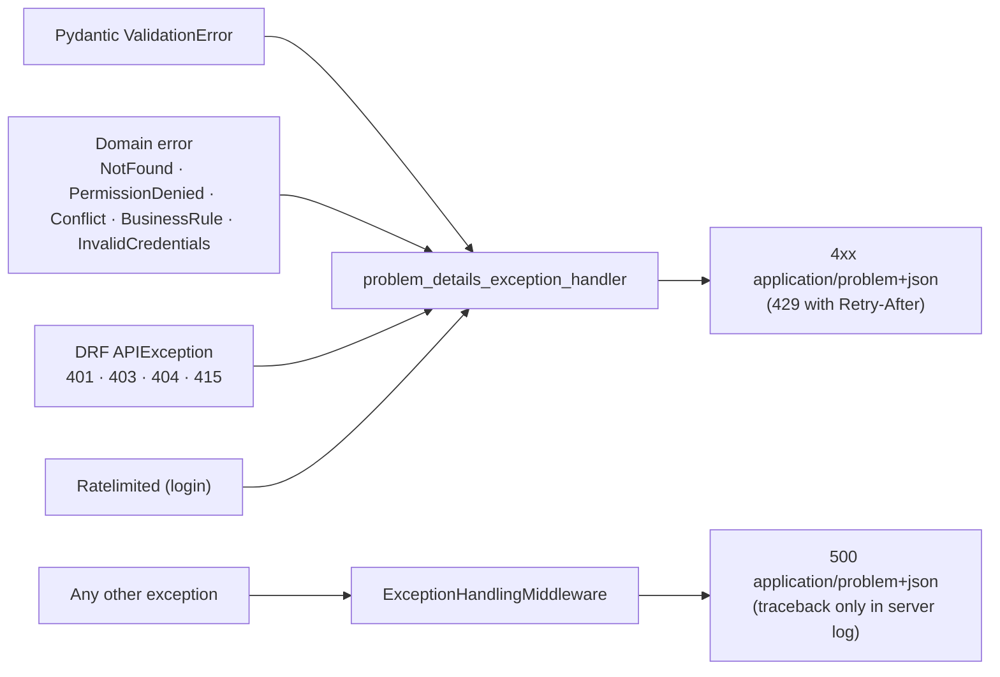
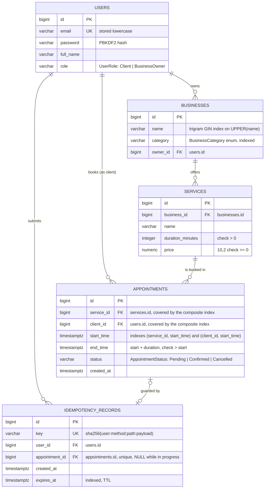

# BookIt – Appointment Booking API

Backend for BookIt: business owners list services, and clients book appointments.
Built with **Python 3.12 · Django 5.2 · Django REST Framework · Pydantic v2 · PostgreSQL 16 · JWT (SimpleJWT) · Redis**.

- Design spec: [`docs/superpowers/specs/2026-10-18-bookit-api-design.md`](docs/superpowers/specs/2026-10-18-bookit-api-design.md)
- Diagrams in this README: [architecture](#architecture), [booking sequence](#booking-sequence), [error flow](#error-flow), [data model (ERD)](#data-model-erd)
- Postman collection: [`docs/BookIt.postman_collection.json`](docs/BookIt.postman_collection.json)

## Quick start (Docker Compose)

```bash
python scripts/init_env.py      # creates .env from .env.example with a generated DJANGO_SECRET_KEY
docker compose up --build       # db (Postgres) + redis + api; the api migrates and seeds on start
```
- The API runs at `http://localhost:8000/api/v1/`. Check it with `GET /api/v1/health` → `{"status": "OK"}`.
- `docker compose ps` shows all three services as `(healthy)`.
- Postgres is also published on `localhost:5432`, so you can connect with `psql` or pgAdmin using the values in `.env`.
- `docker compose down` stops the stack and keeps the data. `docker compose down -v` also deletes the database volume.

## Local development (without the api container)

1. Create the environment file: `python scripts/init_env.py`. Secrets are never in code; `.env` is gitignored.
2. Start only the database: `docker compose up -d db`.
3. Install and run:
   ```bash
   python -m venv .venv
   .venv/Scripts/python -m pip install -r requirements.txt   # Linux/macOS: .venv/bin/python
   .venv/Scripts/python manage.py migrate
   .venv/Scripts/python manage.py seed          # --reset to re-seed
   .venv/Scripts/python manage.py runserver
   ```
   Without `REDIS_URL`, the login rate limit uses the in-memory cache. That is fine for one dev process.

## Seeded login credentials

All seeded users share the password in `SEED_USER_PASSWORD` in `.env` (default in `.env.example`: `BookIt123!`).

| Role | Emails |
|---|---|
| BusinessOwner | `owner1@bookit.dev` … `owner4@bookit.dev` |
| Client | `client1@bookit.dev` … `client6@bookit.dev` |

The seed creates 10 users, 20 businesses (all 6 categories), 50 services and 200 appointments in all 3 statuses. Appointments use hourly slots from 30 days in the past to 30 days in the future, so they never overlap. The data is random but reproducible (`--seed N`). Running `seed` again on a seeded DB does nothing.

## API overview (v1)

All paths start with `/api/v1`. Every endpoint except health, register, login and refresh needs `Authorization: Bearer <access token>`.

| Method | Path | Who | Success | Errors |
|---|---|---|---|---|
| GET | `/health` | public | 200 `{"status": "OK"}` | 503 database down |
| POST | `/auth/register` | public | 201 | 400, 409 email taken |
| POST | `/auth/login` | public | 200 `{access, refresh, token_type}` | 400, 401, 429 rate limited |
| POST | `/auth/refresh` | public | 200 `{access, token_type}` | 400, 401 |
| GET | `/businesses?category=&search=&order=&limit=&offset=` | any user | 200 page | 400, 401 |
| POST | `/appointments` | Client | 201 | 400, 401, 403, 409 slot taken / duplicate request |
| GET | `/appointments?from=&to=&status=&limit=&offset=` | any user | 200 page | 400, 401 |
| GET | `/businesses/{id}/summary` | owner of that business | 200 | 401, 403, 404 |

- **Paths:** the assignment used `/api/auth/...`. Here everything is versioned under `/api/v1/`. A new version is a new `bookit/api/vN/` package that reuses the same services.
- **Times:** `from`, `to`, `start_time` and `end_time` are **unix timestamps in seconds (UTC)** and must be positive. `from`/`to` filter on `start_time` and are inclusive.
- **Enums** (case-insensitive in query parameters):
  - `status`: `Pending`, `Confirmed`, `Cancelled`
  - `role`: `Client`, `BusinessOwner`
  - `category`: `Barber`, `Beauty`, `Fitness`, `Massage`, `Physiotherapy`, `Tutoring`
  - `order`: `asc` (default) or `desc`, by business name
- **Pagination:** `limit` (1–100, default 20) and `offset`. The response is `{count, limit, offset, next, previous, results}`; `count` is the total number of matches.
- **Scope:** a Client sees their own appointments. A BusinessOwner sees appointments for services of the businesses they own.
- **Booking rules:** the start time must be in the future. The end time is `start + service duration`. An overlap with a Pending or Confirmed appointment of the same service → 409. A Cancelled appointment frees its slot.
- **Summary:** for each service, the count of upcoming Pending/Confirmed appointments and the expected revenue (`count × price`).

### Tokens
- The access token lives 15 min and the refresh token lives 1 day. Both carry `user_id` and `role`.
- A user stays logged in while the access token is valid, and gets a new one from `/auth/refresh`.
- Refresh tokens are not rotated. When the refresh token expires, the user must log in again.

### Errors
Every error is RFC 9457 Problem Details (`application/problem+json`):
```json
{"type": "about:blank", "title": "Conflict", "status": 409,
 "detail": "The requested time slot is already booked.", "correlation_id": "3f2a…",
 "errors": [{"field": "start_time", "message": "..."}]}
```
`errors` appears only on validation failures. An unexpected error returns a generic 500. The stack trace is only in the server log, under the same `correlation_id`, which is also sent as the `X-Correlation-ID` response header.

### Booking idempotency (protects against double charging)
`POST /appointments` has an `@idempotent` decorator. It runs after JWT authentication:
- It hashes `user + method + path + JSON body`. If the client sends an `Idempotency-Key` header, the header replaces the body in the hash.
- It stores the hash in the `idempotency_records` table for 10 minutes.
- The same request again within that window → **409 "Duplicate booking request"**, and no second appointment is created.
- A failed booking releases the hash. A successful one is linked to the created appointment.
- This prepares for a payment step: one booking request can never be charged twice.
- Expired hashes are purged by the app at most every 5 minutes, or with `python manage.py purge_idempotency_keys`.

### Login rate limit
`POST /auth/login` only, with `django-ratelimit`:
- **per client IP:** 5 attempts per minute (`LOGIN_RATE_LIMIT`)
- **per email:** 10 attempts per minute (`LOGIN_EMAIL_RATE_LIMIT`). It is higher because anyone who knows an email could otherwise lock its owner out.
- Exceeding either limit → **429** Problem Details with `Retry-After: 60`. Successful logins count too.
- In Docker the counters live in a small Redis service, so all gunicorn workers share them.

## Architecture



| Layer | Folder | Responsibility | Must not |
|---|---|---|---|
| Middleware | `bookit/middleware/` | correlation id, request logs, last-resort 500 (every request) | contain booking rules |
| API | `bookit/api/` | routing, JWT auth, `@idempotent` and login rate limit, Pydantic parse/format, status codes | contain business rules or ORM queries |
| Services | `bookit/services/` | business rules, ownership, transactions, domain errors | import DRF or read HTTP objects |
| Models | `bookit/models/` | tables, enums, DB constraints | contain request logic |
| Config | `config/` | settings from env / `.env` | contain secret values |

- **Views** parse input with Pydantic, call one service method, and return a Pydantic response.
- **Services** hold every business rule and transaction. They receive their dependencies (for example the clock) in the constructor, so they are tested without HTTP.
- **Custom middlewares**, in order. The assignment asked for global exception handling and request logging; the correlation id links the log lines of one request.
  1. correlation id
  2. request logging (method, path, status, duration)
  3. global exception handling (generic JSON 500)
- **Route-level decorators:** `@idempotent` on booking, and the rate limits on login. Django middleware is global, so per-route behavior lives in decorators that run after DRF authentication.
- **No N+1:** `select_related` / `prefetch_related`. Tests assert that the query count stays the same as rows grow.
- **The business summary** is one SQL aggregation (`Count` / `Sum` with `filter=`).
- **Routes:** `bookit/api/v1/urls.py` mounts one URLconf per resource from `bookit/api/v1/routes/`.
- **Dependency injection:** views get services from `api/v1/dependencies.py`; tests create services directly with a fixed clock.
- **Versioning:** `bookit/api/urls.py` mounts `v1/` with `namespace="v1"`. A future `v2/` package gets its own urls, views and schemas and reuses the same services.

```
config/            settings (reads .env), urls, wsgi
bookit/models/     User, Business, Service, Appointment, IdempotencyRecord, enums
bookit/services/   AuthService, BusinessService, AppointmentService, IdempotencyService, SeedService
bookit/api/        common/ (errors, pagination, parsing, idempotency, rate limit) · v1/ (urls, routes, views, schemas)
bookit/middleware/ correlation, request logging, exception handling
tests/             services, schemas, middleware, models, API, commands
```

### Booking sequence



### Error flow



## Data model (ERD)



| Enum | Column | Values |
|---|---|---|
| `UserRole` | `users.role` | `Client`, `BusinessOwner` |
| `BusinessCategory` | `businesses.category` | `Barber`, `Beauty`, `Fitness`, `Massage`, `Physiotherapy`, `Tutoring` |
| `AppointmentStatus` | `appointments.status` | `Pending`, `Confirmed`, `Cancelled` |

- All three enums are Django `TextChoices`. DB check constraints also enforce them.
- `users` keeps only what the API needs. There is no `PermissionsMixin` (no admin, groups or permissions), and `last_login` is disabled because JWT logins are stateless.
- `end_time` is stored, so the overlap check is a simple range query: `start_time < new_end AND end_time > new_start AND status <> 'Cancelled'`.
- `idempotency_records` works as a `hash → TTL` dictionary that guards appointment creation. `appointment_id` is set after the 201, so each appointment has at most one record. An expired row is ignored and purged.
- All foreign keys use `ON DELETE CASCADE`.

## How are database connections and transactions scoped per request?

Each request uses Django's per-thread database connection. It opens on the first query and stays open for `CONN_MAX_AGE = 60` seconds, with health checks. So later requests on the same worker reuse it instead of reconnecting.

Requests are **not** wrapped in one transaction (`ATOMIC_REQUESTS = False`). Reads run in autocommit. Only writes that must succeed or fail together open an explicit `transaction.atomic()` in the service layer. Examples: booking (lock the service row with `SELECT … FOR UPDATE`, check overlaps, insert), registration and seeding. This keeps transactions and locks short, and makes them part of the business logic, not the HTTP layer.

## Indexes

| Index | Serves |
|---|---|
| `appointments (service_id, start_time)` | booking overlap check, summary, owner listing |
| `appointments (client_id, start_time)` | a client's appointment list |
| `businesses (category)` | category filter |
| `businesses` trigram GIN on `UPPER(name)` | `?search=` (`icontains` → `LIKE '%x%'`, which a B-tree cannot serve) |

The single-column foreign-key indexes on `appointments.service_id` and `client_id` were dropped, because the composite indexes start with those columns.

Search on 200,001 businesses (`EXPLAIN ANALYZE`, one run on a laptop):

| | Plan | Time |
|---|---|---|
| with the trigram index | Bitmap Index Scan on `businesses_name_trgm_idx` | 1.6 ms |
| without it | Parallel Seq Scan, ~200,000 rows filtered out | 43.9 ms |

## Tests

```bash
docker compose up -d db
.venv/Scripts/python -m pytest
```
The suite is TDD-built and follows a test pyramid:
- **Most tests are unit tests of the service classes.** They run without HTTP and with a fixed clock.
- Pydantic schema tests, middleware tests and DB index tests come next.
- A thin layer of API tests checks status codes, 401/403/429, response shapes and query counts.
- `tests/test_check_postman.py` fails if a route has no request in the Postman collection.

## Postman

Import `docs/BookIt.postman_collection.json`. The `host` variable defaults to `http://localhost:8000`.
- The login requests save the tokens into collection variables, so the requests after them are authenticated.
- Run the whole collection in Collection Runner, in order.
- The last folder, "Rate limit", uses up the login budget of your IP for one minute.

## Known limitations and next steps

- **No status-change endpoint.** `Cancelled` exists, and it frees the slot, but there is no `PATCH /appointments/{id}/status` yet.
- **A duplicate booking gets 409, not a replay of the first 201.** A client that lost the first response checks `GET /appointments`. For payments, the next step is to store and replay the first response.
- **Deep `OFFSET` pages get slower**, because Postgres still reads the skipped rows. At scale the next step is keyset (cursor) pagination.
- **Expected revenue uses the current service price.** Storing the price on each appointment would keep old bookings at their booked price.

## Bonus items

| Item | Status |
|---|---|
| Refresh-token flow | Done: 15 min access, 1 day refresh, no rotation |
| Unit tests for a service class (pytest) | Done for **all** service classes |
| docker-compose (API + Postgres) | Done, plus Redis and healthchecks |
| Request validation (Pydantic) | Done: all requests and responses |
| Rate limiting on login | Done: 5/m per IP and 10/m per email → 429 |
