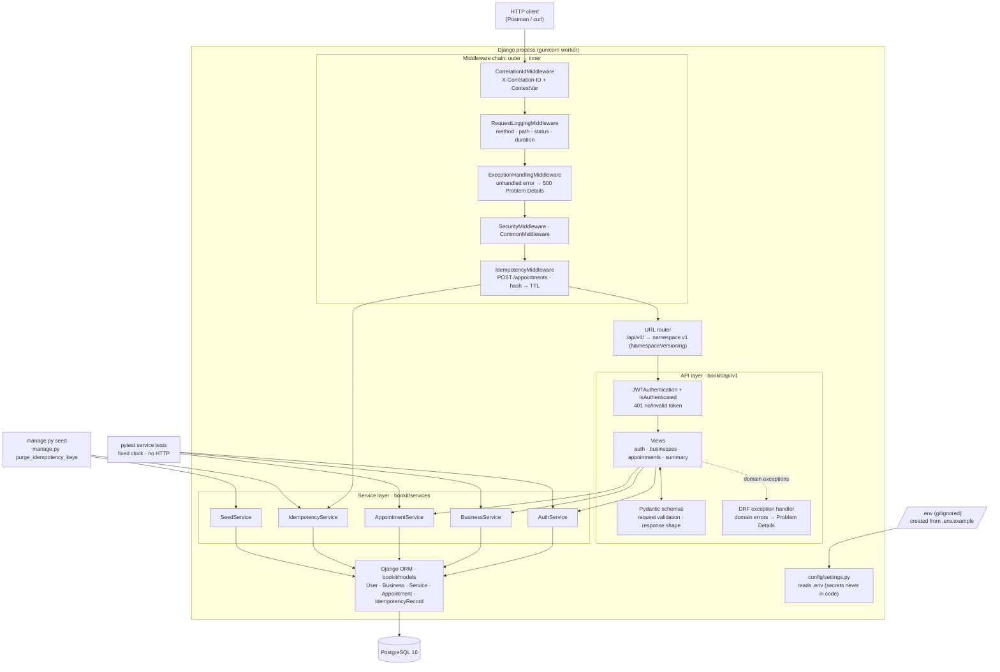
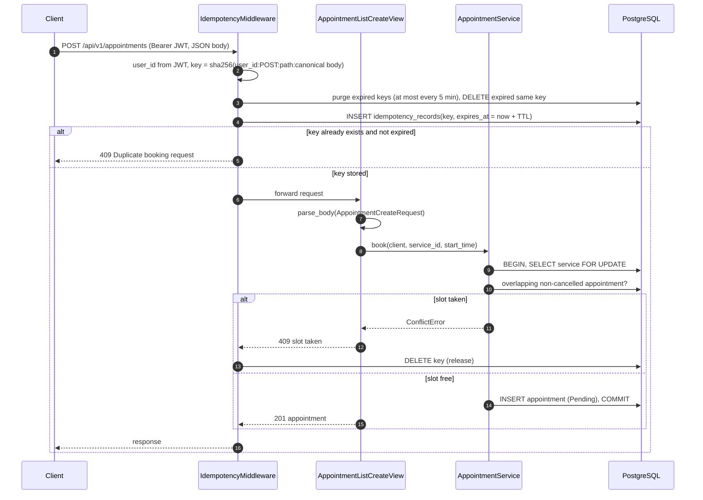
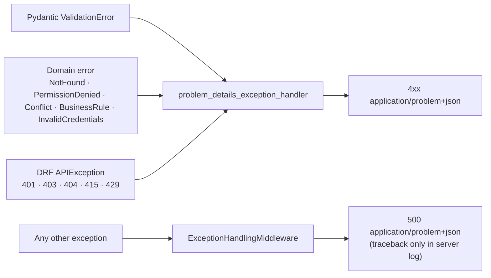

# BookIt – Architecture

## Layers and request flow

| Layer | Folder | Responsibility | Must not |
|---|---|---|---|
| Middleware | `bookit/middleware/` | correlation id, request logs, last-resort 500, duplicate-booking guard | contain booking rules |
| API | `bookit/api/v1/` | routing, JWT auth, Pydantic parse/format, status codes | contain business rules or ORM queries |
| Services | `bookit/services/` | business rules, ownership, transactions, domain errors | import DRF or read HTTP objects |
| Models | `bookit/models/` | tables, enums, DB constraints | contain request logic |
| Config | `config/` | settings from env / `.env` | contain secret values |

**Dependency injection:**
- Services receive collaborators in the constructor (for example `clock=timezone.now`).
- Views get the services from `api/v1/dependencies.py`.
- Tests create the services directly with a fixed clock.

**Versioning:**
- `bookit/api/urls.py` mounts `v1/` with `namespace="v1"`.
- A future `v2/` package gets its own urls, views and schemas and reuses the same services.

## Booking sequence (with idempotency)

## Error flow

