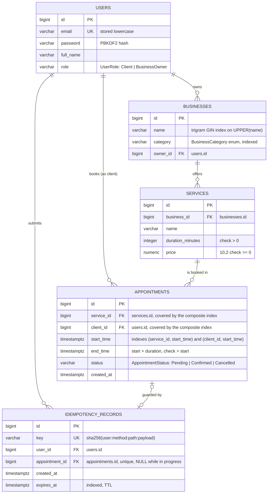

# BookIt – Entity Relationship Diagram

## Enums

| Enum | Column | Values |
|---|---|---|
| `UserRole` | `users.role` | `Client`, `BusinessOwner` |
| `BusinessCategory` | `businesses.category` | `Barber`, `Beauty`, `Fitness`, `Massage`, `Physiotherapy`, `Tutoring` |
| `AppointmentStatus` | `appointments.status` | `Pending`, `Confirmed`, `Cancelled` |

## Notes
- All three enums are Django `TextChoices`. DB check constraints also enforce them.
- `users` keeps only what the API needs. There is no `PermissionsMixin` (no admin, groups or permissions), and `last_login` is disabled because JWT logins are stateless.
- `end_time` is stored, so the overlap check is a simple range query:
  `start_time < new_end AND end_time > new_start AND status <> 'Cancelled'`.
- `idempotency_records` works as a `hash → TTL` dictionary that guards appointment creation:
  - The same user cannot create the same appointment twice within the TTL. This prevents a double charge once payments exist.
  - The row is linked to the appointment it created. `appointment_id` is set after the 201, so each appointment has at most one record.
  - A row whose `expires_at` has passed is ignored and purged.
- All foreign keys use `ON DELETE CASCADE`.
