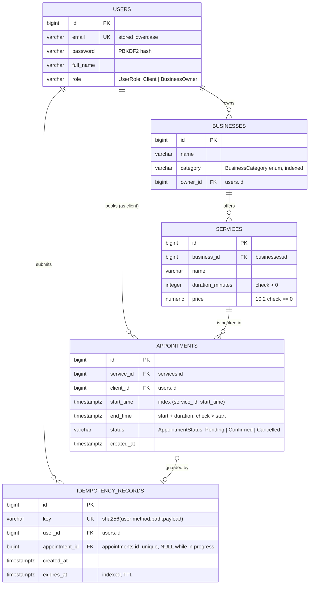
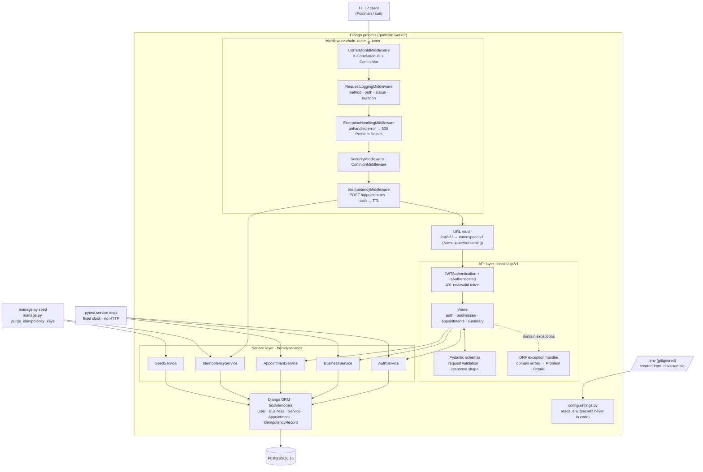
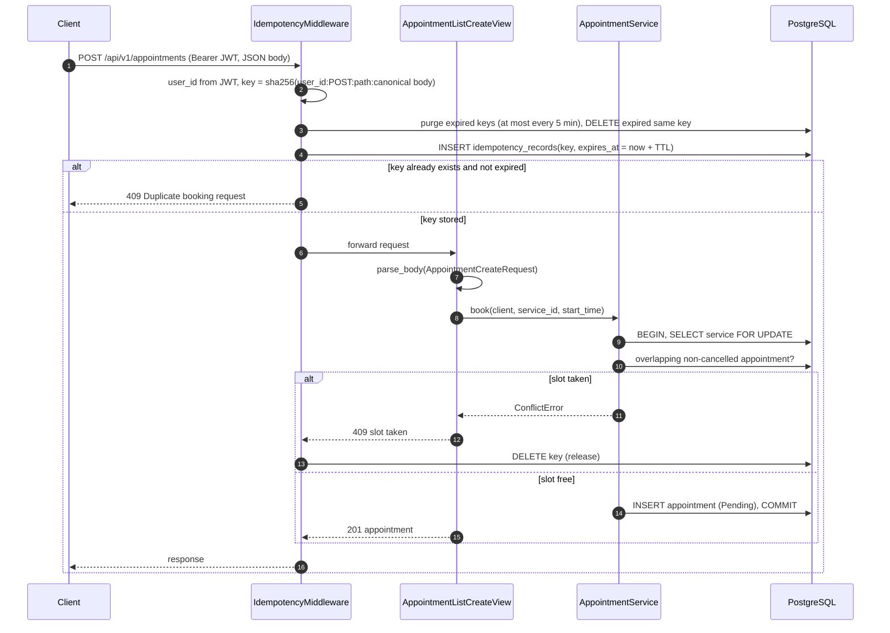
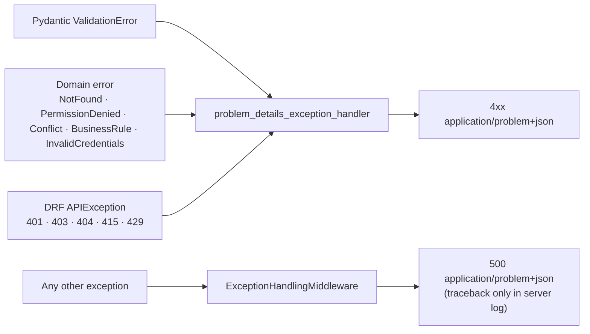

# BookIt API Implementation Plan

> **For agentic workers:** REQUIRED SUB-SKILL: Use superpowers:subagent-driven-development (recommended) or superpowers:executing-plans to implement this plan task-by-task. Steps use checkbox (`- [ ]`) syntax for tracking.

**Goal:** Build the BookIt appointment booking REST API: JWT auth, a paginated business list, appointment booking and listing, an owner summary, custom middlewares, idempotent booking, seed data, Docker, a README and a Postman collection.

**Architecture:**
- Request path: Middleware chain → DRF views (`bookit/api/v1`) → service classes (`bookit/services`) → Django ORM (`bookit/models`) → PostgreSQL.
- Views do only HTTP work. Request and response data use Pydantic v2 schemas.
- Services hold all business rules and transactions. They raise domain exceptions, and one DRF exception handler maps those to RFC 9457 Problem Details.
- Versioning uses DRF `NamespaceVersioning`.
- Configuration and secrets come from a gitignored `.env`.

**Tech Stack:** Python 3.12, Django 5.2, DRF 3.15+, djangorestframework-simplejwt 5.x, Pydantic 2.x (`pydantic[email]`), python-dotenv, PostgreSQL 16, psycopg 3, pytest + pytest-django, Faker, gunicorn, Docker Compose.

**Spec:** `docs/superpowers/specs/2026-10-18-bookit-api-design.md`

## Global Constraints

**Versions:**
- Python **3.12**: the venv is `.venv`, created with `py -V:3.12 -m venv .venv`.
- `Django>=5.2,<5.3`, `pydantic[email]>=2.9,<3`, PostgreSQL **16** (`postgres:16` image).

**Commands (Git Bash on Windows):**
- Python: `.venv/Scripts/python`. Tests: `.venv/Scripts/python -m pytest`.
- Postgres must be running before tests:
  `docker start bookit-db 2>/dev/null || docker run --name bookit-db -e POSTGRES_PASSWORD=bookit -e POSTGRES_DB=bookit -p 5432:5432 -d postgres:16`

**Secrets:**
- `DJANGO_SECRET_KEY` and `DB_PASSWORD` are read only from the environment or `.env`. They **never** appear as literals or fallback defaults in code.
- `.env` is gitignored. `.env.example` is committed.
- Create `.env` with `.venv/Scripts/python scripts/init_env.py`.

**API rules:**
- All API paths live under `/api/v1/`, with no trailing slash (`APPEND_SLASH = False`).
- Every endpoint except `auth/register`, `auth/login` and `auth/refresh` requires a JWT:
  - missing, invalid or expired token → **401** with `WWW-Authenticate: Bearer ...`
  - authenticated but not allowed → **403**
- Enums are Django `TextChoices`:
  - `UserRole`: `Client`, `BusinessOwner`
  - `AppointmentStatus`: `Pending`, `Confirmed`, `Cancelled`
- Times in the API (`from`, `to`, `start_time`, `end_time`) are **unix timestamps in seconds, UTC**.
- Error bodies are Problem Details with `Content-Type: application/problem+json` and the shape `{type, title, status, detail, correlation_id, errors?}`.

**Code style:**
- Every production function, method and class has a **1–2 line docstring**. No other comments unless the code is not obvious.
- Test functions have no docstrings, because their names describe them.
- No DRF serializers. Pydantic models only.

**Postman sync:**
- After writing any route, view or schema under `bookit/api/`, start the `postman-sync` subagent in the background. It updates `docs/BookIt.postman_collection.json`.
- Every API task (6, 7, 8, 9, 10, 14) ends by checking that the collection is valid JSON (`.venv/Scripts/python -m json.tool docs/BookIt.postman_collection.json`) and committing it with the task.

**Git:**
- One branch per task, named `dev/<feature>`. Each branch is created from the `master` tip and fast-forward merged back (`git merge --ff-only`).
- **Commit messages contain no `Co-Authored-By` or any other Claude attribution line.**
- Never push without asking.

## Testing strategy (TDD test pyramid)

Every class gets unit tests. Most tests target the service layer. Only a thin layer of tests goes through HTTP.

| Level | Folder | What it tests | Share |
|---|---|---|---|
| **Service unit tests** | `tests/test_services/` | All business rules and edge cases. They call the service class directly, with an injected fixed clock and no HTTP. | ~60% |
| **Schema unit tests** | `tests/test_schemas/` | Pydantic validation and formatting: timestamps, enums, pagination bounds, extra fields. No HTTP, no DB. | ~15% |
| **Middleware / handler unit tests** | `tests/test_middleware/`, `tests/test_api/test_exception_handler.py` | Each middleware and the exception handler, called directly with `RequestFactory` and a stub `get_response`. | ~10% |
| **API tests (thin)** | `tests/test_api/` | Per endpoint, only the HTTP contract: happy-path status + shape, 401, 403, one 400, query count. Business-rule variants are **not** repeated here. | ~15% |

**TDD order inside every feature task:**
1. Failing **service** tests
2. Service implementation
3. Failing **schema** tests
4. Schemas
5. Failing **API** tests
6. View + URL
7. Run the full suite

**Bonus covered:** the assignment asks for "unit tests for one service class (pytest)". This plan has pytest unit tests for **every** service class: `AuthService`, `BusinessService`, `AppointmentService`, `IdempotencyService`, `SeedService`.

## Review Focus

These five inputs are implied by the spec but are easy to miss. Each one has a pinned test in the task named in brackets.
1. **Bad unix timestamps** (`from=abc`, `from=1.5`, `from=99999999999999999`) are rejected with a validation error (→ 400), never a 500. [Task 8, schema test `test_invalid_list_filters_are_rejected`]
2. **Email case:**
   - register `Jane@Example.com`, then log in with `jane@example.com` → success
   - register `JANE@example.com` again → `ConflictError`
   [Task 6, service tests `test_login_is_case_insensitive_on_email`, `test_register_rejects_duplicate_email_in_any_case`]
3. **Malformed booking body** (invalid JSON, `[]`, `"text"`) → 400, and no idempotency row is left. [Task 9, API test `test_malformed_body_returns_400_and_leaves_no_key`]
4. **Pagination bounds:**
   - `limit=0`, `limit=101`, `limit=abc` or `offset=-1` → rejected
   - `offset` beyond `count` → 200 with empty `results` and the correct `count`
   [Task 7, schema test `test_invalid_page_params_are_rejected`, API test `test_offset_beyond_count_returns_empty_page`]
5. **Missing or empty secret:** `DJANGO_SECRET_KEY` unset or empty → a clear `ImproperlyConfigured` error at startup, not a silent insecure default. [Task 1: `test_missing_required_setting_fails_fast`, `test_empty_required_setting_fails_fast`]

---

## File map

```
.gitignore / .gitattributes / .dockerignore / .env.example / CLAUDE.md
requirements.txt, pytest.ini, manage.py, Dockerfile, docker-compose.yml, docker/entrypoint.sh, README.md
scripts/           __init__.py, init_env.py
config/            __init__.py, settings.py, urls.py, wsgi.py
bookit/
  apps.py
  models/          __init__.py, enums.py, user.py, business.py, service.py, appointment.py, idempotency.py
  migrations/      0001_initial.py, 0002_idempotencyrecord.py (generated)
  services/        __init__.py, exceptions.py, auth_service.py, business_service.py, appointment_service.py,
                   idempotency_service.py, seed_service.py
  api/
    urls.py        version router
    common/        problem.py, exception_handler.py, error_views.py, schemas.py, schema_types.py, parsing.py, pagination.py
    v1/            urls.py, dependencies.py,
                   schemas/ (auth.py, businesses.py, appointments.py),
                   views/ (root.py, auth.py, businesses.py, appointments.py)
  middleware/      correlation.py, request_logging.py, exception_handling.py, idempotency.py
  management/commands/  seed.py, purge_idempotency_keys.py
tests/
  conftest.py, factories.py, error_urls.py, test_setup.py, test_init_env.py
  test_models/ test_services/ test_schemas/ test_middleware/ test_api/ test_commands/
docs/
  erd.md, architecture.md, BookIt.postman_collection.json
```

**Responsibilities:**
- `models/`: tables and DB constraints only.
- `services/`: business rules, transactions and domain errors.
- `api/common/`: HTTP plumbing shared by all versions.
- `api/v1/`: v1 routes, views and schemas.
- `middleware/`: cross-cutting HTTP concerns.
- `scripts/`: developer tooling that runs outside Django.

## Task order

| # | Branch | Deliverable |
|---|---|---|
| 1 | `dev/project-setup` | Django project, `.env`-based settings, `init_env.py`, pytest smoke tests |
| 2 | `dev/docs-diagrams` | ERD, architecture, booking sequence and error-flow diagrams |
| 3 | `dev/domain-models` | enums, 4 models, migration, test factories |
| 4 | `dev/api-versioning` | `/api/v1/` namespace routing, JWT-protected root |
| 5 | `dev/middlewares` | correlation id, request logging, exception middleware, Problem Details handler |
| 6 | `dev/auth-jwt` | register / login / refresh with Pydantic, role claim |
| 7 | `dev/businesses-list` | filtered, paginated business list |
| 8 | `dev/appointments` | booking + scoped, filtered appointment list |
| 9 | `dev/booking-idempotency` | idempotency table, middleware, in-app purge, purge command |
| 10 | `dev/business-summary` | owner-only ORM aggregation |
| 11 | `dev/seed-command` | `manage.py seed` |
| 12 | `dev/docker-compose` | Dockerfile, compose, entrypoint |
| 13 | `dev/readme-postman` | README, Postman collection |
| 14 | `dev/login-rate-limit` | (optional bonus) login throttling |

---

### Task 1: Project bootstrap with `.env` configuration (`dev/project-setup`)

**Files:**
- Create: `.gitattributes`, `requirements.txt`, `pytest.ini`, `.env.example`, `manage.py`
- Create: `scripts/__init__.py`, `scripts/init_env.py`
- Create: `config/__init__.py`, `config/settings.py`, `config/urls.py`, `config/wsgi.py`
- Create: `bookit/__init__.py`, `bookit/apps.py`
- Test: `tests/__init__.py`, `tests/test_init_env.py`, `tests/test_setup.py`
- Already exist (commit them): `.gitignore`, `CLAUDE.md`, `docs/`
- Generated locally, never committed: `.env`

**Interfaces:**
- Produces:
  - `scripts.init_env.create_env_file(root: Path) -> bool`: creates `root/.env` from `root/.env.example` with a new secret key. Returns `False` if `.env` already exists.
  - `config.settings.env(name: str, default: str | None = None) -> str`: raises `ImproperlyConfigured` when the variable is missing or empty and has no default.
  - `config.settings` with a PostgreSQL `default` DB built from `DB_*` variables
  - the Django app label `bookit`

- [ ] **Step 1: Initial commit on master (docs and repo rules only)**

Confirm that `.gitignore` contains at least these lines: `.remember/`, `.claude/settings.local.json`, `.venv/`, `__pycache__/`, `.env`.

Create `.gitattributes`:
```gitattributes
* text=auto
*.sh text eol=lf
```

```bash
git add .gitignore .gitattributes CLAUDE.md .claude/agents/ docs/
git status --short   # must NOT list .remember/, .claude/settings.local.json or .env
git commit -m "chore: add assignment brief, design spec, plan and repo rules"
git checkout -b dev/project-setup
```

- [ ] **Step 2: Start Postgres and install dependencies**

Create `requirements.txt`:
```text
Django>=5.2,<5.3
djangorestframework>=3.15,<3.17
djangorestframework-simplejwt>=5.3,<6
pydantic[email]>=2.9,<3
python-dotenv>=1.0,<2
psycopg[binary]>=3.2,<4
Faker>=30,<40
gunicorn>=23,<24
pytest>=8,<9
pytest-django>=4.9,<5
```

Run:
```bash
docker start bookit-db 2>/dev/null || docker run --name bookit-db -e POSTGRES_PASSWORD=bookit -e POSTGRES_DB=bookit -p 5432:5432 -d postgres:16
.venv/Scripts/python -m pip install --upgrade pip
.venv/Scripts/python -m pip install -r requirements.txt
```
Expected: pip ends with `Successfully installed ...`, and `docker ps` shows `bookit-db` as `Up`.

- [ ] **Step 3: Write the failing tests**

Create `tests/__init__.py` (empty) and `pytest.ini`:
```ini
[pytest]
DJANGO_SETTINGS_MODULE = config.settings
python_files = test_*.py
testpaths = tests
addopts = -ra
```

`tests/test_init_env.py`:
```python
import re

from scripts.init_env import create_env_file

TEMPLATE = "# comment\nDJANGO_SECRET_KEY=\nDB_PASSWORD=bookit\n"


def _secret(path):
    return re.search(r"^DJANGO_SECRET_KEY=(.*)$", path.read_text(encoding="utf-8"), re.M).group(1)


def test_creates_env_from_example_with_generated_secret(tmp_path):
    (tmp_path / ".env.example").write_text(TEMPLATE, encoding="utf-8")
    assert create_env_file(tmp_path) is True
    env_file = tmp_path / ".env"
    assert len(_secret(env_file)) >= 50
    assert "DB_PASSWORD=bookit" in env_file.read_text(encoding="utf-8")
    assert "# comment" in env_file.read_text(encoding="utf-8")


def test_never_overwrites_an_existing_env(tmp_path):
    (tmp_path / ".env.example").write_text(TEMPLATE, encoding="utf-8")
    (tmp_path / ".env").write_text("DJANGO_SECRET_KEY=keep-me\n", encoding="utf-8")
    assert create_env_file(tmp_path) is False
    assert (tmp_path / ".env").read_text(encoding="utf-8") == "DJANGO_SECRET_KEY=keep-me\n"


def test_each_env_gets_a_different_secret(tmp_path):
    first, second = tmp_path / "a", tmp_path / "b"
    for folder in (first, second):
        folder.mkdir()
        (folder / ".env.example").write_text(TEMPLATE, encoding="utf-8")
        create_env_file(folder)
    assert _secret(first / ".env") != _secret(second / ".env")
```

`tests/test_setup.py`:
```python
import pytest
from django.conf import settings
from django.core.exceptions import ImproperlyConfigured
from django.db import connection

from config.settings import env


@pytest.mark.django_db
def test_database_is_reachable_postgresql():
    with connection.cursor() as cursor:
        cursor.execute("SELECT 1")
        assert cursor.fetchone() == (1,)
    assert connection.vendor == "postgresql"


def test_secret_key_is_loaded_from_the_environment():
    assert len(settings.SECRET_KEY) >= 50


def test_missing_required_setting_fails_fast(monkeypatch):
    monkeypatch.delenv("BOOKIT_TEST_MISSING", raising=False)
    with pytest.raises(ImproperlyConfigured, match="BOOKIT_TEST_MISSING"):
        env("BOOKIT_TEST_MISSING")


def test_empty_required_setting_fails_fast(monkeypatch):
    monkeypatch.setenv("BOOKIT_TEST_EMPTY", "")
    with pytest.raises(ImproperlyConfigured, match="BOOKIT_TEST_EMPTY"):
        env("BOOKIT_TEST_EMPTY")


def test_optional_setting_uses_its_default(monkeypatch):
    monkeypatch.delenv("BOOKIT_TEST_OPTIONAL", raising=False)
    assert env("BOOKIT_TEST_OPTIONAL", "fallback") == "fallback"
```

- [ ] **Step 4: Run them to verify they fail**

Run: `.venv/Scripts/python -m pytest -v`
Expected: ERROR during collection, `ModuleNotFoundError: No module named 'config'` / `'scripts'`.

- [ ] **Step 5: Implement `.env.example` and `scripts/init_env.py`**

`.env.example`:
```dotenv
# BookIt environment template. Create your local .env with:
#   .venv/Scripts/python scripts/init_env.py
# .env is gitignored. Never commit real secrets.

# Django. DJANGO_SECRET_KEY is generated by scripts/init_env.py.
DJANGO_SECRET_KEY=
DJANGO_DEBUG=1
DJANGO_ALLOWED_HOSTS=localhost,127.0.0.1

# PostgreSQL. Must match the docker run command (POSTGRES_PASSWORD / POSTGRES_DB).
DB_NAME=bookit
DB_USER=postgres
DB_PASSWORD=bookit
DB_HOST=localhost
DB_PORT=5432

# JWT lifetimes
JWT_ACCESS_MINUTES=15
JWT_REFRESH_DAYS=1

# Booking idempotency
IDEMPOTENCY_TTL_SECONDS=600
IDEMPOTENCY_PURGE_INTERVAL_SECONDS=300

# Bonus: login rate limit
LOGIN_RATE_LIMIT=5/min

# Logging
LOG_LEVEL=INFO
```

`scripts/__init__.py`: empty.

`scripts/init_env.py`:
```python
"""Create a local .env from .env.example with a freshly generated DJANGO_SECRET_KEY."""
import re
import secrets
import sys
from pathlib import Path

ROOT = Path(__file__).resolve().parent.parent
_SECRET_LINE = re.compile(r"^DJANGO_SECRET_KEY=.*$", re.M)


def create_env_file(root: Path) -> bool:
    """Write root/.env from the template; return False and change nothing if .env already exists."""
    target = root / ".env"
    if target.exists():
        return False
    template = (root / ".env.example").read_text(encoding="utf-8")
    secret = secrets.token_urlsafe(50)
    target.write_text(_SECRET_LINE.sub(lambda _: f"DJANGO_SECRET_KEY={secret}", template, count=1), encoding="utf-8")
    return True


def main() -> int:
    """CLI entry point: create .env in the project root."""
    if create_env_file(ROOT):
        print("Created .env with a new DJANGO_SECRET_KEY. Check the DB_* values match your Postgres container.")
    else:
        print(".env already exists; nothing changed.")
    return 0


if __name__ == "__main__":
    sys.exit(main())
```

- [ ] **Step 6: Create the Django project**

`manage.py`:
```python
#!/usr/bin/env python
"""Django command-line entry point."""
import os
import sys


def main() -> None:
    """Run a Django management command."""
    os.environ.setdefault("DJANGO_SETTINGS_MODULE", "config.settings")
    from django.core.management import execute_from_command_line

    execute_from_command_line(sys.argv)


if __name__ == "__main__":
    main()
```

`config/__init__.py`: empty.

`config/wsgi.py`:
```python
"""WSGI entry point used by gunicorn."""
import os

from django.core.wsgi import get_wsgi_application

os.environ.setdefault("DJANGO_SETTINGS_MODULE", "config.settings")
application = get_wsgi_application()
```

`config/urls.py`:
```python
"""Root URL configuration."""
urlpatterns = []
```

`config/settings.py`:
```python
"""Django settings for the BookIt API; values come from the environment and the local .env file."""
import os
from pathlib import Path

from django.core.exceptions import ImproperlyConfigured
from dotenv import load_dotenv

BASE_DIR = Path(__file__).resolve().parent.parent
load_dotenv(BASE_DIR / ".env")


def env(name: str, default: str | None = None) -> str:
    """Return an environment variable; a missing or empty one without a default is a configuration error."""
    value = os.environ.get(name) or default
    if not value:
        raise ImproperlyConfigured(f"Missing required environment variable: {name}. Copy .env.example to .env.")
    return value


SECRET_KEY = env("DJANGO_SECRET_KEY")
DEBUG = env("DJANGO_DEBUG", "0") == "1"
ALLOWED_HOSTS = env("DJANGO_ALLOWED_HOSTS", "localhost,127.0.0.1").split(",")

INSTALLED_APPS = [
    "django.contrib.contenttypes",
    "bookit",
]

MIDDLEWARE = [
    "django.middleware.security.SecurityMiddleware",
    "django.middleware.common.CommonMiddleware",
]

ROOT_URLCONF = "config.urls"
WSGI_APPLICATION = "config.wsgi.application"
APPEND_SLASH = False

DATABASES = {
    "default": {
        "ENGINE": "django.db.backends.postgresql",
        "NAME": env("DB_NAME", "bookit"),
        "USER": env("DB_USER", "postgres"),
        "PASSWORD": env("DB_PASSWORD"),
        "HOST": env("DB_HOST", "localhost"),
        "PORT": env("DB_PORT", "5432"),
        "CONN_MAX_AGE": int(env("DB_CONN_MAX_AGE", "60")),
        "CONN_HEALTH_CHECKS": True,
        "ATOMIC_REQUESTS": False,
    }
}

LANGUAGE_CODE = "en-us"
TIME_ZONE = "UTC"
USE_I18N = False
USE_TZ = True
DEFAULT_AUTO_FIELD = "django.db.models.BigAutoField"
```

`bookit/__init__.py`: empty.

`bookit/apps.py`:
```python
"""Django app configuration for BookIt."""
from django.apps import AppConfig


class BookitConfig(AppConfig):
    """Registers the bookit app."""

    default_auto_field = "django.db.models.BigAutoField"
    name = "bookit"
```

- [ ] **Step 7: Initialize the local `.env`**

Run:
```bash
.venv/Scripts/python scripts/init_env.py
git check-ignore -v .env
```
Expected:
- `Created .env with a new DJANGO_SECRET_KEY...`
- `git check-ignore` prints `.gitignore:...:.env  .env`

- [ ] **Step 8: Run the tests to verify they pass**

Run: `.venv/Scripts/python -m pytest -v`
Expected: `8 passed`.

- [ ] **Step 9: Verify no secret literal is in tracked code**

Run: `git grep -n -i "secret_key\s*=\s*['\"]" -- ':!docs' ':!*.md'`
Expected: no output. The only `SECRET_KEY` assignment is `env("DJANGO_SECRET_KEY")`.

- [ ] **Step 10: Commit and merge**

```bash
git add .
git status --short   # .env must NOT be listed
git commit -m "chore: bootstrap Django project with .env-based settings and init script"
git checkout master && git merge --ff-only dev/project-setup
```

---

### Task 2: ERD and architecture diagrams (`dev/docs-diagrams`)

**Files:**
- Create: `docs/erd.md`, `docs/architecture.md`

**Interfaces:**
- Produces: the diagrams that the README links to (Task 13). Table and column names must match Tasks 3 and 9.

- [ ] **Step 1: Create the branch**

```bash
git checkout master && git checkout -b dev/docs-diagrams
```

- [ ] **Step 2: Write `docs/erd.md`**

````markdown
# BookIt – Entity Relationship Diagram



**Notes**
- `role`, `status` and `category` are Django `TextChoices` enums (`UserRole`, `AppointmentStatus`, `BusinessCategory`). They are also enforced by DB check constraints.
- `end_time` is stored, so the overlap check is a simple range query:
  `start_time < new_end AND end_time > new_start AND status <> 'Cancelled'`.
- `idempotency_records` works as a `hash → TTL` dictionary. A row whose `expires_at` has passed is ignored and purged.
- `users` keeps only what the API needs. There is no `PermissionsMixin` (no admin, groups or permissions), `last_login` is disabled (JWT logins are stateless), and `is_active` is a constant `True` attribute, not a column.
````

- [ ] **Step 3: Write `docs/architecture.md`**

````markdown
# BookIt – Architecture

## Layers and request flow



| Layer | Folder | Responsibility | Must not |
|---|---|---|---|
| Middleware | `bookit/middleware/` | correlation id, request logs, last-resort 500, duplicate-booking guard | contain booking rules |
| API | `bookit/api/v1/` | routing, JWT auth, Pydantic parse/format, status codes | contain business rules or ORM queries |
| Services | `bookit/services/` | business rules, ownership, transactions, domain errors | import DRF or read HTTP objects |
| Models | `bookit/models/` | tables, enums, DB constraints | contain request logic |
| Config | `config/` | settings from env / `.env` | contain secret values |

**Dependency injection:**
- Services receive collaborators in the constructor (for example `clock=timezone.now`).
- Views get the services from `api/v1/dependencies.py`.
- Tests create the services directly with a fixed clock.

**Versioning:**
- `bookit/api/urls.py` mounts `v1/` with `namespace="v1"`.
- A future `v2/` package gets its own urls, views and schemas and reuses the same services.

## Booking sequence (with idempotency)



## Error flow


````

- [ ] **Step 4: Check that the Mermaid syntax renders**

Paste each Mermaid block into https://mermaid.live, or open the files in a Markdown preview with Mermaid support.
Expected: all four diagrams render with no parse error.

- [ ] **Step 5: Commit and merge**

```bash
git add docs/erd.md docs/architecture.md
git commit -m "docs: add ERD, architecture, booking sequence and error-flow diagrams"
git checkout master && git merge --ff-only dev/docs-diagrams
```

---

### Task 3: Domain models and enums (`dev/domain-models`)

**Files:**
- Create: `bookit/models/__init__.py`, `bookit/models/enums.py`, `bookit/models/user.py`, `bookit/models/business.py`, `bookit/models/service.py`, `bookit/models/appointment.py`
- Generate: `bookit/migrations/__init__.py`, `bookit/migrations/0001_initial.py`
- Modify: `config/settings.py` (apps, `AUTH_USER_MODEL`, password validators)
- Test: `tests/conftest.py`, `tests/factories.py`, `tests/test_models/__init__.py`, `tests/test_models/test_models.py`

**Interfaces:**
- Produces:
  - `from bookit.models import User, Business, Service, Appointment, UserRole, AppointmentStatus, BusinessCategory`
  - `User.objects.create_user(email, password, full_name, role=UserRole.CLIENT) -> User`
  - Related names: `user.businesses`, `user.appointments`, `business.services`, `service.appointments`
  - Test factories in `tests/factories.py`:
    - `make_user(*, role=UserRole.CLIENT, email=None, password=DEFAULT_PASSWORD, full_name="Test User") -> User`
    - `make_business(*, owner, name=None, category=BusinessCategory.BARBER) -> Business`
    - `make_service(*, business, name=None, duration_minutes=60, price="100.00") -> Service`
    - `make_appointment(*, service, client, start_time, status=AppointmentStatus.PENDING) -> Appointment`
  - Fixtures in `tests/conftest.py`: `client_user`, `owner_user`

- [ ] **Step 1: Create the branch**

```bash
git checkout master && git checkout -b dev/domain-models
```

- [ ] **Step 2: Write the failing tests**

`tests/factories.py`:
```python
"""Plain factory helpers that build valid test data."""
import itertools
from datetime import datetime, timedelta
from decimal import Decimal

from bookit.models import Appointment, AppointmentStatus, Business, BusinessCategory, Service, User, UserRole

DEFAULT_PASSWORD = "Str0ng-Passw0rd!"
_sequence = itertools.count(1)


def make_user(
    *,
    role: str = UserRole.CLIENT,
    email: str | None = None,
    password: str = DEFAULT_PASSWORD,
    full_name: str = "Test User",
) -> User:
    """Create a user with a unique email."""
    return User.objects.create_user(
        email=email or f"user{next(_sequence)}@example.com",
        password=password,
        full_name=full_name,
        role=role,
    )


def make_business(
    *, owner: User, name: str | None = None, category: str = BusinessCategory.BARBER
) -> Business:
    """Create a business owned by the given user."""
    return Business.objects.create(owner=owner, name=name or f"Business {next(_sequence)}", category=category)


def make_service(
    *, business: Business, name: str | None = None, duration_minutes: int = 60, price: str = "100.00"
) -> Service:
    """Create a service for the given business."""
    return Service.objects.create(
        business=business,
        name=name or f"Service {next(_sequence)}",
        duration_minutes=duration_minutes,
        price=Decimal(price),
    )


def make_appointment(
    *, service: Service, client: User, start_time: datetime, status: str = AppointmentStatus.PENDING
) -> Appointment:
    """Create an appointment whose end time follows the service duration."""
    return Appointment.objects.create(
        service=service,
        client=client,
        start_time=start_time,
        end_time=start_time + timedelta(minutes=service.duration_minutes),
        status=status,
    )
```

`tests/conftest.py`:
```python
import pytest

from bookit.models import UserRole
from tests.factories import make_user


@pytest.fixture(autouse=True)
def fast_password_hasher(settings):
    settings.PASSWORD_HASHERS = ["django.contrib.auth.hashers.MD5PasswordHasher"]


@pytest.fixture
def client_user(db):
    return make_user(role=UserRole.CLIENT, full_name="Clara Client")


@pytest.fixture
def owner_user(db):
    return make_user(role=UserRole.BUSINESS_OWNER, full_name="Oscar Owner")
```

`tests/test_models/__init__.py`: empty.

`tests/test_models/test_models.py`:
```python
from datetime import timedelta

import pytest
from django.db import IntegrityError
from django.utils import timezone

from bookit.models import Appointment, AppointmentStatus, BusinessCategory, User, UserRole
from tests.factories import DEFAULT_PASSWORD, make_appointment, make_business, make_service, make_user

pytestmark = pytest.mark.django_db


def test_enum_values_match_the_assignment():
    assert UserRole.values == ["Client", "BusinessOwner"]
    assert AppointmentStatus.values == ["Pending", "Confirmed", "Cancelled"]
    assert BusinessCategory.values == ["Barber", "Beauty", "Fitness", "Massage", "Physiotherapy", "Tutoring"]


def test_unknown_business_category_is_rejected_by_the_database():
    with pytest.raises(IntegrityError):
        make_business(owner=make_user(role=UserRole.BUSINESS_OWNER), category="Cooking")


def test_create_user_hashes_password_and_lowercases_email():
    user = User.objects.create_user(email="Jane.Doe@Example.COM", password=DEFAULT_PASSWORD, full_name="Jane Doe")
    assert user.email == "jane.doe@example.com"
    assert user.password != DEFAULT_PASSWORD
    assert user.check_password(DEFAULT_PASSWORD)
    assert user.role == UserRole.CLIENT


def test_email_is_unique():
    make_user(email="dup@example.com")
    with pytest.raises(IntegrityError):
        make_user(email="dup@example.com")


def test_unknown_role_is_rejected_by_the_database():
    with pytest.raises(IntegrityError):
        make_user(role="Admin")


def test_appointment_defaults_to_pending_and_links_to_business_owner():
    owner = make_user(role=UserRole.BUSINESS_OWNER)
    service = make_service(business=make_business(owner=owner), duration_minutes=45)
    start = timezone.now() + timedelta(days=1)
    appointment = make_appointment(service=service, client=make_user(), start_time=start)
    assert appointment.status == AppointmentStatus.PENDING
    assert appointment.end_time - appointment.start_time == timedelta(minutes=45)
    assert appointment.service.business.owner == owner


def test_appointment_end_must_be_after_start():
    service = make_service(business=make_business(owner=make_user(role=UserRole.BUSINESS_OWNER)))
    start = timezone.now()
    with pytest.raises(IntegrityError):
        Appointment.objects.create(service=service, client=make_user(), start_time=start, end_time=start)


def test_unknown_appointment_status_is_rejected_by_the_database():
    service = make_service(business=make_business(owner=make_user(role=UserRole.BUSINESS_OWNER)))
    with pytest.raises(IntegrityError):
        make_appointment(service=service, client=make_user(), start_time=timezone.now(), status="Done")
```

- [ ] **Step 3: Run the tests to verify they fail**

Run: `.venv/Scripts/python -m pytest tests/test_models -v`
Expected: ERROR, `ModuleNotFoundError: No module named 'bookit.models'` (or a related import error).

- [ ] **Step 4: Implement the enums and models**

`bookit/models/enums.py`:
```python
"""Enumerations stored as text columns."""
from django.db import models


class UserRole(models.TextChoices):
    """Who the user is on the platform."""

    CLIENT = "Client", "Client"
    BUSINESS_OWNER = "BusinessOwner", "Business owner"


class AppointmentStatus(models.TextChoices):
    """Lifecycle state of an appointment."""

    PENDING = "Pending", "Pending"
    CONFIRMED = "Confirmed", "Confirmed"
    CANCELLED = "Cancelled", "Cancelled"


class BusinessCategory(models.TextChoices):
    """Kind of business listed on the platform."""

    BARBER = "Barber", "Barber"
    BEAUTY = "Beauty", "Beauty"
    FITNESS = "Fitness", "Fitness"
    MASSAGE = "Massage", "Massage"
    PHYSIOTHERAPY = "Physiotherapy", "Physiotherapy"
    TUTORING = "Tutoring", "Tutoring"
```

`bookit/models/user.py`:
```python
"""Custom user model identified by email, with only the columns the API needs."""
from django.contrib.auth.models import AbstractBaseUser, BaseUserManager
from django.db import models

from .enums import UserRole


class UserManager(BaseUserManager):
    """Creates users with a lowercase email and a hashed password."""

    use_in_migrations = True

    def create_user(self, email: str, password: str | None, full_name: str, role: str = UserRole.CLIENT):
        """Create and save a user."""
        if not email:
            raise ValueError("Email is required.")
        user = self.model(email=self.normalize_email(email).lower(), full_name=full_name, role=role)
        user.set_password(password)
        user.save(using=self._db)
        return user


class User(AbstractBaseUser):
    """Platform user; the role decides whether they book appointments or own businesses."""

    email = models.EmailField(unique=True)
    full_name = models.CharField(max_length=150)
    role = models.CharField(max_length=20, choices=UserRole.choices, default=UserRole.CLIENT)
    last_login = None  # JWT logins are stateless, so the inherited column is dropped

    objects = UserManager()

    USERNAME_FIELD = "email"
    EMAIL_FIELD = "email"
    REQUIRED_FIELDS = ["full_name"]

    class Meta:
        db_table = "users"
        constraints = [models.CheckConstraint(condition=models.Q(role__in=UserRole.values), name="users_role_valid")]

    def __str__(self) -> str:
        """Return the email as the display name."""
        return self.email
```

`bookit/models/business.py`:
```python
"""Business listed by an owner."""
from django.conf import settings
from django.db import models

from .enums import BusinessCategory


class Business(models.Model):
    """A business (barber, clinic, tutor...) owned by a BusinessOwner user."""

    name = models.CharField(max_length=200)
    category = models.CharField(max_length=30, choices=BusinessCategory.choices, db_index=True)
    owner = models.ForeignKey(settings.AUTH_USER_MODEL, on_delete=models.CASCADE, related_name="businesses")

    class Meta:
        db_table = "businesses"
        ordering = ["name", "id"]
        constraints = [
            models.CheckConstraint(
                condition=models.Q(category__in=BusinessCategory.values), name="businesses_category_valid"
            ),
        ]

    def __str__(self) -> str:
        """Return the business name."""
        return self.name
```

`bookit/models/service.py`:
```python
"""Bookable service offered by a business."""
from django.db import models

from .business import Business


class Service(models.Model):
    """A service with a fixed duration and price."""

    business = models.ForeignKey(Business, on_delete=models.CASCADE, related_name="services")
    name = models.CharField(max_length=200)
    duration_minutes = models.PositiveIntegerField()
    price = models.DecimalField(max_digits=10, decimal_places=2)

    class Meta:
        db_table = "services"
        ordering = ["name", "id"]
        constraints = [
            models.CheckConstraint(condition=models.Q(duration_minutes__gt=0), name="services_duration_positive"),
            models.CheckConstraint(condition=models.Q(price__gte=0), name="services_price_non_negative"),
        ]

    def __str__(self) -> str:
        """Return the service name."""
        return self.name
```

`bookit/models/appointment.py`:
```python
"""Appointment booked by a client for a service."""
from django.conf import settings
from django.db import models

from .enums import AppointmentStatus
from .service import Service


class Appointment(models.Model):
    """A booked time slot; end_time is stored to make overlap checks a range query."""

    service = models.ForeignKey(Service, on_delete=models.CASCADE, related_name="appointments")
    client = models.ForeignKey(settings.AUTH_USER_MODEL, on_delete=models.CASCADE, related_name="appointments")
    start_time = models.DateTimeField()
    end_time = models.DateTimeField()
    status = models.CharField(max_length=20, choices=AppointmentStatus.choices, default=AppointmentStatus.PENDING)
    created_at = models.DateTimeField(auto_now_add=True)

    class Meta:
        db_table = "appointments"
        ordering = ["start_time", "id"]
        indexes = [
            models.Index(fields=["service", "start_time"], name="appt_service_start_idx"),
            models.Index(fields=["client", "start_time"], name="appt_client_start_idx"),
        ]
        constraints = [
            models.CheckConstraint(condition=models.Q(end_time__gt=models.F("start_time")), name="appt_end_after_start"),
            models.CheckConstraint(condition=models.Q(status__in=AppointmentStatus.values), name="appt_status_valid"),
        ]

    def __str__(self) -> str:
        """Return a short description of the booking."""
        return f"{self.service_id}@{self.start_time:%Y-%m-%d %H:%M}"
```

`bookit/models/__init__.py`:
```python
"""Public model API of the bookit app."""
from .appointment import Appointment
from .business import Business
from .enums import AppointmentStatus, BusinessCategory, UserRole
from .service import Service
from .user import User

__all__ = ["Appointment", "AppointmentStatus", "Business", "BusinessCategory", "Service", "User", "UserRole"]
```

In `config/settings.py`, replace `INSTALLED_APPS` and add the auth settings after it:
```python
INSTALLED_APPS = [
    "django.contrib.auth",
    "django.contrib.contenttypes",
    "rest_framework",
    "bookit",
]

AUTH_USER_MODEL = "bookit.User"
AUTH_PASSWORD_VALIDATORS = [
    {"NAME": "django.contrib.auth.password_validation.MinimumLengthValidator", "OPTIONS": {"min_length": 8}},
    {"NAME": "django.contrib.auth.password_validation.NumericPasswordValidator"},
]
```

- [ ] **Step 5: Generate the migration**

Run:
```bash
mkdir -p bookit/migrations && touch bookit/migrations/__init__.py
.venv/Scripts/python manage.py makemigrations bookit
```
Expected: `Migrations for 'bookit': bookit/migrations/0001_initial.py` listing User, Business, Service and Appointment.

- [ ] **Step 6: Run the tests to verify they pass**

Run: `.venv/Scripts/python -m pytest -v`
Expected: all pass (`16 passed`).

- [ ] **Step 7: Apply the migration to the dev DB**

Run: `.venv/Scripts/python manage.py migrate`
Expected: `Applying bookit.0001_initial... OK`.

- [ ] **Step 8: Commit and merge**

```bash
git add .
git commit -m "feat(models): add User, Business, Service, Appointment with role/status enums"
git checkout master && git merge --ff-only dev/domain-models
```

---

### Task 4: API versioning and JWT-protected root (`dev/api-versioning`)

**Files:**
- Modify: `config/urls.py`, `config/settings.py` (`REST_FRAMEWORK`, `SIMPLE_JWT`)
- Create: `bookit/api/__init__.py`, `bookit/api/urls.py`, `bookit/api/v1/__init__.py`, `bookit/api/v1/urls.py`, `bookit/api/v1/views/__init__.py`, `bookit/api/v1/views/root.py`
- Test: `tests/test_api/__init__.py`, `tests/test_api/test_versioning.py`; modify `tests/conftest.py` (add `api_client`)

**Interfaces:**
- Consumes: `User` (Task 3).
- Produces:
  - URL prefix `/api/v1/`, with every v1 route in namespace `v1`
  - `request.version == "v1"` in v1 views
  - `ApiRootView` at `GET /api/v1/`
  - fixture `api_client` (an unauthenticated `rest_framework.test.APIClient`)

- [ ] **Step 1: Create the branch**

```bash
git checkout master && git checkout -b dev/api-versioning
```

- [ ] **Step 2: Write the failing tests**

Add to `tests/conftest.py` (put the import at the top of the file):
```python
from rest_framework.test import APIClient


@pytest.fixture
def api_client():
    return APIClient()
```

`tests/test_api/__init__.py`: empty.

`tests/test_api/test_versioning.py`:
```python
import pytest

pytestmark = pytest.mark.django_db


def test_v1_root_reports_the_resolved_version(api_client, client_user):
    api_client.force_authenticate(client_user)
    response = api_client.get("/api/v1/")
    assert response.status_code == 200
    assert response.json() == {"version": "v1"}


def test_v1_root_requires_a_jwt(api_client):
    response = api_client.get("/api/v1/")
    assert response.status_code == 401
    assert response["WWW-Authenticate"].startswith("Bearer")


def test_unknown_version_returns_404(api_client, client_user):
    api_client.force_authenticate(client_user)
    assert api_client.get("/api/v2/").status_code == 404
```

- [ ] **Step 3: Run the tests to verify they fail**

Run: `.venv/Scripts/python -m pytest tests/test_api/test_versioning.py -v`
Expected:
- the first two tests FAIL (`404 != 200`, `404 != 401`), because there are no routes yet
- the third one passes by accident

- [ ] **Step 4: Implement versioned routing**

`bookit/api/__init__.py`, `bookit/api/v1/__init__.py`: empty.

`bookit/api/urls.py`:
```python
"""Mounts each supported API version under its own URL namespace."""
from django.urls import include, path

urlpatterns = [
    path("v1/", include(("bookit.api.v1.urls", "v1"), namespace="v1")),
]
```

`bookit/api/v1/views/root.py`:
```python
"""Version discovery endpoint."""
from rest_framework.response import Response
from rest_framework.views import APIView


class ApiRootView(APIView):
    """GET /api/v1/: report the API version resolved for this request."""

    def get(self, request):
        """Return the active API version."""
        return Response({"version": request.version})
```

`bookit/api/v1/views/__init__.py`:
```python
"""v1 view classes."""
from .root import ApiRootView

__all__ = ["ApiRootView"]
```

`bookit/api/v1/urls.py`:
```python
"""URL routes of API v1."""
from django.urls import path

from .views import ApiRootView

urlpatterns = [
    path("", ApiRootView.as_view(), name="root"),
]
```

`config/urls.py`:
```python
"""Root URL configuration: everything lives under /api/<version>/."""
from django.urls import include, path

urlpatterns = [
    path("api/", include("bookit.api.urls")),
]
```

Add `from datetime import timedelta` to the imports in `config/settings.py`, and append:
```python
REST_FRAMEWORK = {
    "DEFAULT_AUTHENTICATION_CLASSES": ["rest_framework_simplejwt.authentication.JWTAuthentication"],
    "DEFAULT_PERMISSION_CLASSES": ["rest_framework.permissions.IsAuthenticated"],
    "DEFAULT_VERSIONING_CLASS": "rest_framework.versioning.NamespaceVersioning",
    "DEFAULT_VERSION": "v1",
    "ALLOWED_VERSIONS": ["v1"],
    "DEFAULT_RENDERER_CLASSES": ["rest_framework.renderers.JSONRenderer"],
    "DEFAULT_PARSER_CLASSES": ["rest_framework.parsers.JSONParser"],
    "TEST_REQUEST_DEFAULT_FORMAT": "json",
}

SIMPLE_JWT = {
    "ACCESS_TOKEN_LIFETIME": timedelta(minutes=int(env("JWT_ACCESS_MINUTES", "15"))),
    "REFRESH_TOKEN_LIFETIME": timedelta(days=int(env("JWT_REFRESH_DAYS", "1"))),
    "ROTATE_REFRESH_TOKENS": False,
    "AUTH_HEADER_TYPES": ("Bearer",),
    "USER_ID_FIELD": "id",
    "USER_ID_CLAIM": "user_id",
    "SIGNING_KEY": SECRET_KEY,
}
```

- [ ] **Step 5: Run the tests to verify they pass**

Run: `.venv/Scripts/python -m pytest -v`
Expected: all pass (`19 passed`).

- [ ] **Step 6: Commit and merge**

```bash
git add .
git commit -m "feat(api): add namespace-based /api/v1 routing with JWT-protected root"
git checkout master && git merge --ff-only dev/api-versioning
```

---

### Task 5: Error handling and middlewares (`dev/middlewares`)

**Files:**
- Create: `bookit/services/__init__.py`, `bookit/services/exceptions.py`
- Create: `bookit/middleware/__init__.py`, `bookit/middleware/correlation.py`, `bookit/middleware/request_logging.py`, `bookit/middleware/exception_handling.py`
- Create: `bookit/api/common/__init__.py`, `bookit/api/common/problem.py`, `bookit/api/common/exception_handler.py`, `bookit/api/common/error_views.py`
- Modify: `config/settings.py` (`MIDDLEWARE`, `LOGGING`, `EXCEPTION_HANDLER`), `config/urls.py` (`handler404`, `handler500`)
- Test (unit): `tests/test_middleware/__init__.py`, `tests/test_middleware/test_correlation.py`, `tests/test_middleware/test_request_logging.py`, `tests/test_middleware/test_exception_handling.py`, `tests/test_api/test_exception_handler.py`
- Test (thin integration): `tests/error_urls.py`, `tests/test_api/test_error_wiring.py`

**Interfaces:**
- Produces:
  - Domain errors in `bookit.services.exceptions`: `DomainError(message=None)` with a `.message` attribute, and its subclasses `NotFoundError`, `PermissionDeniedError`, `ConflictError`, `BusinessRuleError`, `InvalidCredentialsError`
  - `bookit.middleware.correlation.get_correlation_id() -> str` (`"-"` outside a request), `HEADER = "X-Correlation-ID"`
  - `bookit.api.common.problem.problem_body(status_code, detail, errors=None) -> dict`
  - `bookit.api.common.problem.problem_response(status_code, detail, errors=None) -> JsonResponse`
  - `PROBLEM_CONTENT_TYPE = "application/problem+json"`
  - `bookit.middleware.exception_handling.GENERIC_SERVER_ERROR = "An unexpected error occurred."`
  - `bookit.api.common.exception_handler.problem_details_exception_handler(exc, context) -> Response | None`, `VALIDATION_FAILED = "Request validation failed."`
  - Pydantic errors are rendered as `errors: [{"field": "<loc joined by .>", "message": "<msg>"}]`

- [ ] **Step 1: Create the branch**

```bash
git checkout master && git checkout -b dev/middlewares
```

- [ ] **Step 2: Write failing unit tests for the middlewares**

`tests/test_middleware/__init__.py`: empty.

`tests/test_middleware/test_correlation.py`:
```python
import logging
import re

from django.http import HttpResponse

from bookit.middleware.correlation import HEADER, CorrelationIdFilter, CorrelationIdMiddleware, get_correlation_id

HEX32 = re.compile(r"[0-9a-f]{32}")


def _run(rf, **headers):
    seen = {}

    def view(request):
        seen["id"] = get_correlation_id()
        return HttpResponse()

    response = CorrelationIdMiddleware(view)(rf.get("/", **headers))
    return response, seen["id"]


def test_generates_an_id_when_none_is_sent(rf):
    response, inside_request = _run(rf)
    assert HEX32.fullmatch(response[HEADER])
    assert inside_request == response[HEADER]


def test_reuses_a_safe_incoming_id(rf):
    response, _ = _run(rf, HTTP_X_CORRELATION_ID="req-123.abc")
    assert response[HEADER] == "req-123.abc"


def test_replaces_an_unsafe_incoming_id(rf):
    response, _ = _run(rf, HTTP_X_CORRELATION_ID="bad id\nINJECTED")
    assert HEX32.fullmatch(response[HEADER])


def test_id_is_cleared_after_the_request(rf):
    _run(rf)
    assert get_correlation_id() == "-"


def test_log_filter_adds_the_current_id():
    record = logging.LogRecord("x", logging.INFO, __file__, 1, "msg", None, None)
    assert CorrelationIdFilter().filter(record) is True
    assert record.correlation_id == "-"
```

`tests/test_middleware/test_request_logging.py`:
```python
import logging

from django.http import HttpResponse

from bookit.middleware.request_logging import RequestLoggingMiddleware


def test_logs_method_path_status_and_duration(rf, caplog):
    middleware = RequestLoggingMiddleware(lambda request: HttpResponse(status=201))
    with caplog.at_level(logging.INFO, logger="bookit.requests"):
        middleware(rf.post("/api/v1/appointments?x=1"))
    record = next(r for r in caplog.records if r.name == "bookit.requests")
    assert (record.method, record.path, record.status_code) == ("POST", "/api/v1/appointments", 201)
    assert record.duration_ms >= 0
    assert "POST /api/v1/appointments -> 201" in record.getMessage()
```

`tests/test_middleware/test_exception_handling.py`:
```python
import json
import logging

import pytest
from django.core.exceptions import PermissionDenied
from django.http import Http404, HttpResponse

from bookit.api.common.error_views import not_found, server_error
from bookit.middleware.exception_handling import GENERIC_SERVER_ERROR, ExceptionHandlingMiddleware


def _middleware():
    return ExceptionHandlingMiddleware(lambda request: HttpResponse())


def test_unexpected_error_becomes_a_generic_problem_500(rf, caplog):
    with caplog.at_level(logging.ERROR, logger="bookit.errors"):
        response = _middleware().process_exception(rf.get("/x"), RuntimeError("secret internal detail"))
    body = json.loads(response.content)
    assert response.status_code == 500
    assert response["Content-Type"] == "application/problem+json"
    assert body["detail"] == GENERIC_SERVER_ERROR
    assert "secret internal detail" not in response.content.decode()
    record = next(r for r in caplog.records if r.name == "bookit.errors")
    assert "secret internal detail" in str(record.exc_info[1])


@pytest.mark.parametrize("error", [Http404(), PermissionDenied()])
def test_django_http_errors_are_left_to_django(rf, error):
    assert _middleware().process_exception(rf.get("/x"), error) is None


def test_json_error_views(rf):
    assert not_found(rf.get("/x")).status_code == 404
    response = server_error(rf.get("/x"))
    assert response.status_code == 500
    assert json.loads(response.content)["detail"] == GENERIC_SERVER_ERROR
```

- [ ] **Step 3: Write failing unit tests for the exception handler**

`tests/test_api/test_exception_handler.py`:
```python
from http import HTTPStatus
from unittest.mock import ANY

import pytest
from pydantic import BaseModel
from pydantic import ValidationError as PydanticValidationError
from rest_framework.exceptions import NotAuthenticated, ValidationError

from bookit.api.common.exception_handler import VALIDATION_FAILED, problem_details_exception_handler as handle
from bookit.services.exceptions import (
    BusinessRuleError,
    ConflictError,
    InvalidCredentialsError,
    NotFoundError,
    PermissionDeniedError,
)


class _Probe(BaseModel):
    age: int


@pytest.mark.parametrize(
    "error, status_code",
    [
        (NotFoundError("Business not found."), 404),
        (PermissionDeniedError("Not yours."), 403),
        (ConflictError("Slot taken."), 409),
        (BusinessRuleError("In the past."), 400),
        (InvalidCredentialsError("Bad password."), 401),
    ],
)
def test_domain_errors_map_to_http_status(error, status_code):
    response = handle(error, {})
    assert response.status_code == status_code
    assert response.data["detail"] == error.message
    assert response.data["title"] == HTTPStatus(status_code).phrase
    assert response.content_type == "application/problem+json"


def test_pydantic_errors_become_a_field_list():
    with pytest.raises(PydanticValidationError) as caught:
        _Probe.model_validate({"age": "x"})
    response = handle(caught.value, {})
    assert response.status_code == 400
    assert response.data["detail"] == VALIDATION_FAILED
    assert response.data["errors"] == [{"field": "age", "message": ANY}]


def test_drf_errors_keep_the_problem_shape():
    response = handle(NotAuthenticated(), {})
    assert response.status_code == 401
    assert response.data["detail"] == "Authentication credentials were not provided."


def test_drf_field_errors_are_listed():
    response = handle(ValidationError({"limit": ["bad"]}), {})
    assert response.status_code == 400
    assert response.data["errors"] == {"limit": ["bad"]}


def test_unknown_errors_are_left_for_the_500_middleware():
    assert handle(RuntimeError("boom"), {}) is None
```

- [ ] **Step 4: Run the tests to verify they fail**

Run: `.venv/Scripts/python -m pytest tests/test_middleware tests/test_api/test_exception_handler.py -v`
Expected: collection ERROR, `ModuleNotFoundError: No module named 'bookit.middleware'`.

- [ ] **Step 5: Implement the domain errors, Problem Details and middlewares**

`bookit/services/__init__.py`, `bookit/middleware/__init__.py`, `bookit/api/common/__init__.py`: empty.

`bookit/services/exceptions.py`:
```python
"""Domain errors raised by the service layer; the API maps each one to an HTTP status."""


class DomainError(Exception):
    """Base class for expected business failures."""

    default_message = "The request could not be completed."

    def __init__(self, message: str | None = None):
        """Store a human-readable message."""
        self.message = message or self.default_message
        super().__init__(self.message)


class NotFoundError(DomainError):
    """A referenced resource does not exist."""

    default_message = "Resource not found."


class PermissionDeniedError(DomainError):
    """The caller is authenticated but not allowed to do this."""

    default_message = "You do not have permission to perform this action."


class ConflictError(DomainError):
    """The request conflicts with the current state (duplicate or overlap)."""

    default_message = "The request conflicts with the current state."


class BusinessRuleError(DomainError):
    """The request is well-formed but breaks a business rule."""

    default_message = "The request breaks a business rule."


class InvalidCredentialsError(DomainError):
    """Login credentials or a refresh token are not valid."""

    default_message = "Invalid credentials."
```

`bookit/middleware/correlation.py`:
```python
"""Correlation id middleware and the logging filter that stamps it on every record."""
import logging
import re
import uuid
from contextvars import ContextVar

HEADER = "X-Correlation-ID"
_META_KEY = "HTTP_X_CORRELATION_ID"
_SAFE_ID = re.compile(r"[A-Za-z0-9._-]{1,128}")
_correlation_id: ContextVar[str] = ContextVar("correlation_id", default="-")


def get_correlation_id() -> str:
    """Return the correlation id of the current request, or '-' outside a request."""
    return _correlation_id.get()


class CorrelationIdMiddleware:
    """Gives every request a correlation id and echoes it in the response header."""

    def __init__(self, get_response):
        """Store the next handler in the chain."""
        self.get_response = get_response

    def __call__(self, request):
        """Bind the id for the duration of the request and add it to the response."""
        incoming = request.META.get(_META_KEY, "")
        correlation_id = incoming if _SAFE_ID.fullmatch(incoming) else uuid.uuid4().hex
        token = _correlation_id.set(correlation_id)
        try:
            response = self.get_response(request)
        finally:
            _correlation_id.reset(token)
        response[HEADER] = correlation_id
        return response


class CorrelationIdFilter(logging.Filter):
    """Adds `correlation_id` to log records that do not already have one."""

    def filter(self, record: logging.LogRecord) -> bool:
        """Attach the current correlation id and keep the record."""
        if not hasattr(record, "correlation_id"):
            record.correlation_id = get_correlation_id()
        return True
```

`bookit/middleware/request_logging.py`:
```python
"""Logs one line per request: method, path, status code and duration."""
import logging
import time

from .correlation import get_correlation_id

logger = logging.getLogger("bookit.requests")


class RequestLoggingMiddleware:
    """Measures each request and logs its outcome."""

    def __init__(self, get_response):
        """Store the next handler in the chain."""
        self.get_response = get_response

    def __call__(self, request):
        """Time the inner chain and log the result with structured extra fields."""
        started = time.perf_counter()
        response = self.get_response(request)
        duration_ms = round((time.perf_counter() - started) * 1000, 2)
        logger.info(
            "%s %s -> %s (%.2f ms)",
            request.method,
            request.path,
            response.status_code,
            duration_ms,
            extra={
                "method": request.method,
                "path": request.path,
                "status_code": response.status_code,
                "duration_ms": duration_ms,
                "correlation_id": get_correlation_id(),
            },
        )
        return response
```

`bookit/api/common/problem.py`:
```python
"""RFC 9457 Problem Details helpers shared by the exception handler and the middlewares."""
from http import HTTPStatus
from typing import Any

from django.http import JsonResponse

from bookit.middleware.correlation import get_correlation_id

PROBLEM_CONTENT_TYPE = "application/problem+json"


def problem_body(status_code: int, detail: str, errors: Any = None) -> dict[str, Any]:
    """Build a Problem Details body tagged with the current correlation id."""
    body = {
        "type": "about:blank",
        "title": HTTPStatus(status_code).phrase,
        "status": status_code,
        "detail": detail,
        "correlation_id": get_correlation_id(),
    }
    if errors is not None:
        body["errors"] = errors
    return body


def problem_response(status_code: int, detail: str, errors: Any = None) -> JsonResponse:
    """Return a Problem Details response for code paths outside DRF views."""
    return JsonResponse(
        problem_body(status_code, detail, errors), status=status_code, content_type=PROBLEM_CONTENT_TYPE
    )
```

`bookit/middleware/exception_handling.py`:
```python
"""Last-resort handler that turns unhandled exceptions into a generic 500 response."""
import logging

from django.core.exceptions import BadRequest, PermissionDenied, SuspiciousOperation
from django.http import Http404

from bookit.api.common.problem import problem_response

logger = logging.getLogger("bookit.errors")
GENERIC_SERVER_ERROR = "An unexpected error occurred."
_HANDLED_BY_DJANGO = (Http404, PermissionDenied, BadRequest, SuspiciousOperation)


class ExceptionHandlingMiddleware:
    """Logs unhandled view exceptions server-side and hides their details from the client."""

    def __init__(self, get_response):
        """Store the next handler in the chain."""
        self.get_response = get_response

    def __call__(self, request):
        """Pass the request through; errors are caught in process_exception."""
        return self.get_response(request)

    def process_exception(self, request, exception):
        """Return a generic 500 Problem Details response; let Django handle its own HTTP errors."""
        if isinstance(exception, _HANDLED_BY_DJANGO):
            return None
        logger.error("Unhandled exception on %s %s", request.method, request.path, exc_info=exception)
        return problem_response(500, GENERIC_SERVER_ERROR)
```

`bookit/api/common/error_views.py`:
```python
"""JSON replacements for Django's HTML 404/500 pages (used when DEBUG is off)."""
from bookit.middleware.exception_handling import GENERIC_SERVER_ERROR

from .problem import problem_response


def not_found(request, exception=None):
    """Return a Problem Details 404."""
    return problem_response(404, "The requested resource was not found.")


def server_error(request):
    """Return a Problem Details 500 without internal details."""
    return problem_response(500, GENERIC_SERVER_ERROR)
```

`bookit/api/common/exception_handler.py`:
```python
"""DRF exception handler: maps domain, Pydantic and DRF errors to Problem Details."""
from typing import Any

from pydantic import ValidationError as PydanticValidationError
from rest_framework import exceptions, status
from rest_framework.response import Response
from rest_framework.views import exception_handler as drf_exception_handler

from bookit.services.exceptions import (
    BusinessRuleError,
    ConflictError,
    DomainError,
    InvalidCredentialsError,
    NotFoundError,
    PermissionDeniedError,
)

from .problem import PROBLEM_CONTENT_TYPE, problem_body

VALIDATION_FAILED = "Request validation failed."


class ConflictException(exceptions.APIException):
    """HTTP 409 for domain conflicts."""

    status_code = status.HTTP_409_CONFLICT
    default_detail = "The request conflicts with the current state."
    default_code = "conflict"


class BusinessRuleException(exceptions.APIException):
    """HTTP 400 for broken business rules."""

    status_code = status.HTTP_400_BAD_REQUEST
    default_detail = "The request breaks a business rule."
    default_code = "business_rule"


_DOMAIN_TO_API = {
    NotFoundError: exceptions.NotFound,
    PermissionDeniedError: exceptions.PermissionDenied,
    ConflictError: ConflictException,
    BusinessRuleError: BusinessRuleException,
    InvalidCredentialsError: exceptions.AuthenticationFailed,
}


def problem_details_exception_handler(exc: Exception, context: dict[str, Any]) -> Response | None:
    """Return a Problem Details response, or None so unknown errors reach the 500 middleware."""
    if isinstance(exc, PydanticValidationError):
        body = problem_body(status.HTTP_400_BAD_REQUEST, VALIDATION_FAILED, _pydantic_errors(exc))
        return Response(body, status=status.HTTP_400_BAD_REQUEST, content_type=PROBLEM_CONTENT_TYPE)
    if isinstance(exc, DomainError):
        exc = _to_api_exception(exc)
    response = drf_exception_handler(exc, context)
    if response is None:
        return None
    detail, errors = _split_drf_data(response.data)
    response.data = problem_body(response.status_code, detail, errors)
    response.content_type = PROBLEM_CONTENT_TYPE
    return response


def _to_api_exception(exc: DomainError) -> exceptions.APIException:
    """Translate a domain error into the matching DRF exception."""
    for domain_type, api_type in _DOMAIN_TO_API.items():
        if isinstance(exc, domain_type):
            return api_type(detail=exc.message)
    return exceptions.APIException(detail=exc.message)


def _pydantic_errors(exc: PydanticValidationError) -> list[dict[str, str]]:
    """Flatten Pydantic errors into [{field, message}] using the request field names."""
    return [
        {"field": ".".join(str(part) for part in error["loc"]) or "request", "message": error["msg"]}
        for error in exc.errors(include_url=False)
    ]


def _split_drf_data(data: Any) -> tuple[str, Any]:
    """Return the detail text and optional field errors from DRF error data."""
    if isinstance(data, dict) and "detail" in data:
        return str(data["detail"]), None
    return VALIDATION_FAILED, data
```

- [ ] **Step 6: Run the unit tests to verify they pass**

Run: `.venv/Scripts/python -m pytest tests/test_middleware tests/test_api/test_exception_handler.py -v`
Expected: all PASS.

- [ ] **Step 7: Write the failing wiring tests (thin integration)**

`tests/error_urls.py`:
```python
"""Test-only routes that raise errors to exercise the full error-handling chain."""
from django.urls import path
from rest_framework.permissions import AllowAny
from rest_framework.views import APIView

from bookit.services.exceptions import ConflictError


class _OpenView(APIView):
    """Base for test views that need no authentication."""

    authentication_classes: list = []
    permission_classes = [AllowAny]


class BoomView(_OpenView):
    """Raises an unexpected error."""

    def get(self, request):
        """Fail with an internal message that must never reach the client."""
        raise RuntimeError("secret internal detail")


class ConflictView(_OpenView):
    """Raises a domain conflict."""

    def get(self, request):
        """Fail with a domain conflict."""
        raise ConflictError("Slot taken.")


urlpatterns = [
    path("boom", BoomView.as_view()),
    path("conflict", ConflictView.as_view()),
]
```

`tests/test_api/test_error_wiring.py`:
```python
import pytest

pytestmark = pytest.mark.urls("tests.error_urls")


def test_unhandled_error_returns_generic_500_with_correlation_id(client):
    client.raise_request_exception = False
    response = client.get("/boom")
    assert response.status_code == 500
    assert response.json()["correlation_id"] == response["X-Correlation-ID"]
    assert "secret internal detail" not in response.content.decode()


def test_domain_error_returns_problem_details(client):
    response = client.get("/conflict")
    assert response.status_code == 409
    assert response["Content-Type"] == "application/problem+json"
    assert response.json()["detail"] == "Slot taken."
```

Run: `.venv/Scripts/python -m pytest tests/test_api/test_error_wiring.py -v`
Expected: FAIL. The 500 test gets a Django HTML/traceback response with no `X-Correlation-ID`. The 409 test gets a plain DRF body without `application/problem+json`.

- [ ] **Step 8: Wire the middlewares, handler and logging into settings**

In `config/settings.py`, replace `MIDDLEWARE`:
```python
MIDDLEWARE = [
    "bookit.middleware.correlation.CorrelationIdMiddleware",
    "bookit.middleware.request_logging.RequestLoggingMiddleware",
    "bookit.middleware.exception_handling.ExceptionHandlingMiddleware",
    "django.middleware.security.SecurityMiddleware",
    "django.middleware.common.CommonMiddleware",
]
```

Add to the `REST_FRAMEWORK` dict:
```python
    "EXCEPTION_HANDLER": "bookit.api.common.exception_handler.problem_details_exception_handler",
```

Append:
```python
LOGGING = {
    "version": 1,
    "disable_existing_loggers": False,
    "filters": {"correlation_id": {"()": "bookit.middleware.correlation.CorrelationIdFilter"}},
    "formatters": {
        "default": {"format": "%(asctime)s %(levelname)s [%(correlation_id)s] %(name)s: %(message)s"},
    },
    "handlers": {
        "console": {"class": "logging.StreamHandler", "formatter": "default", "filters": ["correlation_id"]},
    },
    "root": {"handlers": ["console"], "level": env("LOG_LEVEL", "INFO")},
}
```

In `config/urls.py`, append:
```python
handler404 = "bookit.api.common.error_views.not_found"
handler500 = "bookit.api.common.error_views.server_error"
```

- [ ] **Step 9: Run the full suite**

Run: `.venv/Scripts/python -m pytest -v`
Expected: all PASS, 0 failed.

- [ ] **Step 10: Commit and merge**

```bash
git add .
git commit -m "feat(middleware): add correlation id, request logging, 500 handler and Problem Details errors"
git checkout master && git merge --ff-only dev/middlewares
```

---

### Task 6: Authentication with JWT (`dev/auth-jwt`)

**Files:**
- Create: `bookit/services/auth_service.py`
- Create: `bookit/api/common/schemas.py`, `bookit/api/common/parsing.py`
- Create: `bookit/api/v1/dependencies.py`, `bookit/api/v1/schemas/__init__.py`, `bookit/api/v1/schemas/auth.py`, `bookit/api/v1/views/auth.py`
- Modify: `bookit/api/v1/views/__init__.py`, `bookit/api/v1/urls.py`, `tests/conftest.py` (add `auth_client`), `tests/factories.py` (email domain)
- Test (service unit): `tests/test_services/__init__.py`, `tests/test_services/test_auth_service.py`
- Test (schema unit): `tests/test_schemas/__init__.py`, `tests/test_schemas/test_auth_schemas.py`
- Test (thin API): `tests/test_api/test_auth_api.py`

**Interfaces:**
- Consumes: `User`, `UserRole` (Task 3); `ConflictError`, `InvalidCredentialsError` (Task 5).
- Produces:
  - `AuthService().register(*, email, password, full_name, role) -> User`
  - `AuthService().login(*, email, password) -> TokenPair`
  - `AuthService().refresh(refresh_token: str) -> str` (a new access token)
  - `AuthService().issue_tokens(user) -> TokenPair`
  - `TokenPair(access: str, refresh: str)`, a frozen dataclass
  - `bookit.api.common.schemas`: `RequestSchema` (extra forbid), `QuerySchema` (extra ignore, strip), `ResponseSchema` (frozen)
  - `bookit.api.common.parsing`: `parse_body(schema, request)`, `parse_query(schema, request)`
  - `bookit.api.v1.views.auth.PublicView`: base class with no authentication, `AllowAny`
  - `bookit.api.v1.dependencies.get_auth_service() -> AuthService`
  - fixture `auth_client(user) -> APIClient` with a real Bearer access token
  - Routes: `POST /api/v1/auth/register` (201), `POST /api/v1/auth/login` (200), `POST /api/v1/auth/refresh` (200)

- [ ] **Step 1: Create the branch and use a valid email domain in factories**

```bash
git checkout master && git checkout -b dev/auth-jwt
```

`EmailStr` (email-validator) rejects some special-use domains, so test users get a normal domain. In `tests/factories.py`, change the `make_user` email default to:
```python
        email=email or f"user{next(_sequence)}@bookit-test.io",
```

- [ ] **Step 2: Write the failing service tests**

`tests/test_services/__init__.py`: empty.

`tests/test_services/test_auth_service.py`:
```python
from datetime import timedelta

import pytest
from rest_framework_simplejwt.tokens import AccessToken, RefreshToken

from bookit.models import UserRole
from bookit.services.auth_service import AuthService
from bookit.services.exceptions import ConflictError, InvalidCredentialsError
from tests.factories import DEFAULT_PASSWORD, make_user

pytestmark = pytest.mark.django_db


@pytest.fixture
def auth():
    return AuthService()


def test_register_creates_user_with_normalized_fields(auth):
    user = auth.register(
        email="  Jane@Example-Mail.io ", password=DEFAULT_PASSWORD, full_name=" Jane Doe ", role=UserRole.CLIENT
    )
    assert user.email == "jane@example-mail.io"
    assert user.full_name == "Jane Doe"
    assert user.role == UserRole.CLIENT
    assert user.check_password(DEFAULT_PASSWORD)


def test_register_rejects_duplicate_email_in_any_case(auth):
    make_user(email="jane@bookit-test.io")
    with pytest.raises(ConflictError):
        auth.register(email="JANE@bookit-test.io", password=DEFAULT_PASSWORD, full_name="J", role=UserRole.CLIENT)


def test_login_returns_tokens_with_user_id_and_role_claims(auth, owner_user):
    tokens = auth.login(email=owner_user.email, password=DEFAULT_PASSWORD)
    access = AccessToken(tokens.access)
    assert str(access["user_id"]) == str(owner_user.id)
    assert access["role"] == UserRole.BUSINESS_OWNER
    assert RefreshToken(tokens.refresh)["role"] == UserRole.BUSINESS_OWNER


def test_login_is_case_insensitive_on_email(auth, client_user):
    assert auth.login(email=client_user.email.upper(), password=DEFAULT_PASSWORD).access


def test_login_rejects_wrong_password(auth, client_user):
    with pytest.raises(InvalidCredentialsError):
        auth.login(email=client_user.email, password="wrong-password")


def test_login_rejects_unknown_email(auth):
    with pytest.raises(InvalidCredentialsError):
        auth.login(email="nobody@bookit-test.io", password=DEFAULT_PASSWORD)


def test_refresh_returns_a_new_access_token_with_role(auth, client_user):
    access = AccessToken(auth.refresh(auth.issue_tokens(client_user).refresh))
    assert access["role"] == UserRole.CLIENT
    assert str(access["user_id"]) == str(client_user.id)


def test_refresh_rejects_an_expired_refresh_token(auth, client_user):
    token = RefreshToken.for_user(client_user)
    token.set_exp(lifetime=-timedelta(seconds=1))
    with pytest.raises(InvalidCredentialsError):
        auth.refresh(str(token))


def test_refresh_rejects_an_access_token(auth, client_user):
    with pytest.raises(InvalidCredentialsError):
        auth.refresh(auth.issue_tokens(client_user).access)


def test_refresh_rejects_garbage(auth):
    with pytest.raises(InvalidCredentialsError):
        auth.refresh("not-a-token")
```

Run: `.venv/Scripts/python -m pytest tests/test_services/test_auth_service.py -v`
Expected: collection ERROR, `ModuleNotFoundError: No module named 'bookit.services.auth_service'`.

- [ ] **Step 3: Implement `AuthService`**

`bookit/services/auth_service.py`:
```python
"""User registration, login and JWT issuing."""
from dataclasses import dataclass

from django.contrib.auth import authenticate
from django.db import IntegrityError, transaction
from rest_framework_simplejwt.exceptions import TokenError
from rest_framework_simplejwt.tokens import RefreshToken

from bookit.models import User

from .exceptions import ConflictError, InvalidCredentialsError

DUPLICATE_EMAIL = "A user with this email already exists."


@dataclass(frozen=True)
class TokenPair:
    """Access and refresh JWTs returned after login."""

    access: str
    refresh: str


class AuthService:
    """Registers users and issues JWTs that carry the user id and role claims."""

    def register(self, *, email: str, password: str, full_name: str, role: str) -> User:
        """Create a user; raise ConflictError when the email is already registered (any case)."""
        normalized = email.strip().lower()
        if User.objects.filter(email=normalized).exists():
            raise ConflictError(DUPLICATE_EMAIL)
        try:
            with transaction.atomic():
                return User.objects.create_user(
                    email=normalized, password=password, full_name=full_name.strip(), role=role
                )
        except IntegrityError as exc:
            raise ConflictError(DUPLICATE_EMAIL) from exc

    def login(self, *, email: str, password: str) -> TokenPair:
        """Check the credentials and return a new token pair."""
        user = authenticate(email=email.strip().lower(), password=password)
        if user is None:
            raise InvalidCredentialsError("Invalid email or password.")
        return self.issue_tokens(user)

    def refresh(self, refresh_token: str) -> str:
        """Return a new access token; the refresh token is never extended, so expiry forces a new login."""
        try:
            return str(RefreshToken(refresh_token).access_token)
        except TokenError as exc:
            raise InvalidCredentialsError("Refresh token is invalid or expired.") from exc

    def issue_tokens(self, user: User) -> TokenPair:
        """Create a refresh token with a role claim; its access token copies the claims."""
        refresh = RefreshToken.for_user(user)
        refresh["role"] = str(user.role)
        return TokenPair(access=str(refresh.access_token), refresh=str(refresh))
```

Run: `.venv/Scripts/python -m pytest tests/test_services/test_auth_service.py -v`
Expected: all PASS.

- [ ] **Step 4: Write the failing schema tests**

`tests/test_schemas/__init__.py`: empty.

`tests/test_schemas/test_auth_schemas.py`:
```python
import pytest
from pydantic import ValidationError

from bookit.api.v1.schemas.auth import LoginRequest, RefreshRequest, RegisterRequest, UserOut
from bookit.models import User, UserRole

VALID = {"email": "ok@bookit-test.io", "password": "Str0ng-Passw0rd!", "full_name": "Ok User", "role": "Client"}


def test_valid_register_request_parses_role_enum():
    payload = RegisterRequest.model_validate(VALID)
    assert payload.role is UserRole.CLIENT


@pytest.mark.parametrize(
    "override, field",
    [
        ({"email": "not-an-email"}, "email"),
        ({"password": "short"}, "password"),
        ({"password": "12345678901"}, "password"),
        ({"role": "Admin"}, "role"),
        ({"full_name": "   "}, "full_name"),
        ({"is_staff": True}, "is_staff"),
    ],
)
def test_invalid_register_requests_are_rejected(override, field):
    with pytest.raises(ValidationError) as caught:
        RegisterRequest.model_validate({**VALID, **override})
    assert field in [str(error["loc"][0]) for error in caught.value.errors()]


def test_login_and_refresh_require_their_fields():
    with pytest.raises(ValidationError):
        LoginRequest.model_validate({"email": "ok@bookit-test.io"})
    with pytest.raises(ValidationError):
        RefreshRequest.model_validate({"refresh": ""})


def test_user_out_never_contains_the_password():
    user = User(id=7, email="ok@bookit-test.io", full_name="Ok", role=UserRole.BUSINESS_OWNER, password="hash")
    assert UserOut.from_model(user).model_dump(mode="json") == {
        "id": 7,
        "email": "ok@bookit-test.io",
        "full_name": "Ok",
        "role": "BusinessOwner",
    }
```

Run: `.venv/Scripts/python -m pytest tests/test_schemas/test_auth_schemas.py -v`
Expected: collection ERROR, `ModuleNotFoundError: No module named 'bookit.api.v1.schemas'`.

- [ ] **Step 5: Implement the base schemas, parsing helpers and auth schemas**

`bookit/api/common/schemas.py`:
```python
"""Base Pydantic classes shared by all API versions."""
from pydantic import BaseModel, ConfigDict


class RequestSchema(BaseModel):
    """JSON request body: unknown fields are rejected."""

    model_config = ConfigDict(extra="forbid")


class QuerySchema(BaseModel):
    """Query string: unknown parameters are ignored and text is trimmed."""

    model_config = ConfigDict(extra="ignore", str_strip_whitespace=True)


class ResponseSchema(BaseModel):
    """Response body built explicitly from domain objects."""

    model_config = ConfigDict(frozen=True)
```

`bookit/api/common/parsing.py`:
```python
"""Turns DRF request data into validated Pydantic models."""
from typing import TypeVar

from pydantic import BaseModel
from rest_framework.request import Request

SchemaT = TypeVar("SchemaT", bound=BaseModel)


def parse_body(schema: type[SchemaT], request: Request) -> SchemaT:
    """Validate the JSON body; a Pydantic error becomes a 400 Problem Details response."""
    return schema.model_validate(request.data)


def parse_query(schema: type[SchemaT], request: Request) -> SchemaT:
    """Validate query parameters; for repeated keys the last value wins."""
    return schema.model_validate(request.query_params.dict())
```

`bookit/api/v1/schemas/__init__.py`: empty.

`bookit/api/v1/schemas/auth.py`:
```python
"""Pydantic request and response schemas for the auth endpoints."""
from typing import Literal

from django.contrib.auth.password_validation import validate_password
from django.core.exceptions import ValidationError as DjangoValidationError
from pydantic import EmailStr, Field, field_validator

from bookit.api.common.schemas import RequestSchema, ResponseSchema
from bookit.models import User, UserRole


class RegisterRequest(RequestSchema):
    """Body of POST /auth/register."""

    email: EmailStr
    password: str = Field(min_length=1, max_length=128)
    full_name: str = Field(min_length=1, max_length=150)
    role: UserRole

    @field_validator("password")
    @classmethod
    def password_meets_policy(cls, value: str) -> str:
        """Apply Django's configured password validators."""
        try:
            validate_password(value)
        except DjangoValidationError as exc:
            raise ValueError(" ".join(exc.messages)) from exc
        return value

    @field_validator("full_name")
    @classmethod
    def full_name_is_not_blank(cls, value: str) -> str:
        """Reject names that contain only whitespace."""
        if not value.strip():
            raise ValueError("must not be blank")
        return value.strip()


class LoginRequest(RequestSchema):
    """Body of POST /auth/login."""

    email: EmailStr
    password: str = Field(min_length=1, max_length=128)


class RefreshRequest(RequestSchema):
    """Body of POST /auth/refresh."""

    refresh: str = Field(min_length=1)


class UserOut(ResponseSchema):
    """Public view of a user (never includes the password)."""

    id: int
    email: str
    full_name: str
    role: UserRole

    @classmethod
    def from_model(cls, user: User) -> "UserOut":
        """Build the response from a User."""
        return cls(id=user.id, email=user.email, full_name=user.full_name, role=user.role)


class TokenPairOut(ResponseSchema):
    """Login response."""

    access: str
    refresh: str
    token_type: Literal["Bearer"] = "Bearer"


class AccessTokenOut(ResponseSchema):
    """Refresh response."""

    access: str
    token_type: Literal["Bearer"] = "Bearer"
```

Run: `.venv/Scripts/python -m pytest tests/test_schemas -v`
Expected: all PASS.

- [ ] **Step 6: Write the failing API tests (HTTP contract only)**

Add to `tests/conftest.py` (put the import at the top):
```python
from bookit.services.auth_service import AuthService


@pytest.fixture
def auth_client():
    def _make(user):
        client = APIClient()
        client.credentials(HTTP_AUTHORIZATION=f"Bearer {AuthService().issue_tokens(user).access}")
        return client

    return _make
```

`tests/test_api/test_auth_api.py`:
```python
from datetime import timedelta

import pytest
from rest_framework_simplejwt.tokens import AccessToken

from bookit.services.auth_service import AuthService
from tests.factories import DEFAULT_PASSWORD

pytestmark = pytest.mark.django_db
REGISTER, LOGIN, REFRESH, ROOT = "/api/v1/auth/register", "/api/v1/auth/login", "/api/v1/auth/refresh", "/api/v1/"


def test_register_returns_201_and_the_user(api_client):
    response = api_client.post(
        REGISTER,
        {"email": "New@Bookit-Test.io", "password": DEFAULT_PASSWORD, "full_name": "New", "role": "BusinessOwner"},
    )
    assert response.status_code == 201
    assert response.json() | {"id": 0} == {
        "id": 0, "email": "new@bookit-test.io", "full_name": "New", "role": "BusinessOwner"
    }


def test_register_invalid_body_returns_400_problem(api_client):
    response = api_client.post(REGISTER, {"email": "bad"})
    assert response.status_code == 400
    assert response["Content-Type"] == "application/problem+json"
    assert {"email", "password", "full_name", "role"} <= {e["field"] for e in response.json()["errors"]}


def test_register_duplicate_email_returns_409(api_client, client_user):
    body = {"email": client_user.email.upper(), "password": DEFAULT_PASSWORD, "full_name": "X", "role": "Client"}
    assert api_client.post(REGISTER, body).status_code == 409


def test_login_returns_200_and_a_token_pair(api_client, client_user):
    response = api_client.post(LOGIN, {"email": client_user.email, "password": DEFAULT_PASSWORD})
    assert response.status_code == 200
    assert response.json()["token_type"] == "Bearer"
    assert AccessToken(response.json()["access"])["role"] == "Client"


def test_login_with_wrong_password_returns_401(api_client, client_user):
    assert api_client.post(LOGIN, {"email": client_user.email, "password": "wrong-pass"}).status_code == 401


def test_login_ignores_a_bad_bearer_header(api_client, client_user):
    api_client.credentials(HTTP_AUTHORIZATION="Bearer garbage")
    assert api_client.post(LOGIN, {"email": client_user.email, "password": DEFAULT_PASSWORD}).status_code == 200


def test_refresh_returns_200_and_a_new_access_token(api_client, client_user):
    response = api_client.post(REFRESH, {"refresh": AuthService().issue_tokens(client_user).refresh})
    assert response.status_code == 200
    assert AccessToken(response.json()["access"])["role"] == "Client"


def test_refresh_with_invalid_token_returns_401(api_client):
    assert api_client.post(REFRESH, {"refresh": "not-a-token"}).status_code == 401


def test_protected_endpoint_rejects_missing_and_expired_tokens(api_client, client_user):
    assert api_client.get(ROOT).status_code == 401
    expired = AccessToken.for_user(client_user)
    expired.set_exp(lifetime=-timedelta(seconds=1))
    api_client.credentials(HTTP_AUTHORIZATION=f"Bearer {expired}")
    response = api_client.get(ROOT)
    assert response.status_code == 401
    assert response["WWW-Authenticate"].startswith("Bearer")


def test_protected_endpoint_accepts_a_valid_token(auth_client, client_user):
    assert auth_client(client_user).get(ROOT).status_code == 200
```

Run: `.venv/Scripts/python -m pytest tests/test_api/test_auth_api.py -v`
Expected: the register, login and refresh tests FAIL with `404`, because the routes do not exist yet. The last two tests pass.

- [ ] **Step 7: Implement views, dependency factory and routes**

`bookit/api/v1/dependencies.py`:
```python
"""Builds the service objects used by v1 views (one place to swap implementations)."""
from bookit.services.auth_service import AuthService


def get_auth_service() -> AuthService:
    """Return the auth service."""
    return AuthService()
```

`bookit/api/v1/views/auth.py`:
```python
"""Authentication endpoints: register, login and refresh."""
from rest_framework import status
from rest_framework.permissions import AllowAny
from rest_framework.response import Response
from rest_framework.views import APIView

from bookit.api.common.parsing import parse_body

from ..dependencies import get_auth_service
from ..schemas.auth import AccessTokenOut, LoginRequest, RefreshRequest, RegisterRequest, TokenPairOut, UserOut


class PublicView(APIView):
    """Base for endpoints that must work without a token."""

    authentication_classes: list = []
    permission_classes = [AllowAny]


class RegisterView(PublicView):
    """POST /auth/register: create a Client or BusinessOwner account."""

    def post(self, request):
        """Validate the body and create the user."""
        payload = parse_body(RegisterRequest, request)
        user = get_auth_service().register(
            email=payload.email, password=payload.password, full_name=payload.full_name, role=payload.role
        )
        return Response(UserOut.from_model(user).model_dump(mode="json"), status=status.HTTP_201_CREATED)


class LoginView(PublicView):
    """POST /auth/login: exchange credentials for an access and a refresh token."""

    def post(self, request):
        """Validate the credentials and return a token pair."""
        payload = parse_body(LoginRequest, request)
        tokens = get_auth_service().login(email=payload.email, password=payload.password)
        return Response(TokenPairOut(access=tokens.access, refresh=tokens.refresh).model_dump(mode="json"))


class RefreshView(PublicView):
    """POST /auth/refresh: get a new access token while the refresh token is valid."""

    def post(self, request):
        """Return a new access token."""
        payload = parse_body(RefreshRequest, request)
        access = get_auth_service().refresh(payload.refresh)
        return Response(AccessTokenOut(access=access).model_dump(mode="json"))
```

`bookit/api/v1/views/__init__.py`:
```python
"""v1 view classes."""
from .auth import LoginView, RefreshView, RegisterView
from .root import ApiRootView

__all__ = ["ApiRootView", "LoginView", "RefreshView", "RegisterView"]
```

`bookit/api/v1/urls.py`:
```python
"""URL routes of API v1."""
from django.urls import path

from .views import ApiRootView, LoginView, RefreshView, RegisterView

urlpatterns = [
    path("", ApiRootView.as_view(), name="root"),
    path("auth/register", RegisterView.as_view(), name="auth-register"),
    path("auth/login", LoginView.as_view(), name="auth-login"),
    path("auth/refresh", RefreshView.as_view(), name="auth-refresh"),
]
```

- [ ] **Step 8: Run the full suite**

Run: `.venv/Scripts/python -m pytest -v`
Expected: all PASS, 0 failed.

- [ ] **Step 9: Sync Postman, then commit and merge**

Run the `postman-sync` subagent. It creates `docs/BookIt.postman_collection.json` with the Auth folder. Then:
```bash
.venv/Scripts/python -m json.tool docs/BookIt.postman_collection.json > /dev/null && echo OK
git add .
git commit -m "feat(auth): add register, login and refresh endpoints with role claim in JWT"
git checkout master && git merge --ff-only dev/auth-jwt
```

---

### Task 7: Businesses list with limit/offset pagination (`dev/businesses-list`)

**Files:**
- Create: `bookit/services/business_service.py`, `bookit/api/common/pagination.py`, `bookit/api/common/schema_types.py`, `bookit/api/v1/schemas/businesses.py`, `bookit/api/v1/views/businesses.py`
- Modify: `bookit/api/v1/dependencies.py`, `bookit/api/v1/views/__init__.py`, `bookit/api/v1/urls.py`
- Test (service unit): `tests/test_services/test_business_service.py`
- Test (schema unit): `tests/test_schemas/test_business_schemas.py`
- Test (thin API): `tests/test_api/test_businesses_api.py`

**Interfaces:**
- Consumes: `QuerySchema`, `ResponseSchema`, `parse_query` (Task 6); factories (Task 3).
- Produces:
  - `BusinessService(clock=timezone.now).list_businesses(*, category: BusinessCategory | None = None, search=None) -> QuerySet[Business]`, with `owner` loaded through `select_related` and `services` through `prefetch_related`
  - `bookit.api.common.schema_types.case_insensitive_enum(enum_cls)`, `CaseInsensitiveStatus`, `CaseInsensitiveCategory`
  - `bookit.api.common.pagination.PageParams` (`limit` 1–100, default 20; `offset` ≥ 0)
  - `Page[ItemT]` (`count, limit, offset, next, previous, results`)
  - `paginate(queryset, params, request, item_schema) -> Page`, which calls `item_schema.from_model(row)` for each row
  - `ServiceOut`, `BusinessOut`, `BusinessListQuery` in `bookit/api/v1/schemas/businesses.py`
  - `get_business_service() -> BusinessService`
  - Route: `GET /api/v1/businesses`

- [ ] **Step 1: Create the branch**

```bash
git checkout master && git checkout -b dev/businesses-list
```

- [ ] **Step 2: Write the failing service tests**

`tests/test_services/test_business_service.py`:
```python
import pytest

from bookit.models import BusinessCategory, UserRole
from bookit.services.business_service import BusinessService
from tests.factories import make_business, make_service, make_user

pytestmark = pytest.mark.django_db


@pytest.fixture
def businesses():
    return BusinessService()


def _names(queryset):
    return [business.name for business in queryset]


def test_list_returns_all_businesses_ordered_by_name(businesses, owner_user):
    for name in ["Zeta Spa", "Alpha Cuts", "Mid Clinic"]:
        make_business(owner=owner_user, name=name)
    assert _names(businesses.list_businesses()) == ["Alpha Cuts", "Mid Clinic", "Zeta Spa"]


def test_category_filter_matches_the_enum_value(businesses, owner_user):
    make_business(owner=owner_user, name="Cut", category=BusinessCategory.BARBER)
    make_business(owner=owner_user, name="Barberella", category=BusinessCategory.BEAUTY)
    make_business(owner=owner_user, name="Heal", category=BusinessCategory.PHYSIOTHERAPY)
    assert _names(businesses.list_businesses(category=BusinessCategory.BARBER)) == ["Cut"]


def test_search_matches_a_name_substring_in_any_case(businesses, owner_user):
    for name in ["Sharp Cuts", "Blunt", "CUTE Nails"]:
        make_business(owner=owner_user, name=name)
    assert _names(businesses.list_businesses(search="cut")) == ["CUTE Nails", "Sharp Cuts"]


def test_filters_combine(businesses, owner_user):
    make_business(owner=owner_user, name="Sharp Cuts", category=BusinessCategory.BARBER)
    make_business(owner=owner_user, name="Cut Clinic", category=BusinessCategory.PHYSIOTHERAPY)
    assert _names(businesses.list_businesses(category=BusinessCategory.BARBER, search="cut")) == ["Sharp Cuts"]


def test_missing_filters_are_ignored(businesses, owner_user):
    make_business(owner=owner_user, name="A")
    make_business(owner=owner_user, name="B")
    assert _names(businesses.list_businesses(category=None, search="")) == ["A", "B"]


def test_owner_and_services_load_in_two_queries(businesses, django_assert_num_queries):
    for _ in range(3):
        business = make_business(owner=make_user(role=UserRole.BUSINESS_OWNER))
        make_service(business=business)
        make_service(business=business)
    with django_assert_num_queries(2):
        rows = list(businesses.list_businesses())
        assert [len(row.services.all()) for row in rows] == [2, 2, 2]
        assert all(row.owner.full_name for row in rows)
```

Run: `.venv/Scripts/python -m pytest tests/test_services/test_business_service.py -v`
Expected: collection ERROR, `No module named 'bookit.services.business_service'`.

- [ ] **Step 3: Implement `BusinessService.list_businesses`**

`bookit/services/business_service.py`:
```python
"""Business queries: the filtered listing and (Task 10) the owner summary."""
from collections.abc import Callable
from datetime import datetime

from django.db.models import QuerySet
from django.utils import timezone

from bookit.models import Business, BusinessCategory


class BusinessService:
    """Read-side business rules for businesses."""

    def __init__(self, clock: Callable[[], datetime] = timezone.now):
        """Inject the clock so time-based rules are testable."""
        self._clock = clock

    def list_businesses(
        self, *, category: BusinessCategory | None = None, search: str | None = None
    ) -> QuerySet[Business]:
        """Filter by category and name substring (any case); owner and services are preloaded."""
        businesses = Business.objects.select_related("owner").prefetch_related("services")
        if category:
            businesses = businesses.filter(category=category)
        if search:
            businesses = businesses.filter(name__icontains=search.strip())
        return businesses.order_by("name", "id")
```

Run: `.venv/Scripts/python -m pytest tests/test_services/test_business_service.py -v`
Expected: all PASS.

- [ ] **Step 4: Write the failing schema tests**

`tests/test_schemas/test_business_schemas.py`:
```python
import pytest
from pydantic import ValidationError

from bookit.api.common.pagination import PageParams
from bookit.api.v1.schemas.businesses import BusinessListQuery, BusinessOut
from bookit.models import BusinessCategory
from tests.factories import make_business, make_service


def test_page_params_have_defaults():
    params = PageParams.model_validate({})
    assert (params.limit, params.offset) == (20, 0)


def test_page_params_parse_query_strings():
    params = PageParams.model_validate({"limit": "10", "offset": "30"})
    assert (params.limit, params.offset) == (10, 30)


@pytest.mark.parametrize("params", [{"limit": "0"}, {"limit": "101"}, {"limit": "abc"}, {"offset": "-1"}])
def test_invalid_page_params_are_rejected(params):
    with pytest.raises(ValidationError):
        PageParams.model_validate(params)


def test_business_query_matches_category_in_any_case_and_inherits_paging():
    query = BusinessListQuery.model_validate({"category": " barber ", "search": " cut ", "limit": "5", "x": "1"})
    assert (query.category, query.search, query.limit) == (BusinessCategory.BARBER, "cut", 5)


def test_unknown_category_is_rejected_with_the_allowed_values():
    with pytest.raises(ValidationError) as caught:
        BusinessListQuery.model_validate({"category": "Cooking"})
    assert "Barber" in caught.value.errors()[0]["msg"]


@pytest.mark.django_db
def test_business_out_includes_owner_and_services(owner_user):
    business = make_business(owner=owner_user, name="Cut", category="Barber")
    service = make_service(business=business, name="Haircut", duration_minutes=30, price="45.00")
    assert BusinessOut.from_model(business).model_dump(mode="json") == {
        "id": business.id,
        "name": "Cut",
        "category": "Barber",
        "owner_id": owner_user.id,
        "owner_name": "Oscar Owner",
        "services": [{"id": service.id, "name": "Haircut", "duration_minutes": 30, "price": "45.00"}],
    }
```

Run: `.venv/Scripts/python -m pytest tests/test_schemas/test_business_schemas.py -v`
Expected: collection ERROR, `No module named 'bookit.api.common.pagination'`.

- [ ] **Step 5: Implement the enum types, pagination and business schemas**

`bookit/api/common/schema_types.py` (Task 8 adds `UnixTimestamp` to this file):
```python
"""Reusable annotated Pydantic types for API schemas."""
from enum import Enum
from typing import Annotated, Any

from pydantic import BeforeValidator

from bookit.models import AppointmentStatus, BusinessCategory


def case_insensitive_enum(enum_cls: type[Enum]) -> BeforeValidator:
    """Return a validator that maps a value to the enum member, ignoring case and surrounding spaces."""

    def _match(value: Any) -> Any:
        """Return the matching member, or the raw value so Pydantic reports the allowed values."""
        if isinstance(value, str):
            for member in enum_cls:
                if member.value.lower() == value.strip().lower():
                    return member
        return value

    return BeforeValidator(_match)


CaseInsensitiveStatus = Annotated[AppointmentStatus, case_insensitive_enum(AppointmentStatus)]
CaseInsensitiveCategory = Annotated[BusinessCategory, case_insensitive_enum(BusinessCategory)]
```

`bookit/api/common/pagination.py`:
```python
"""Limit/offset pagination with a Pydantic page envelope."""
from typing import Generic, TypeVar

from django.db.models import QuerySet
from pydantic import BaseModel, Field
from rest_framework.request import Request

from .schemas import QuerySchema

ItemT = TypeVar("ItemT", bound=BaseModel)
DEFAULT_LIMIT = 20
MAX_LIMIT = 100


class PageParams(QuerySchema):
    """Shared `limit` and `offset` query parameters."""

    limit: int = Field(default=DEFAULT_LIMIT, ge=1, le=MAX_LIMIT)
    offset: int = Field(default=0, ge=0)


class Page(BaseModel, Generic[ItemT]):
    """Paginated response envelope with the total number of matching rows."""

    count: int
    limit: int
    offset: int
    next: str | None
    previous: str | None
    results: list[ItemT]


def paginate(queryset: QuerySet, params: PageParams, request: Request, item_schema: type[ItemT]) -> Page[ItemT]:
    """Return one page of the queryset; `item_schema.from_model` builds each result."""
    count = queryset.count()
    rows = queryset[params.offset : params.offset + params.limit]
    next_offset = params.offset + params.limit
    return Page[item_schema](
        count=count,
        limit=params.limit,
        offset=params.offset,
        next=_page_link(request, params.limit, next_offset) if next_offset < count else None,
        previous=_page_link(request, params.limit, max(params.offset - params.limit, 0)) if params.offset else None,
        results=[item_schema.from_model(row) for row in rows],
    )


def _page_link(request: Request, limit: int, offset: int) -> str:
    """Return the current absolute URL with `limit` and `offset` replaced."""
    query = request.query_params.copy()
    query["limit"], query["offset"] = str(limit), str(offset)
    return request.build_absolute_uri(f"{request.path}?{query.urlencode()}")
```

`bookit/api/v1/schemas/businesses.py`:
```python
"""Pydantic schemas for the business endpoints."""
from decimal import Decimal

from pydantic import Field

from bookit.api.common.pagination import PageParams
from bookit.api.common.schema_types import CaseInsensitiveCategory
from bookit.api.common.schemas import ResponseSchema
from bookit.models import Business, BusinessCategory, Service


class BusinessListQuery(PageParams):
    """Query parameters of GET /businesses."""

    category: CaseInsensitiveCategory | None = None
    search: str | None = Field(default=None, max_length=200)


class ServiceOut(ResponseSchema):
    """A bookable service inside a business item."""

    id: int
    name: str
    duration_minutes: int
    price: Decimal

    @classmethod
    def from_model(cls, service: Service) -> "ServiceOut":
        """Build the response from a Service."""
        return cls(id=service.id, name=service.name, duration_minutes=service.duration_minutes, price=service.price)


class BusinessOut(ResponseSchema):
    """One business with its owner name and services."""

    id: int
    name: str
    category: BusinessCategory
    owner_id: int
    owner_name: str
    services: list[ServiceOut]

    @classmethod
    def from_model(cls, business: Business) -> "BusinessOut":
        """Build the response; expects owner and services to be preloaded."""
        return cls(
            id=business.id,
            name=business.name,
            category=business.category,
            owner_id=business.owner_id,
            owner_name=business.owner.full_name,
            services=[ServiceOut.from_model(service) for service in business.services.all()],
        )
```

Run: `.venv/Scripts/python -m pytest tests/test_schemas -v`
Expected: all PASS.

- [ ] **Step 6: Write the failing API tests (HTTP contract only)**

`tests/test_api/test_businesses_api.py`:
```python
import pytest
from django.db import connection
from django.test.utils import CaptureQueriesContext

from bookit.models import UserRole
from tests.factories import make_business, make_service, make_user

pytestmark = pytest.mark.django_db
URL = "/api/v1/businesses"


def test_requires_authentication(api_client):
    assert api_client.get(URL).status_code == 401


def test_returns_a_page_with_total_count_and_links(auth_client, client_user, owner_user):
    for i in range(25):
        make_business(owner=owner_user, name=f"Shop {i:02d}")
    response = auth_client(client_user).get(URL, {"limit": 10, "offset": 10})
    body = response.json()
    assert response.status_code == 200
    assert (body["count"], body["limit"], body["offset"]) == (25, 10, 10)
    assert [item["name"] for item in body["results"]] == [f"Shop {i:02d}" for i in range(10, 20)]
    assert "offset=20" in body["next"]
    assert "offset=0" in body["previous"]


def test_filters_reduce_the_total_count(auth_client, client_user, owner_user):
    make_business(owner=owner_user, name="Cut", category="Barber")
    make_business(owner=owner_user, name="Heal", category="Physiotherapy")
    body = auth_client(client_user).get(URL, {"category": "barber"}).json()
    assert body["count"] == 1
    assert body["results"][0]["name"] == "Cut"


def test_invalid_pagination_returns_400(auth_client, client_user):
    response = auth_client(client_user).get(URL, {"limit": 0})
    assert response.status_code == 400
    assert response.json()["errors"][0]["field"] == "limit"


def test_offset_beyond_count_returns_empty_page(auth_client, client_user, owner_user):
    for i in range(3):
        make_business(owner=owner_user, name=f"Shop {i}")
    body = auth_client(client_user).get(URL, {"offset": 50}).json()
    assert (body["count"], body["results"], body["next"]) == (3, [], None)


def test_query_count_does_not_grow_with_rows(auth_client, client_user):
    client = auth_client(client_user)

    def count_queries():
        with CaptureQueriesContext(connection) as queries:
            assert client.get(URL).status_code == 200
        return len(queries)

    make_service(business=make_business(owner=make_user(role=UserRole.BUSINESS_OWNER)))
    baseline = count_queries()
    for _ in range(5):
        business = make_business(owner=make_user(role=UserRole.BUSINESS_OWNER))
        make_service(business=business)
        make_service(business=business)
    assert count_queries() == baseline
```

Run: `.venv/Scripts/python -m pytest tests/test_api/test_businesses_api.py -v`
Expected: `test_requires_authentication` fails with `404 != 401`, and the other tests fail too. The route does not exist yet.

- [ ] **Step 7: Implement the view, dependency and route**

Append to `bookit/api/v1/dependencies.py`:
```python
from bookit.services.business_service import BusinessService


def get_business_service() -> BusinessService:
    """Return the business service."""
    return BusinessService()
```
(Move the import to the top of the file next to the `AuthService` import.)

`bookit/api/v1/views/businesses.py`:
```python
"""Business endpoints."""
from rest_framework.response import Response
from rest_framework.views import APIView

from bookit.api.common.pagination import paginate
from bookit.api.common.parsing import parse_query

from ..dependencies import get_business_service
from ..schemas.businesses import BusinessListQuery, BusinessOut


class BusinessListView(APIView):
    """GET /businesses: paginated list filtered by category and name search."""

    def get(self, request):
        """Return one page of businesses with the total match count."""
        query = parse_query(BusinessListQuery, request)
        businesses = get_business_service().list_businesses(category=query.category, search=query.search)
        return Response(paginate(businesses, query, request, BusinessOut).model_dump(mode="json"))
```

In `bookit/api/v1/views/__init__.py`, add `from .businesses import BusinessListView` and add `"BusinessListView"` to `__all__`.

In `bookit/api/v1/urls.py`, import `BusinessListView` and add:
```python
    path("businesses", BusinessListView.as_view(), name="business-list"),
```

- [ ] **Step 8: Run the full suite**

Run: `.venv/Scripts/python -m pytest -v`
Expected: all PASS, 0 failed.

- [ ] **Step 9: Sync Postman, then commit and merge**

Run the `postman-sync` subagent (it adds the Businesses folder), then:
```bash
.venv/Scripts/python -m json.tool docs/BookIt.postman_collection.json > /dev/null && echo OK
git add .
git commit -m "feat(businesses): add filtered business list with limit/offset pagination"
git checkout master && git merge --ff-only dev/businesses-list
```

---

### Task 8: Appointments: booking and scoped listing (`dev/appointments`)

**Files:**
- Modify: `bookit/models/enums.py`, `bookit/models/__init__.py` (add `ACTIVE_APPOINTMENT_STATUSES`)
- Create: `bookit/services/appointment_service.py`, `bookit/api/v1/schemas/appointments.py`, `bookit/api/v1/views/appointments.py`
- Modify: `bookit/api/common/schema_types.py` (add `UnixTimestamp`)
- Modify: `bookit/api/v1/dependencies.py`, `bookit/api/v1/views/__init__.py`, `bookit/api/v1/urls.py`
- Test (service unit): `tests/test_services/test_appointment_service.py`
- Test (schema unit): `tests/test_schemas/test_appointment_schemas.py`
- Test (thin API): `tests/test_api/test_appointments_api.py`

**Interfaces:**
- Consumes: models and factories (Task 3); domain errors (Task 5); `RequestSchema`, `ResponseSchema`, `parse_body`, `parse_query` (Task 6); `PageParams`, `paginate` (Task 7).
- Produces:
  - `ACTIVE_APPOINTMENT_STATUSES = (AppointmentStatus.PENDING, AppointmentStatus.CONFIRMED)`, exported from `bookit.models`
  - `AppointmentService(clock=timezone.now).book(*, client, service_id, start_time) -> Appointment`
  - `AppointmentService(...).list_for_user(*, user, start_from=None, start_to=None, status=None) -> QuerySet[Appointment]`
  - `bookit.api.common.schema_types.UnixTimestamp`: input is integer seconds, output is an aware UTC `datetime`; it serializes back to `int`
  - `AppointmentCreateRequest`, `AppointmentListQuery` (aliases `from`/`to`), `AppointmentOut`
  - `get_appointment_service() -> AppointmentService`
  - Routes: `GET /api/v1/appointments` and `POST /api/v1/appointments` (201)

- [ ] **Step 1: Create the branch**

```bash
git checkout master && git checkout -b dev/appointments
```

- [ ] **Step 2: Write the failing service tests**

`tests/test_services/test_appointment_service.py`:
```python
from datetime import UTC, datetime, timedelta

import pytest

from bookit.models import Appointment, AppointmentStatus, UserRole
from bookit.services.appointment_service import AppointmentService
from bookit.services.exceptions import BusinessRuleError, ConflictError, PermissionDeniedError
from tests.factories import make_appointment, make_business, make_service, make_user

pytestmark = pytest.mark.django_db
NOW = datetime(2030, 1, 1, 12, 0, tzinfo=UTC)


def at(hours: float) -> datetime:
    return NOW + timedelta(hours=hours)


@pytest.fixture
def appointments():
    return AppointmentService(clock=lambda: NOW)


@pytest.fixture
def haircut(owner_user):
    return make_service(business=make_business(owner=owner_user), duration_minutes=60, price="80.00")


def test_book_creates_a_pending_appointment_with_end_time(appointments, client_user, haircut):
    appointment = appointments.book(client=client_user, service_id=haircut.id, start_time=at(2))
    assert appointment.status == AppointmentStatus.PENDING
    assert (appointment.start_time, appointment.end_time) == (at(2), at(3))
    assert appointment.client == client_user
    assert Appointment.objects.count() == 1


@pytest.mark.parametrize("hours", [0, -1])
def test_book_rejects_a_start_time_that_is_not_in_the_future(appointments, client_user, haircut, hours):
    with pytest.raises(BusinessRuleError):
        appointments.book(client=client_user, service_id=haircut.id, start_time=at(hours))


def test_book_rejects_an_unknown_service(appointments, client_user):
    with pytest.raises(BusinessRuleError):
        appointments.book(client=client_user, service_id=999_999, start_time=at(2))


def test_book_rejects_a_business_owner(appointments, owner_user, haircut):
    with pytest.raises(PermissionDeniedError):
        appointments.book(client=owner_user, service_id=haircut.id, start_time=at(2))


@pytest.mark.parametrize("start_hours", [2, 2.5, 1.5])
def test_book_rejects_an_overlapping_slot(appointments, client_user, haircut, start_hours):
    make_appointment(service=haircut, client=make_user(), start_time=at(2))
    with pytest.raises(ConflictError):
        appointments.book(client=client_user, service_id=haircut.id, start_time=at(start_hours))


@pytest.mark.parametrize("start_hours", [3, 1])
def test_book_allows_back_to_back_slots(appointments, client_user, haircut, start_hours):
    make_appointment(service=haircut, client=make_user(), start_time=at(2))
    assert appointments.book(client=client_user, service_id=haircut.id, start_time=at(start_hours))


def test_book_ignores_cancelled_appointments(appointments, client_user, haircut):
    make_appointment(service=haircut, client=make_user(), start_time=at(2), status=AppointmentStatus.CANCELLED)
    assert appointments.book(client=client_user, service_id=haircut.id, start_time=at(2))


def test_book_allows_the_same_time_on_another_service(appointments, client_user, haircut):
    make_appointment(service=haircut, client=make_user(), start_time=at(2))
    other = make_service(business=haircut.business)
    assert appointments.book(client=client_user, service_id=other.id, start_time=at(2))


def test_client_sees_only_own_appointments(appointments, client_user, haircut):
    mine = make_appointment(service=haircut, client=client_user, start_time=at(2))
    make_appointment(service=haircut, client=make_user(), start_time=at(5))
    assert list(appointments.list_for_user(user=client_user)) == [mine]


def test_owner_sees_appointments_of_owned_businesses_only(appointments, owner_user, client_user, haircut):
    first = make_appointment(service=haircut, client=client_user, start_time=at(2))
    second = make_appointment(service=haircut, client=make_user(), start_time=at(4))
    foreign = make_service(business=make_business(owner=make_user(role=UserRole.BUSINESS_OWNER)))
    make_appointment(service=foreign, client=client_user, start_time=at(2))
    assert list(appointments.list_for_user(user=owner_user)) == [first, second]


def test_list_range_is_inclusive(appointments, client_user, haircut):
    first = make_appointment(service=haircut, client=client_user, start_time=at(2))
    second = make_appointment(service=haircut, client=client_user, start_time=at(4))
    make_appointment(service=haircut, client=client_user, start_time=at(6))
    result = appointments.list_for_user(user=client_user, start_from=at(2), start_to=at(4))
    assert list(result) == [first, second]


def test_list_filters_by_status(appointments, client_user, haircut):
    make_appointment(service=haircut, client=client_user, start_time=at(2))
    cancelled = make_appointment(
        service=haircut, client=client_user, start_time=at(4), status=AppointmentStatus.CANCELLED
    )
    assert list(appointments.list_for_user(user=client_user, status=AppointmentStatus.CANCELLED)) == [cancelled]


def test_list_preloads_service_business_and_client(appointments, client_user, haircut, django_assert_num_queries):
    for hours in (2, 4, 6):
        make_appointment(service=haircut, client=client_user, start_time=at(hours))
    with django_assert_num_queries(1):
        rows = list(appointments.list_for_user(user=client_user))
        assert all(row.service.business.name and row.client.full_name for row in rows)
```

Run: `.venv/Scripts/python -m pytest tests/test_services/test_appointment_service.py -v`
Expected: collection ERROR, `No module named 'bookit.services.appointment_service'`.

- [ ] **Step 3: Implement `AppointmentService`**

Append to `bookit/models/enums.py`:
```python
ACTIVE_APPOINTMENT_STATUSES = (AppointmentStatus.PENDING, AppointmentStatus.CONFIRMED)
```
In `bookit/models/__init__.py`, import `ACTIVE_APPOINTMENT_STATUSES` from `.enums` and add it to `__all__`.

`bookit/services/appointment_service.py`:
```python
"""Booking and listing appointments."""
from collections.abc import Callable
from datetime import datetime, timedelta

from django.db import transaction
from django.db.models import QuerySet
from django.utils import timezone

from bookit.models import ACTIVE_APPOINTMENT_STATUSES, Appointment, AppointmentStatus, Service, User, UserRole

from .exceptions import BusinessRuleError, ConflictError, PermissionDeniedError


class AppointmentService:
    """Business rules for creating and reading appointments."""

    def __init__(self, clock: Callable[[], datetime] = timezone.now):
        """Inject the clock so 'in the future' checks are testable."""
        self._clock = clock

    def book(self, *, client: User, service_id: int, start_time: datetime) -> Appointment:
        """Book a free slot for a client; the service row lock stops two parallel bookings of one slot."""
        if client.role != UserRole.CLIENT:
            raise PermissionDeniedError("Only clients can book appointments.")
        if start_time <= self._clock():
            raise BusinessRuleError("Appointment start time must be in the future.")
        with transaction.atomic():
            service = (
                Service.objects.select_for_update(of=("self",)).select_related("business").filter(pk=service_id).first()
            )
            if service is None:
                raise BusinessRuleError(f"Service {service_id} does not exist.")
            end_time = start_time + timedelta(minutes=service.duration_minutes)
            if self._overlaps(service, start_time, end_time):
                raise ConflictError("The requested time slot is already booked.")
            return Appointment.objects.create(
                service=service,
                client=client,
                start_time=start_time,
                end_time=end_time,
                status=AppointmentStatus.PENDING,
            )

    def list_for_user(
        self,
        *,
        user: User,
        start_from: datetime | None = None,
        start_to: datetime | None = None,
        status: str | None = None,
    ) -> QuerySet[Appointment]:
        """Return the caller's appointments (as client or as owner), filtered, with display relations preloaded."""
        appointments = Appointment.objects.select_related("service__business", "client")
        if user.role == UserRole.BUSINESS_OWNER:
            appointments = appointments.filter(service__business__owner=user)
        else:
            appointments = appointments.filter(client=user)
        if start_from is not None:
            appointments = appointments.filter(start_time__gte=start_from)
        if start_to is not None:
            appointments = appointments.filter(start_time__lte=start_to)
        if status is not None:
            appointments = appointments.filter(status=status)
        return appointments.order_by("start_time", "id")

    @staticmethod
    def _overlaps(service: Service, start_time: datetime, end_time: datetime) -> bool:
        """Return True when an active appointment of the service intersects [start_time, end_time)."""
        return Appointment.objects.filter(
            service=service,
            status__in=ACTIVE_APPOINTMENT_STATUSES,
            start_time__lt=end_time,
            end_time__gt=start_time,
        ).exists()
```

Run: `.venv/Scripts/python -m pytest tests/test_services/test_appointment_service.py -v`
Expected: all PASS.

- [ ] **Step 4: Write the failing schema tests**

`tests/test_schemas/test_appointment_schemas.py`:
```python
from datetime import UTC, datetime, timedelta
from decimal import Decimal

import pytest
from pydantic import ValidationError

from bookit.api.v1.schemas.appointments import AppointmentCreateRequest, AppointmentListQuery, AppointmentOut
from bookit.models import Appointment, AppointmentStatus, Business, Service, User

TS = 1_893_456_000  # 2030-01-01T00:00:00Z
TS_DATETIME = datetime(2030, 1, 1, tzinfo=UTC)


def test_create_request_parses_unix_seconds_to_utc():
    payload = AppointmentCreateRequest.model_validate({"service_id": 3, "start_time": TS})
    assert payload.start_time == TS_DATETIME
    assert payload.start_time.tzinfo is UTC


@pytest.mark.parametrize(
    "body",
    [
        {"service_id": 3, "start_time": "tomorrow"},
        {"service_id": 3, "start_time": 1.5},
        {"service_id": 3, "start_time": True},
        {"service_id": 0, "start_time": TS},
        {"service_id": 3, "start_time": TS, "status": "Confirmed"},
        {"start_time": TS},
    ],
)
def test_invalid_create_requests_are_rejected(body):
    with pytest.raises(ValidationError):
        AppointmentCreateRequest.model_validate(body)


def test_list_query_reads_from_to_aliases_and_status_in_any_case():
    query = AppointmentListQuery.model_validate({"from": str(TS), "to": str(TS + 3600), "status": " pending "})
    assert query.start_from == TS_DATETIME
    assert query.start_to == TS_DATETIME + timedelta(hours=1)
    assert query.status is AppointmentStatus.PENDING


@pytest.mark.parametrize(
    "params",
    [
        {"from": "abc"},
        {"from": "1.5"},
        {"from": "99999999999999999"},
        {"to": ""},
        {"status": "Done"},
        {"from": str(TS + 10), "to": str(TS)},
    ],
)
def test_invalid_list_filters_are_rejected(params):
    with pytest.raises(ValidationError):
        AppointmentListQuery.model_validate(params)


def test_appointment_out_renders_unix_timestamps_and_display_names():
    business = Business(id=2, name="Cut Shop")
    service = Service(id=3, name="Haircut", price=Decimal("80.00"), duration_minutes=60, business=business)
    client = User(id=4, full_name="Clara")
    appointment = Appointment(
        id=1,
        service=service,
        client=client,
        start_time=TS_DATETIME,
        end_time=TS_DATETIME + timedelta(hours=1),
        status=AppointmentStatus.PENDING,
    )
    assert AppointmentOut.from_model(appointment).model_dump(mode="json") == {
        "id": 1,
        "status": "Pending",
        "start_time": TS,
        "end_time": TS + 3600,
        "service_id": 3,
        "service_name": "Haircut",
        "price": "80.00",
        "business_id": 2,
        "business_name": "Cut Shop",
        "client_id": 4,
        "client_name": "Clara",
    }
```

Run: `.venv/Scripts/python -m pytest tests/test_schemas/test_appointment_schemas.py -v`
Expected: collection ERROR, `No module named 'bookit.api.v1.schemas.appointments'`.

- [ ] **Step 5: Implement the shared types and appointment schemas**

Replace `bookit/api/common/schema_types.py` (created in Task 7) with this full version. It keeps the enum helpers and adds `UnixTimestamp`:
```python
"""Reusable annotated Pydantic types for API schemas."""
from datetime import UTC, datetime
from enum import Enum
from typing import Annotated, Any

from pydantic import BeforeValidator, PlainSerializer

from bookit.models import AppointmentStatus, BusinessCategory

_TIMESTAMP_ERROR = "must be a unix timestamp in seconds"


def case_insensitive_enum(enum_cls: type[Enum]) -> BeforeValidator:
    """Return a validator that maps a value to the enum member, ignoring case and surrounding spaces."""

    def _match(value: Any) -> Any:
        """Return the matching member, or the raw value so Pydantic reports the allowed values."""
        if isinstance(value, str):
            for member in enum_cls:
                if member.value.lower() == value.strip().lower():
                    return member
        return value

    return BeforeValidator(_match)


def _to_utc_datetime(value: Any) -> datetime:
    """Accept integer seconds (int or digit string) and return an aware UTC datetime."""
    if isinstance(value, datetime):
        return value
    if isinstance(value, bool) or not isinstance(value, (int, str)):
        raise ValueError(_TIMESTAMP_ERROR)
    if isinstance(value, str) and not value.strip().lstrip("-").isdigit():
        raise ValueError(_TIMESTAMP_ERROR)
    try:
        return datetime.fromtimestamp(int(value), tz=UTC)
    except (OverflowError, OSError, ValueError) as exc:
        raise ValueError("unix timestamp is out of range") from exc


def _to_unix_seconds(value: datetime) -> int:
    """Serialize a datetime as integer unix seconds."""
    return int(value.timestamp())


UnixTimestamp = Annotated[
    datetime, BeforeValidator(_to_utc_datetime), PlainSerializer(_to_unix_seconds, return_type=int)
]
CaseInsensitiveStatus = Annotated[AppointmentStatus, case_insensitive_enum(AppointmentStatus)]
CaseInsensitiveCategory = Annotated[BusinessCategory, case_insensitive_enum(BusinessCategory)]
```

`bookit/api/v1/schemas/appointments.py`:
```python
"""Pydantic schemas for the appointment endpoints."""
from decimal import Decimal

from pydantic import Field, model_validator

from bookit.api.common.pagination import PageParams
from bookit.api.common.schema_types import CaseInsensitiveStatus, UnixTimestamp
from bookit.api.common.schemas import RequestSchema, ResponseSchema
from bookit.models import Appointment, AppointmentStatus


class AppointmentCreateRequest(RequestSchema):
    """Body of POST /appointments."""

    service_id: int = Field(gt=0)
    start_time: UnixTimestamp


class AppointmentListQuery(PageParams):
    """Query parameters of GET /appointments (`from`/`to` are inclusive unix seconds)."""

    start_from: UnixTimestamp | None = Field(default=None, alias="from")
    start_to: UnixTimestamp | None = Field(default=None, alias="to")
    status: CaseInsensitiveStatus | None = None

    @model_validator(mode="after")
    def range_is_ordered(self) -> "AppointmentListQuery":
        """Reject a range whose start is after its end."""
        if self.start_from and self.start_to and self.start_from > self.start_to:
            raise ValueError("'from' must be less than or equal to 'to'")
        return self


class AppointmentOut(ResponseSchema):
    """One appointment with service, business and client display fields."""

    id: int
    status: AppointmentStatus
    start_time: UnixTimestamp
    end_time: UnixTimestamp
    service_id: int
    service_name: str
    price: Decimal
    business_id: int
    business_name: str
    client_id: int
    client_name: str

    @classmethod
    def from_model(cls, appointment: Appointment) -> "AppointmentOut":
        """Build the response; expects service, business and client to be preloaded."""
        service = appointment.service
        return cls(
            id=appointment.id,
            status=appointment.status,
            start_time=appointment.start_time,
            end_time=appointment.end_time,
            service_id=service.id,
            service_name=service.name,
            price=service.price,
            business_id=service.business_id,
            business_name=service.business.name,
            client_id=appointment.client_id,
            client_name=appointment.client.full_name,
        )
```

Run: `.venv/Scripts/python -m pytest tests/test_schemas -v`
Expected: all PASS.

- [ ] **Step 6: Write the failing API tests (HTTP contract only)**

`tests/test_api/test_appointments_api.py`:
```python
from datetime import timedelta

import pytest
from django.db import connection
from django.test.utils import CaptureQueriesContext
from django.utils import timezone

from bookit.models import AppointmentStatus
from tests.factories import make_appointment, make_business, make_service, make_user

pytestmark = pytest.mark.django_db
URL = "/api/v1/appointments"


def future(days: int = 2):
    return (timezone.now() + timedelta(days=days)).replace(minute=0, second=0, microsecond=0)


@pytest.fixture
def haircut(owner_user):
    business = make_business(owner=owner_user, name="Cut Shop")
    return make_service(business=business, name="Haircut", duration_minutes=60, price="80.00")


def test_book_returns_201_and_the_appointment(auth_client, client_user, haircut):
    start = int(future().timestamp())
    response = auth_client(client_user).post(URL, {"service_id": haircut.id, "start_time": start})
    assert response.status_code == 201
    assert response.json() | {"id": 0} == {
        "id": 0,
        "status": "Pending",
        "start_time": start,
        "end_time": start + 3600,
        "service_id": haircut.id,
        "service_name": "Haircut",
        "price": "80.00",
        "business_id": haircut.business_id,
        "business_name": "Cut Shop",
        "client_id": client_user.id,
        "client_name": "Clara Client",
    }


def test_book_requires_authentication(api_client, haircut):
    assert api_client.post(URL, {"service_id": haircut.id, "start_time": int(future().timestamp())}).status_code == 401


def test_book_as_business_owner_returns_403(auth_client, owner_user, haircut):
    response = auth_client(owner_user).post(URL, {"service_id": haircut.id, "start_time": int(future().timestamp())})
    assert response.status_code == 403


def test_book_in_the_past_returns_400(auth_client, client_user, haircut):
    past = int((timezone.now() - timedelta(hours=1)).timestamp())
    assert auth_client(client_user).post(URL, {"service_id": haircut.id, "start_time": past}).status_code == 400


def test_book_taken_slot_returns_409(auth_client, client_user, haircut):
    make_appointment(service=haircut, client=make_user(), start_time=future())
    response = auth_client(client_user).post(URL, {"service_id": haircut.id, "start_time": int(future().timestamp())})
    assert response.status_code == 409


def test_list_returns_own_appointments_matching_filters(auth_client, client_user, haircut):
    wanted = make_appointment(service=haircut, client=client_user, start_time=future(2))
    make_appointment(service=haircut, client=client_user, start_time=future(2) + timedelta(hours=2),
                     status=AppointmentStatus.CANCELLED)
    params = {"from": int(future(1).timestamp()), "to": int(future(3).timestamp()), "status": "pending"}
    body = auth_client(client_user).get(URL, params).json()
    assert body["count"] == 1
    assert body["results"][0]["id"] == wanted.id


def test_list_with_invalid_filter_returns_400(auth_client, client_user):
    response = auth_client(client_user).get(URL, {"from": "abc"})
    assert response.status_code == 400
    assert response.json()["errors"][0]["field"] == "from"


def test_list_query_count_does_not_grow_with_rows(auth_client, client_user, haircut):
    client = auth_client(client_user)

    def count_queries():
        with CaptureQueriesContext(connection) as queries:
            assert client.get(URL).status_code == 200
        return len(queries)

    make_appointment(service=haircut, client=client_user, start_time=future(1))
    baseline = count_queries()
    for days in range(2, 7):
        other = make_service(business=make_business(owner=make_user(role="BusinessOwner")))
        make_appointment(service=other, client=client_user, start_time=future(days))
    assert count_queries() == baseline
```

Run: `.venv/Scripts/python -m pytest tests/test_api/test_appointments_api.py -v`
Expected: FAIL with `404`, because the route does not exist yet.

- [ ] **Step 7: Implement the view, dependency and route**

Add to `bookit/api/v1/dependencies.py` (import at the top):
```python
from bookit.services.appointment_service import AppointmentService


def get_appointment_service() -> AppointmentService:
    """Return the appointment service."""
    return AppointmentService()
```

`bookit/api/v1/views/appointments.py`:
```python
"""Appointment endpoints."""
from rest_framework import status
from rest_framework.response import Response
from rest_framework.views import APIView

from bookit.api.common.pagination import paginate
from bookit.api.common.parsing import parse_body, parse_query

from ..dependencies import get_appointment_service
from ..schemas.appointments import AppointmentCreateRequest, AppointmentListQuery, AppointmentOut


class AppointmentListCreateView(APIView):
    """GET/POST /appointments: list the caller's appointments or book a new one."""

    def get(self, request):
        """Return one page of the caller's appointments, filtered by time range and status."""
        query = parse_query(AppointmentListQuery, request)
        appointments = get_appointment_service().list_for_user(
            user=request.user, start_from=query.start_from, start_to=query.start_to, status=query.status
        )
        return Response(paginate(appointments, query, request, AppointmentOut).model_dump(mode="json"))

    def post(self, request):
        """Book an appointment for the calling client."""
        payload = parse_body(AppointmentCreateRequest, request)
        appointment = get_appointment_service().book(
            client=request.user, service_id=payload.service_id, start_time=payload.start_time
        )
        return Response(AppointmentOut.from_model(appointment).model_dump(mode="json"), status=status.HTTP_201_CREATED)
```

In `bookit/api/v1/views/__init__.py`, export `AppointmentListCreateView`. In `bookit/api/v1/urls.py`, add:
```python
    path("appointments", AppointmentListCreateView.as_view(), name="appointment-list"),
```

- [ ] **Step 8: Run the full suite**

Run: `.venv/Scripts/python -m pytest -v`
Expected: all PASS, 0 failed.

- [ ] **Step 9: Sync Postman, then commit and merge**

Run the `postman-sync` subagent (it adds the Appointments folder), then:
```bash
.venv/Scripts/python -m json.tool docs/BookIt.postman_collection.json > /dev/null && echo OK
git add .
git commit -m "feat(appointments): add booking with overlap lock and scoped, filtered listing"
git checkout master && git merge --ff-only dev/appointments
```

---

### Task 9: Booking idempotency middleware (`dev/booking-idempotency`)

**Files:**
- Create: `bookit/models/idempotency.py`; modify `bookit/models/__init__.py`
- Generate: `bookit/migrations/0002_idempotencyrecord.py`
- Create: `bookit/services/idempotency_service.py`, `bookit/middleware/idempotency.py`
- Create: `bookit/management/__init__.py`, `bookit/management/commands/__init__.py`, `bookit/management/commands/purge_idempotency_keys.py`
- Modify: `config/settings.py` (middleware + idempotency settings), `tests/conftest.py` (reset the purge clock)
- Test (service unit): `tests/test_services/test_idempotency_service.py`
- Test (unit): `tests/test_middleware/test_idempotency_key.py`
- Test (command): `tests/test_commands/__init__.py`, `tests/test_commands/test_purge_command.py`
- Test (thin API): `tests/test_api/test_booking_idempotency.py`

**Interfaces:**
- Consumes: `Appointment` (Task 3); `problem_response` (Task 5); `POST /api/v1/appointments` (Task 8).
- Produces:
  - `IdempotencyRecord(key, user, appointment (OneToOne, nullable), created_at, expires_at)`, table `idempotency_records`
  - `IdempotencyService(*, clock=timezone.now, ttl_seconds=None, purge_interval_seconds=None)` with these methods:
    - `.claim(*, key, user) -> IdempotencyRecord | None` (`None` = an unexpired duplicate exists)
    - `.complete(record, *, appointment_id: int | None) -> None`
    - `.release(record) -> None`
    - `.purge_expired() -> int`
  - `bookit.middleware.idempotency.build_idempotency_key(user_id: int, request) -> str` (64 hex characters)
  - `DUPLICATE_DETAIL = "Duplicate booking request. The same booking was already submitted."`
  - Settings: `IDEMPOTENT_ROUTES`, `IDEMPOTENCY_TTL_SECONDS`, `IDEMPOTENCY_PURGE_INTERVAL_SECONDS`
  - Command: `manage.py purge_idempotency_keys`

- [ ] **Step 1: Create the branch**

```bash
git checkout master && git checkout -b dev/booking-idempotency
```

- [ ] **Step 2: Write the failing service tests**

`tests/test_services/test_idempotency_service.py`:
```python
from datetime import UTC, datetime, timedelta

import pytest

from bookit.models import IdempotencyRecord
from bookit.services.idempotency_service import IdempotencyService
from tests.factories import make_appointment, make_business, make_service

pytestmark = pytest.mark.django_db
START = datetime(2030, 1, 1, 12, 0, tzinfo=UTC)


class FakeClock:
    def __init__(self, now: datetime):
        self.now = now

    def __call__(self) -> datetime:
        return self.now


@pytest.fixture
def clock():
    return FakeClock(START)


@pytest.fixture
def idempotency(clock):
    return IdempotencyService(clock=clock, ttl_seconds=600, purge_interval_seconds=300)


def _expired(user, key: str) -> IdempotencyRecord:
    return IdempotencyRecord.objects.create(key=key, user=user, expires_at=START - timedelta(seconds=1))


def test_first_claim_stores_the_key_with_its_ttl(idempotency, client_user):
    record = idempotency.claim(key="k1", user=client_user)
    assert record.expires_at == START + timedelta(seconds=600)
    assert record.appointment_id is None


def test_second_claim_within_the_ttl_is_rejected(idempotency, client_user):
    idempotency.claim(key="k1", user=client_user)
    assert idempotency.claim(key="k1", user=client_user) is None


def test_claim_after_the_ttl_is_accepted_again(idempotency, clock, client_user):
    idempotency.claim(key="k1", user=client_user)
    clock.now += timedelta(seconds=601)
    assert idempotency.claim(key="k1", user=client_user) is not None
    assert IdempotencyRecord.objects.count() == 1


def test_release_allows_an_immediate_retry(idempotency, client_user):
    idempotency.release(idempotency.claim(key="k1", user=client_user))
    assert idempotency.claim(key="k1", user=client_user) is not None


def test_complete_links_the_created_appointment(idempotency, client_user, owner_user):
    service = make_service(business=make_business(owner=owner_user))
    appointment = make_appointment(service=service, client=client_user, start_time=START + timedelta(hours=2))
    record = idempotency.claim(key="k1", user=client_user)
    idempotency.complete(record, appointment_id=appointment.id)
    assert IdempotencyRecord.objects.get(pk=record.pk).appointment == appointment


def test_complete_without_an_id_leaves_the_link_empty(idempotency, client_user):
    record = idempotency.claim(key="k1", user=client_user)
    idempotency.complete(record, appointment_id=None)
    assert IdempotencyRecord.objects.get(pk=record.pk).appointment_id is None


def test_purge_expired_deletes_only_expired_keys(idempotency, client_user):
    _expired(client_user, "old")
    idempotency.claim(key="fresh", user=client_user)
    assert idempotency.purge_expired() == 1
    assert list(IdempotencyRecord.objects.values_list("key", flat=True)) == ["fresh"]


def test_claim_purges_expired_keys_at_most_once_per_interval(idempotency, clock, client_user):
    _expired(client_user, "old-1")
    idempotency.claim(key="a", user=client_user)
    assert not IdempotencyRecord.objects.filter(key="old-1").exists()
    _expired(client_user, "old-2")
    clock.now += timedelta(seconds=60)
    idempotency.claim(key="b", user=client_user)
    assert IdempotencyRecord.objects.filter(key="old-2").exists()
    clock.now += timedelta(seconds=300)
    idempotency.claim(key="c", user=client_user)
    assert not IdempotencyRecord.objects.filter(key="old-2").exists()
```

Add to `tests/conftest.py` (import at the top). The purge timestamp is per process, so every test starts from a clean state:
```python
from bookit.services.idempotency_service import IdempotencyService


@pytest.fixture(autouse=True)
def reset_idempotency_purge_clock():
    IdempotencyService._last_purge_at = None
```

Run: `.venv/Scripts/python -m pytest tests/test_services/test_idempotency_service.py -v`
Expected: collection ERROR, `ImportError: cannot import name 'IdempotencyRecord'`.

- [ ] **Step 3: Implement the model, migration and service**

`bookit/models/idempotency.py`:
```python
"""Stored request hashes that stop a user from creating the same appointment twice."""
from django.conf import settings
from django.db import models

from .appointment import Appointment


class IdempotencyRecord(models.Model):
    """One `hash → expires_at` entry guarding appointment creation; the unique key makes the claim atomic."""

    key = models.CharField(max_length=64, unique=True)
    user = models.ForeignKey(settings.AUTH_USER_MODEL, on_delete=models.CASCADE, related_name="idempotency_records")
    appointment = models.OneToOneField(
        Appointment, on_delete=models.CASCADE, null=True, blank=True, related_name="idempotency_record"
    )
    created_at = models.DateTimeField(auto_now_add=True)
    expires_at = models.DateTimeField(db_index=True)

    class Meta:
        db_table = "idempotency_records"

    def __str__(self) -> str:
        """Return a short description of the record."""
        return f"{self.key[:12]}… until {self.expires_at:%Y-%m-%d %H:%M}"
```

In `bookit/models/__init__.py`, add `from .idempotency import IdempotencyRecord` and add `"IdempotencyRecord"` to `__all__`.

Run: `.venv/Scripts/python manage.py makemigrations bookit`
Expected: `bookit/migrations/0002_idempotencyrecord.py`, `Create model IdempotencyRecord`.

Add to `config/settings.py`:
```python
IDEMPOTENT_ROUTES = [("POST", r"^/api/v\d+/appointments/?$")]
IDEMPOTENCY_TTL_SECONDS = int(env("IDEMPOTENCY_TTL_SECONDS", "600"))
IDEMPOTENCY_PURGE_INTERVAL_SECONDS = int(env("IDEMPOTENCY_PURGE_INTERVAL_SECONDS", "300"))
```

`bookit/services/idempotency_service.py`:
```python
"""Short-lived request hashes that reject a duplicate appointment (in theory, a double charge)."""
from collections.abc import Callable
from datetime import datetime, timedelta

from django.conf import settings
from django.db import IntegrityError, transaction
from django.utils import timezone

from bookit.models import IdempotencyRecord, User


class IdempotencyService:
    """Claims request hashes with a TTL; purges expired ones at most once per interval per process."""

    _last_purge_at: datetime | None = None

    def __init__(
        self,
        *,
        clock: Callable[[], datetime] = timezone.now,
        ttl_seconds: int | None = None,
        purge_interval_seconds: int | None = None,
    ):
        """Inject the clock and timings; defaults come from Django settings."""
        self._clock = clock
        self._ttl = timedelta(seconds=settings.IDEMPOTENCY_TTL_SECONDS if ttl_seconds is None else ttl_seconds)
        self._purge_interval = timedelta(
            seconds=settings.IDEMPOTENCY_PURGE_INTERVAL_SECONDS
            if purge_interval_seconds is None
            else purge_interval_seconds
        )

    def claim(self, *, key: str, user: User) -> IdempotencyRecord | None:
        """Store the key and return its record, or None when an unexpired duplicate exists."""
        now = self._clock()
        self._purge_if_due(now)
        IdempotencyRecord.objects.filter(key=key, expires_at__lte=now).delete()
        try:
            with transaction.atomic():
                return IdempotencyRecord.objects.create(key=key, user=user, expires_at=now + self._ttl)
        except IntegrityError:
            return None

    def complete(self, record: IdempotencyRecord, *, appointment_id: int | None) -> None:
        """Link the key to the appointment the request created."""
        if appointment_id is not None:
            IdempotencyRecord.objects.filter(pk=record.pk).update(appointment_id=appointment_id)

    def release(self, record: IdempotencyRecord) -> None:
        """Delete the key so a corrected retry is processed normally."""
        IdempotencyRecord.objects.filter(pk=record.pk).delete()

    def purge_expired(self) -> int:
        """Delete every expired key and return how many were removed."""
        return self._delete_expired(self._clock())

    def _purge_if_due(self, now: datetime) -> None:
        """Purge expired keys when this process has not purged within the interval."""
        last = IdempotencyService._last_purge_at
        if last is None or now - last >= self._purge_interval:
            IdempotencyService._last_purge_at = now
            self._delete_expired(now)

    @staticmethod
    def _delete_expired(now: datetime) -> int:
        """Delete keys whose TTL has passed."""
        deleted, _ = IdempotencyRecord.objects.filter(expires_at__lte=now).delete()
        return deleted
```

Run:
```bash
.venv/Scripts/python manage.py migrate
.venv/Scripts/python -m pytest tests/test_services/test_idempotency_service.py -v
```
Expected: all PASS.

- [ ] **Step 4: Write the failing key and command tests**

`tests/test_middleware/test_idempotency_key.py`:
```python
import json

from bookit.middleware.idempotency import build_idempotency_key

URL = "/api/v1/appointments"
BODY = {"service_id": 3, "start_time": 1_893_456_000}


def _post(rf, body, path=URL, **headers):
    data = body if isinstance(body, str) else json.dumps(body)
    return rf.post(path, data=data, content_type="application/json", **headers)


def test_key_ignores_json_key_order_and_spacing(rf):
    first = build_idempotency_key(1, _post(rf, BODY))
    second = build_idempotency_key(1, _post(rf, '{ "start_time": 1893456000,  "service_id": 3 }'))
    assert first == second
    assert len(first) == 64


def test_key_differs_by_user_body_and_path(rf):
    base = build_idempotency_key(1, _post(rf, BODY))
    assert base != build_idempotency_key(2, _post(rf, BODY))
    assert base != build_idempotency_key(1, _post(rf, {**BODY, "service_id": 4}))
    assert base != build_idempotency_key(1, _post(rf, BODY, path="/api/v2/appointments"))


def test_idempotency_key_header_replaces_the_body(rf):
    first = build_idempotency_key(1, _post(rf, BODY, HTTP_IDEMPOTENCY_KEY="abc"))
    second = build_idempotency_key(1, _post(rf, {**BODY, "service_id": 9}, HTTP_IDEMPOTENCY_KEY="abc"))
    assert first == second


def test_invalid_json_body_still_produces_a_key(rf):
    assert len(build_idempotency_key(1, _post(rf, "not json"))) == 64
```

`tests/test_commands/__init__.py`: empty.

`tests/test_commands/test_purge_command.py`:
```python
from datetime import timedelta
from io import StringIO

import pytest
from django.core.management import call_command
from django.utils import timezone

from bookit.models import IdempotencyRecord

pytestmark = pytest.mark.django_db


def test_purge_command_deletes_expired_keys_and_reports_the_count(client_user):
    IdempotencyRecord.objects.create(key="old", user=client_user, expires_at=timezone.now() - timedelta(seconds=1))
    IdempotencyRecord.objects.create(key="new", user=client_user, expires_at=timezone.now() + timedelta(hours=1))
    out = StringIO()
    call_command("purge_idempotency_keys", stdout=out)
    assert "Deleted 1 expired idempotency key(s)." in out.getvalue()
    assert list(IdempotencyRecord.objects.values_list("key", flat=True)) == ["new"]
```

Run: `.venv/Scripts/python -m pytest tests/test_middleware/test_idempotency_key.py tests/test_commands -v`
Expected: collection ERROR `No module named 'bookit.middleware.idempotency'`, and `Unknown command: 'purge_idempotency_keys'`.

- [ ] **Step 5: Implement the middleware and the purge command**

`bookit/middleware/idempotency.py`:
```python
"""Rejects a repeated booking (same user + same payload) within the TTL window."""
import hashlib
import json
import logging
import re

from django.conf import settings
from rest_framework.exceptions import AuthenticationFailed
from rest_framework_simplejwt.authentication import JWTAuthentication

from bookit.api.common.problem import problem_response
from bookit.services.idempotency_service import IdempotencyService

logger = logging.getLogger("bookit.idempotency")
CLIENT_KEY_HEADER = "Idempotency-Key"
DUPLICATE_DETAIL = "Duplicate booking request. The same booking was already submitted."


def build_idempotency_key(user_id: int, request) -> str:
    """Hash user, method, path and the Idempotency-Key header, or the canonical JSON body if no header."""
    material = request.headers.get(CLIENT_KEY_HEADER, "").strip() or _canonical_body(request.body)
    raw = f"{user_id}:{request.method}:{request.path}:{material}"
    return hashlib.sha256(raw.encode("utf-8")).hexdigest()


def _canonical_body(body: bytes) -> str:
    """Serialize JSON with sorted keys so key order and spacing do not change the hash."""
    try:
        return json.dumps(json.loads(body or b"null"), sort_keys=True, separators=(",", ":"))
    except ValueError:
        return body.decode("utf-8", errors="replace")


def _created_id(response) -> int | None:
    """Return the `id` from a JSON response body, or None when it is missing."""
    try:
        return json.loads(response.content).get("id")
    except (ValueError, AttributeError):
        return None


class IdempotencyMiddleware:
    """Guards the routes in settings.IDEMPOTENT_ROUTES so one booking (and a future charge) cannot run twice."""

    def __init__(self, get_response):
        """Compile the configured routes once."""
        self.get_response = get_response
        self.routes = [(method.upper(), re.compile(pattern)) for method, pattern in settings.IDEMPOTENT_ROUTES]

    def __call__(self, request):
        """Claim the request hash before the view; link it on success and release it on failure."""
        user = self._authenticated_user(request) if self._is_guarded(request) else None
        if user is None:
            return self.get_response(request)
        service = IdempotencyService()
        record = service.claim(key=build_idempotency_key(user.pk, request), user=user)
        if record is None:
            logger.info("Duplicate booking rejected for user %s", user.pk)
            return problem_response(409, DUPLICATE_DETAIL)
        try:
            response = self.get_response(request)
        except Exception:
            service.release(record)
            raise
        if 200 <= response.status_code < 300:
            service.complete(record, appointment_id=_created_id(response))
        else:
            service.release(record)
        return response

    def _is_guarded(self, request) -> bool:
        """Return True when the method and path match a configured route."""
        return any(request.method == method and pattern.match(request.path) for method, pattern in self.routes)

    @staticmethod
    def _authenticated_user(request):
        """Resolve the JWT user before DRF runs; a bad token is left for the view to reject with 401."""
        try:
            result = JWTAuthentication().authenticate(request)
        except AuthenticationFailed:
            return None
        return result[0] if result else None
```

`bookit/management/__init__.py`, `bookit/management/commands/__init__.py`: empty.

`bookit/management/commands/purge_idempotency_keys.py`:
```python
"""Management command: delete expired idempotency keys (for manual use or cron)."""
from django.core.management.base import BaseCommand

from bookit.services.idempotency_service import IdempotencyService


class Command(BaseCommand):
    """Bulk-delete idempotency keys whose TTL has passed."""

    help = "Delete expired idempotency keys."

    def handle(self, *args, **options):
        """Run the purge and print how many keys were removed."""
        deleted = IdempotencyService().purge_expired()
        self.stdout.write(self.style.SUCCESS(f"Deleted {deleted} expired idempotency key(s)."))
```

Append the middleware as the **last** entry of `MIDDLEWARE` in `config/settings.py`:
```python
    "bookit.middleware.idempotency.IdempotencyMiddleware",
```

Run: `.venv/Scripts/python -m pytest tests/test_middleware tests/test_commands -v`
Expected: all PASS.

- [ ] **Step 6: Write the API tests (HTTP contract only)**

`tests/test_api/test_booking_idempotency.py`:
```python
from datetime import timedelta

import pytest
from django.utils import timezone

from bookit.middleware.idempotency import DUPLICATE_DETAIL
from bookit.models import Appointment, IdempotencyRecord
from tests.factories import make_business, make_service, make_user

pytestmark = pytest.mark.django_db
URL = "/api/v1/appointments"


@pytest.fixture
def booking(owner_user):
    service = make_service(business=make_business(owner=owner_user))
    start = (timezone.now() + timedelta(days=2)).replace(minute=0, second=0, microsecond=0)
    return {"service_id": service.id, "start_time": int(start.timestamp())}


def test_same_booking_twice_is_a_duplicate_and_the_key_is_linked(auth_client, client_user, booking):
    client = auth_client(client_user)
    first, second = client.post(URL, booking), client.post(URL, booking)
    assert first.status_code == 201
    assert second.status_code == 409
    assert second.json()["detail"] == DUPLICATE_DETAIL
    assert Appointment.objects.count() == 1
    assert IdempotencyRecord.objects.get().appointment_id == first.json()["id"]


def test_other_user_with_the_same_body_gets_the_slot_conflict(auth_client, client_user, booking):
    assert auth_client(client_user).post(URL, booking).status_code == 201
    response = auth_client(make_user()).post(URL, booking)
    assert response.status_code == 409
    assert response.json()["detail"] != DUPLICATE_DETAIL


def test_failed_booking_releases_the_key(auth_client, client_user, booking):
    client = auth_client(client_user)
    bad = {**booking, "service_id": 999_999}
    assert [client.post(URL, bad).status_code for _ in range(2)] == [400, 400]
    assert not IdempotencyRecord.objects.exists()


@pytest.mark.parametrize("raw", ["not json", "[]", '"text"'])
def test_malformed_body_returns_400_and_leaves_no_key(auth_client, client_user, raw):
    response = auth_client(client_user).post(URL, data=raw, content_type="application/json")
    assert response.status_code == 400
    assert not IdempotencyRecord.objects.exists()


def test_unauthenticated_post_stores_nothing(api_client, booking):
    assert api_client.post(URL, booking).status_code == 401
    assert not IdempotencyRecord.objects.exists()


def test_list_requests_are_not_guarded(auth_client, client_user):
    client = auth_client(client_user)
    assert [client.get(URL).status_code for _ in range(2)] == [200, 200]
    assert not IdempotencyRecord.objects.exists()
```

- [ ] **Step 7: Run the full suite**

Run: `.venv/Scripts/python -m pytest -v`
Expected: all PASS, 0 failed.

- [ ] **Step 8: Commit and merge**

Run the `postman-sync` subagent. It adds the "Book the same appointment again → 409 duplicate" request. Then:
```bash
.venv/Scripts/python -m json.tool docs/BookIt.postman_collection.json > /dev/null && echo OK
git add .
git commit -m "feat(idempotency): reject duplicate bookings with a DB-backed hash TTL and in-app purge"
git checkout master && git merge --ff-only dev/booking-idempotency
```

---

### Task 10: Business summary with ORM aggregation (`dev/business-summary`)

**Files:**
- Modify: `bookit/services/business_service.py` (add `BusinessSummary`, `get_summary`)
- Modify: `bookit/api/v1/schemas/businesses.py`, `bookit/api/v1/views/businesses.py`, `bookit/api/v1/views/__init__.py`, `bookit/api/v1/urls.py`
- Test (service unit): `tests/test_services/test_business_summary.py`
- Test (thin API): `tests/test_api/test_business_summary_api.py`

**Interfaces:**
- Consumes: `ACTIVE_APPOINTMENT_STATUSES` (Task 8); `NotFoundError`, `PermissionDeniedError` (Task 5).
- Produces:
  - `BusinessSummary(business: Business, services: list[Service])`. Each service has the annotations `upcoming_appointments: int` and `expected_revenue: Decimal`.
  - `BusinessService(clock).get_summary(*, user, business_id) -> BusinessSummary`
  - `ServiceSummaryOut`, `BusinessSummaryOut`
  - Route: `GET /api/v1/businesses/<int:business_id>/summary`

- [ ] **Step 1: Create the branch**

```bash
git checkout master && git checkout -b dev/business-summary
```

- [ ] **Step 2: Write the failing service tests**

`tests/test_services/test_business_summary.py`:
```python
from datetime import UTC, datetime, timedelta
from decimal import Decimal

import pytest

from bookit.models import AppointmentStatus, UserRole
from bookit.services.business_service import BusinessService
from bookit.services.exceptions import NotFoundError, PermissionDeniedError
from tests.factories import make_appointment, make_business, make_service, make_user

pytestmark = pytest.mark.django_db
NOW = datetime(2030, 1, 1, 12, 0, tzinfo=UTC)


@pytest.fixture
def summaries():
    return BusinessService(clock=lambda: NOW)


@pytest.fixture
def shop(owner_user):
    return make_business(owner=owner_user, name="Cut Shop")


def _rows(summary):
    return {service.name: (service.upcoming_appointments, service.expected_revenue) for service in summary.services}


def test_counts_upcoming_active_appointments_and_revenue(summaries, owner_user, client_user, shop):
    haircut = make_service(business=shop, name="Haircut", price="50.00", duration_minutes=30)
    make_service(business=shop, name="Shave", price="20.00")
    for hours, status in [
        (1, AppointmentStatus.PENDING),
        (2, AppointmentStatus.CONFIRMED),
        (3, AppointmentStatus.CANCELLED),
        (-24, AppointmentStatus.CONFIRMED),
    ]:
        make_appointment(service=haircut, client=client_user, start_time=NOW + timedelta(hours=hours), status=status)
    rows = _rows(summaries.get_summary(user=owner_user, business_id=shop.id))
    assert rows == {"Haircut": (2, Decimal("100.00")), "Shave": (0, Decimal("0.00"))}


def test_appointment_starting_exactly_now_is_not_upcoming(summaries, owner_user, client_user, shop):
    service = make_service(business=shop, name="Haircut")
    make_appointment(service=service, client=client_user, start_time=NOW)
    assert _rows(summaries.get_summary(user=owner_user, business_id=shop.id))["Haircut"][0] == 0


def test_other_businesses_are_not_counted(summaries, owner_user, client_user, shop):
    make_service(business=shop, name="Haircut")
    foreign = make_service(business=make_business(owner=make_user(role=UserRole.BUSINESS_OWNER)), name="Haircut")
    make_appointment(service=foreign, client=client_user, start_time=NOW + timedelta(hours=1))
    assert _rows(summaries.get_summary(user=owner_user, business_id=shop.id)) == {"Haircut": (0, Decimal("0.00"))}


def test_summary_runs_in_two_queries(summaries, owner_user, client_user, shop, django_assert_num_queries):
    for _ in range(3):
        service = make_service(business=shop)
        make_appointment(service=service, client=client_user, start_time=NOW + timedelta(hours=1))
    with django_assert_num_queries(2):
        summaries.get_summary(user=owner_user, business_id=shop.id)


def test_another_owner_is_forbidden(summaries, shop):
    with pytest.raises(PermissionDeniedError):
        summaries.get_summary(user=make_user(role=UserRole.BUSINESS_OWNER), business_id=shop.id)


def test_a_client_is_forbidden(summaries, client_user, shop):
    with pytest.raises(PermissionDeniedError):
        summaries.get_summary(user=client_user, business_id=shop.id)


def test_missing_business_is_not_found(summaries, client_user):
    with pytest.raises(NotFoundError):
        summaries.get_summary(user=client_user, business_id=999_999)
```

Run: `.venv/Scripts/python -m pytest tests/test_services/test_business_summary.py -v`
Expected: FAIL, `AttributeError: 'BusinessService' object has no attribute 'get_summary'`.

- [ ] **Step 3: Implement `get_summary`**

In `bookit/services/business_service.py`, replace the imports and add the dataclass and method:
```python
"""Business queries: the filtered listing and the owner summary."""
from collections.abc import Callable
from dataclasses import dataclass
from datetime import datetime
from decimal import Decimal

from django.db.models import Count, DecimalField, Q, QuerySet, Sum, Value
from django.db.models.functions import Coalesce
from django.utils import timezone

from bookit.models import ACTIVE_APPOINTMENT_STATUSES, Business, BusinessCategory, Service, User

from .exceptions import NotFoundError, PermissionDeniedError


@dataclass(frozen=True)
class BusinessSummary:
    """A business with its services annotated with upcoming count and expected revenue."""

    business: Business
    services: list[Service]
```

Add this method to `BusinessService`:
```python
    def get_summary(self, *, user: User, business_id: int) -> BusinessSummary:
        """Aggregate upcoming non-cancelled appointments per service in one SQL query (owner only)."""
        business = Business.objects.filter(pk=business_id).first()
        if business is None:
            raise NotFoundError("Business not found.")
        if business.owner_id != user.pk:
            raise PermissionDeniedError("Only the owner of this business can view its summary.")
        upcoming = Q(
            appointments__start_time__gt=self._clock(),
            appointments__status__in=ACTIVE_APPOINTMENT_STATUSES,
        )
        services = (
            Service.objects.filter(business=business)
            .annotate(
                upcoming_appointments=Count("appointments", filter=upcoming),
                expected_revenue=Coalesce(
                    Sum("price", filter=upcoming),
                    Value(Decimal("0.00")),
                    output_field=DecimalField(max_digits=12, decimal_places=2),
                ),
            )
            .order_by("name", "id")
        )
        return BusinessSummary(business=business, services=list(services))
```

Run: `.venv/Scripts/python -m pytest tests/test_services/test_business_summary.py -v`
Expected: all PASS.

- [ ] **Step 4: Write the failing API tests (HTTP contract only)**

`tests/test_api/test_business_summary_api.py`:
```python
from datetime import timedelta

import pytest
from django.utils import timezone

from bookit.models import UserRole
from tests.factories import make_appointment, make_business, make_service, make_user

pytestmark = pytest.mark.django_db


def url(business_id: int) -> str:
    return f"/api/v1/businesses/{business_id}/summary"


@pytest.fixture
def shop(owner_user, client_user):
    business = make_business(owner=owner_user, name="Cut Shop")
    haircut = make_service(business=business, name="Haircut", price="50.00", duration_minutes=30)
    make_appointment(service=haircut, client=client_user, start_time=timezone.now() + timedelta(days=1))
    return business


def test_owner_gets_200_and_the_summary(auth_client, owner_user, shop):
    response = auth_client(owner_user).get(url(shop.id))
    assert response.status_code == 200
    body = response.json()
    assert (body["business_id"], body["business_name"]) == (shop.id, "Cut Shop")
    service = body["services"][0]
    assert (service["service_name"], service["upcoming_appointments"]) == ("Haircut", 1)
    assert service["expected_revenue"] == "50.00"


def test_other_owner_gets_403(auth_client, shop):
    assert auth_client(make_user(role=UserRole.BUSINESS_OWNER)).get(url(shop.id)).status_code == 403


def test_missing_business_gets_404(auth_client, owner_user):
    assert auth_client(owner_user).get(url(999_999)).status_code == 404


def test_requires_authentication(api_client, shop):
    assert api_client.get(url(shop.id)).status_code == 401
```

Run: `.venv/Scripts/python -m pytest tests/test_api/test_business_summary_api.py -v`
Expected: FAIL with `404` for the owner test, because the route does not exist yet.

- [ ] **Step 5: Implement schemas, view and route**

Append to `bookit/api/v1/schemas/businesses.py` (add `from bookit.services.business_service import BusinessSummary` to the imports):
```python
class ServiceSummaryOut(ResponseSchema):
    """Upcoming-appointment totals for one service."""

    service_id: int
    service_name: str
    price: Decimal
    duration_minutes: int
    upcoming_appointments: int
    expected_revenue: Decimal


class BusinessSummaryOut(ResponseSchema):
    """Owner summary of a business."""

    business_id: int
    business_name: str
    services: list[ServiceSummaryOut]

    @classmethod
    def from_model(cls, summary: BusinessSummary) -> "BusinessSummaryOut":
        """Build the response from the annotated services."""
        return cls(
            business_id=summary.business.id,
            business_name=summary.business.name,
            services=[
                ServiceSummaryOut(
                    service_id=service.id,
                    service_name=service.name,
                    price=service.price,
                    duration_minutes=service.duration_minutes,
                    upcoming_appointments=service.upcoming_appointments,
                    expected_revenue=service.expected_revenue,
                )
                for service in summary.services
            ],
        )
```

Append to `bookit/api/v1/views/businesses.py` (import `BusinessSummaryOut`):
```python
class BusinessSummaryView(APIView):
    """GET /businesses/{id}/summary: upcoming appointments and expected revenue per service (owner only)."""

    def get(self, request, business_id: int):
        """Return the summary, or 404/403 from the service layer."""
        summary = get_business_service().get_summary(user=request.user, business_id=business_id)
        return Response(BusinessSummaryOut.from_model(summary).model_dump(mode="json"))
```

Export `BusinessSummaryView` from `bookit/api/v1/views/__init__.py`. Then add to `bookit/api/v1/urls.py`:
```python
    path("businesses/<int:business_id>/summary", BusinessSummaryView.as_view(), name="business-summary"),
```

- [ ] **Step 6: Run the full suite**

Run: `.venv/Scripts/python -m pytest -v`
Expected: all PASS, 0 failed.

- [ ] **Step 7: Sync Postman, then commit and merge**

Run the `postman-sync` subagent (it adds the Owner folder with the summary 200/403/404 requests), then:
```bash
.venv/Scripts/python -m json.tool docs/BookIt.postman_collection.json > /dev/null && echo OK
git add .
git commit -m "feat(summary): add owner-only business summary computed with ORM aggregation"
git checkout master && git merge --ff-only dev/business-summary
```

---

### Task 11: Seed command (`dev/seed-command`)

**Files:**
- Create: `bookit/services/seed_service.py`, `bookit/management/commands/seed.py`
- Modify: `config/settings.py` (`SEED_USER_PASSWORD`), `.env.example` and your local `.env` (add `SEED_USER_PASSWORD`)
- Test (service unit): `tests/test_services/test_seed_service.py`
- Test (command): `tests/test_commands/test_seed_command.py`

**Interfaces:**
- Consumes: all models (Tasks 3, 9); `AuthService` (Task 6, used only in a test).
- Produces:
  - `SeedService(*, password: str, seed: int = 42, clock=timezone.now).run(*, reset=False) -> SeedResult`
  - `SeedResult(users, businesses, services, appointments, skipped)`
  - `seed_email(prefix, number) -> str`
  - Command: `manage.py seed [--reset] [--seed N]`
  - Seeded logins: `owner1..4@bookit.dev` and `client1..6@bookit.dev`, with the password from `SEED_USER_PASSWORD`

- [ ] **Step 1: Create the branch and add the seed password to the env files**

```bash
git checkout master && git checkout -b dev/seed-command
```
Append to `.env.example` **and** to your local `.env`:
```dotenv

# Shared password of all seeded demo users (owner1..4@bookit.dev, client1..6@bookit.dev)
SEED_USER_PASSWORD=BookIt123!
```
Add to `config/settings.py`. It is optional at startup: only the seed command needs it, and the command fails with a clear message when it is empty.
```python
SEED_USER_PASSWORD = os.environ.get("SEED_USER_PASSWORD", "")
```

- [ ] **Step 2: Write the failing service tests**

`tests/test_services/test_seed_service.py`:
```python
from datetime import UTC, datetime

import pytest

from bookit.models import Appointment, Business, BusinessCategory, Service, User, UserRole
from bookit.services.auth_service import AuthService
from bookit.services.seed_service import SeedService

pytestmark = pytest.mark.django_db
NOW = datetime(2030, 1, 1, 12, 0, tzinfo=UTC)
PASSWORD = "Seed-Passw0rd!"


def _seed(**kwargs) -> SeedService:
    return SeedService(password=PASSWORD, clock=lambda: NOW, **kwargs)


def test_seed_creates_the_expected_volumes():
    result = _seed().run()
    assert (result.users, result.businesses, result.services, result.appointments) == (10, 20, 50, 200)
    assert User.objects.filter(role=UserRole.BUSINESS_OWNER).count() == 4
    assert User.objects.filter(role=UserRole.CLIENT).count() == 6
    assert set(Business.objects.values_list("category", flat=True)) == set(BusinessCategory.values)
    assert Service.objects.count() == 50


def test_seeded_users_log_in_with_the_configured_password():
    _seed().run()
    assert AuthService().login(email="owner1@bookit.dev", password=PASSWORD).access
    assert AuthService().login(email="client6@bookit.dev", password=PASSWORD).access


def test_seeded_appointments_never_overlap_on_a_service():
    _seed().run()
    for appointment in Appointment.objects.all():
        clash = Appointment.objects.filter(
            service_id=appointment.service_id,
            start_time__lt=appointment.end_time,
            end_time__gt=appointment.start_time,
        ).exclude(pk=appointment.pk)
        assert not clash.exists()


def test_second_run_is_skipped():
    _seed().run()
    assert _seed().run().skipped is True
    assert Appointment.objects.count() == 200


def test_reset_reseeds_the_same_data_for_the_same_seed():
    _seed(seed=7).run()
    names = sorted(Business.objects.values_list("name", flat=True))
    assert _seed(seed=7).run(reset=True).appointments == 200
    assert sorted(Business.objects.values_list("name", flat=True)) == names


def test_a_password_is_required():
    with pytest.raises(ValueError):
        SeedService(password="")
```

Run: `.venv/Scripts/python -m pytest tests/test_services/test_seed_service.py -v`
Expected: collection ERROR, `No module named 'bookit.services.seed_service'`.

- [ ] **Step 3: Implement `SeedService`**

`bookit/services/seed_service.py`:
```python
"""Reproducible random sample data for local development and the demo."""
import random
from collections.abc import Callable
from dataclasses import dataclass
from datetime import datetime, timedelta
from decimal import Decimal

from django.contrib.auth.hashers import make_password
from django.db import transaction
from django.utils import timezone
from faker import Faker

from bookit.models import Appointment, AppointmentStatus, Business, BusinessCategory, Service, User, UserRole

OWNER_COUNT, CLIENT_COUNT = 4, 6
BUSINESS_COUNT, APPOINTMENT_COUNT = 20, 200
SERVICES_BY_CATEGORY = {
    BusinessCategory.BARBER: ["Haircut", "Beard trim", "Hot towel shave"],
    BusinessCategory.BEAUTY: ["Manicure", "Facial", "Eyebrow shaping"],
    BusinessCategory.FITNESS: ["Personal training", "Group HIIT", "Mobility session"],
    BusinessCategory.MASSAGE: ["Swedish massage", "Deep tissue massage", "Foot reflexology"],
    BusinessCategory.PHYSIOTHERAPY: ["Initial assessment", "Sports rehab", "Back pain session"],
    BusinessCategory.TUTORING: ["Math lesson", "English lesson", "Exam preparation"],
}
NAME_SUFFIX = {
    BusinessCategory.BARBER: "Barbershop",
    BusinessCategory.BEAUTY: "Beauty Studio",
    BusinessCategory.FITNESS: "Fitness Club",
    BusinessCategory.MASSAGE: "Massage Spa",
    BusinessCategory.PHYSIOTHERAPY: "Physio Clinic",
    BusinessCategory.TUTORING: "Tutoring Center",
}


def seed_email(prefix: str, number: int) -> str:
    """Return the fixed login email of a seeded user, e.g. owner1@bookit.dev."""
    return f"{prefix}{number}@bookit.dev"


@dataclass(frozen=True)
class SeedResult:
    """How many rows the seed created; skipped=True when seed data already existed."""

    users: int = 0
    businesses: int = 0
    services: int = 0
    appointments: int = 0
    skipped: bool = False


class SeedService:
    """Creates owners, clients, businesses, services and non-overlapping appointments."""

    def __init__(self, *, password: str, seed: int = 42, clock: Callable[[], datetime] = timezone.now):
        """Inject the shared demo password, the random seed and the clock."""
        if not password:
            raise ValueError("A seed password is required (set SEED_USER_PASSWORD in .env).")
        self._password = password
        self._rng = random.Random(seed)
        self._faker = Faker()
        self._faker.seed_instance(seed)
        self._clock = clock

    def run(self, *, reset: bool = False) -> SeedResult:
        """Seed everything in one transaction; skip when seed users exist, unless reset is requested."""
        with transaction.atomic():
            if reset:
                User.objects.all().delete()
            elif User.objects.filter(email=seed_email("owner", 1)).exists():
                return SeedResult(skipped=True)
            owners = self._create_users(UserRole.BUSINESS_OWNER, "owner", OWNER_COUNT)
            clients = self._create_users(UserRole.CLIENT, "client", CLIENT_COUNT)
            businesses = self._create_businesses(owners)
            services = self._create_services(businesses)
            appointments = self._create_appointments(services, clients)
        return SeedResult(
            users=len(owners) + len(clients),
            businesses=len(businesses),
            services=len(services),
            appointments=len(appointments),
        )

    def _create_users(self, role: str, prefix: str, count: int) -> list[User]:
        """Create users that share one pre-hashed password (hashing once keeps seeding fast)."""
        password_hash = make_password(self._password)
        users = [
            User(email=seed_email(prefix, number), full_name=self._faker.name(), role=role, password=password_hash)
            for number in range(1, count + 1)
        ]
        return User.objects.bulk_create(users)

    def _create_businesses(self, owners: list[User]) -> list[Business]:
        """Create businesses spread evenly over owners and categories."""
        categories = list(BusinessCategory)
        businesses = []
        for index in range(BUSINESS_COUNT):
            category = categories[index % len(categories)]
            name = f"{self._faker.last_name()} {NAME_SUFFIX[category]}"
            businesses.append(Business(name=name, category=category, owner=owners[index % len(owners)]))
        return Business.objects.bulk_create(businesses)

    def _create_services(self, businesses: list[Business]) -> list[Service]:
        """Give the first half of the businesses 3 services and the rest 2 (50 in total)."""
        services = []
        for index, business in enumerate(businesses):
            count = 3 if index < len(businesses) // 2 else 2
            for name in SERVICES_BY_CATEGORY[business.category][:count]:
                services.append(
                    Service(
                        business=business,
                        name=name,
                        duration_minutes=self._rng.choice([30, 45, 60]),
                        price=Decimal(f"{self._rng.randrange(40, 400, 5)}.00"),
                    )
                )
        return Service.objects.bulk_create(services)

    def _create_appointments(self, services: list[Service], clients: list[User]) -> list[Appointment]:
        """Book hourly slots from -30 to +30 days; durations are at most 60 min, so slots never overlap."""
        now = self._clock()
        midnight = now.replace(hour=0, minute=0, second=0, microsecond=0)
        taken: set[tuple[int, datetime]] = set()
        appointments = []
        while len(appointments) < APPOINTMENT_COUNT:
            service = self._rng.choice(services)
            start = midnight + timedelta(days=self._rng.randint(-30, 30), hours=self._rng.randint(9, 17))
            if (service.id, start) in taken:
                continue
            taken.add((service.id, start))
            appointments.append(
                Appointment(
                    service=service,
                    client=self._rng.choice(clients),
                    start_time=start,
                    end_time=start + timedelta(minutes=service.duration_minutes),
                    status=self._status_for(start, now),
                )
            )
        return Appointment.objects.bulk_create(appointments)

    def _status_for(self, start: datetime, now: datetime) -> str:
        """Past slots are confirmed or cancelled; future slots may also still be pending."""
        if start < now:
            return self._rng.choices([AppointmentStatus.CONFIRMED, AppointmentStatus.CANCELLED], weights=[4, 1])[0]
        return self._rng.choices(
            [AppointmentStatus.PENDING, AppointmentStatus.CONFIRMED, AppointmentStatus.CANCELLED], weights=[3, 5, 2]
        )[0]
```

Run: `.venv/Scripts/python -m pytest tests/test_services/test_seed_service.py -v`
Expected: all PASS.

- [ ] **Step 4: Write the failing command tests**

`tests/test_commands/test_seed_command.py`:
```python
from io import StringIO

import pytest
from django.core.management import CommandError, call_command

pytestmark = pytest.mark.django_db


def test_seed_command_seeds_once_with_the_password_from_settings(settings):
    settings.SEED_USER_PASSWORD = "Seed-Passw0rd!"
    out = StringIO()
    call_command("seed", stdout=out)
    assert "Seeded 10 users, 20 businesses, 50 services, 200 appointments." in out.getvalue()
    call_command("seed", stdout=out)
    assert "already seeded" in out.getvalue()


def test_seed_command_fails_without_a_password(settings):
    settings.SEED_USER_PASSWORD = ""
    with pytest.raises(CommandError, match="SEED_USER_PASSWORD"):
        call_command("seed")
```

Run: `.venv/Scripts/python -m pytest tests/test_commands/test_seed_command.py -v`
Expected: FAIL, `CommandError: Unknown command: 'seed'`.

- [ ] **Step 5: Implement the command**

`bookit/management/commands/seed.py`:
```python
"""Management command: fill the database with reproducible sample data."""
from django.conf import settings
from django.core.management.base import BaseCommand, CommandError

from bookit.services.seed_service import SeedService


class Command(BaseCommand):
    """Seed ~10 users, 20 businesses, 50 services and 200 appointments."""

    help = "Seed the database with sample users, businesses, services and appointments."

    def add_arguments(self, parser):
        """Register --reset and --seed."""
        parser.add_argument("--reset", action="store_true", help="Delete existing data before seeding.")
        parser.add_argument("--seed", type=int, default=42, help="Random seed for reproducible data.")

    def handle(self, *args, reset: bool, seed: int, **options):
        """Run the seed service and print a summary."""
        if not settings.SEED_USER_PASSWORD:
            raise CommandError("SEED_USER_PASSWORD is not set. Add it to .env (see .env.example).")
        result = SeedService(password=settings.SEED_USER_PASSWORD, seed=seed).run(reset=reset)
        if result.skipped:
            self.stdout.write("Database already seeded; run with --reset to re-seed.")
            return
        self.stdout.write(
            self.style.SUCCESS(
                f"Seeded {result.users} users, {result.businesses} businesses, "
                f"{result.services} services, {result.appointments} appointments."
            )
        )
```

- [ ] **Step 6: Run the full suite and seed the dev DB**

Run:
```bash
.venv/Scripts/python -m pytest -v
.venv/Scripts/python manage.py seed
```
Expected:
- all tests PASS
- `Seeded 10 users, 20 businesses, 50 services, 200 appointments.`

- [ ] **Step 7: Commit and merge**

```bash
git add .
git commit -m "feat(seed): add reproducible seed command with demo users from SEED_USER_PASSWORD"
git checkout master && git merge --ff-only dev/seed-command
```

---

### Task 12: Docker Compose (`dev/docker-compose`)

**Files:**
- Create: `Dockerfile`, `.dockerignore`, `docker/entrypoint.sh`, `docker-compose.yml`

**Interfaces:**
- Consumes: `.env` (Task 1), `manage.py migrate`, `manage.py seed` (Task 11).
- Produces: `docker compose up --build` starts `db` (postgres:16) and `api` (gunicorn on port 8000). The API container migrates and seeds on startup.

- [ ] **Step 1: Create the branch**

```bash
git checkout master && git checkout -b dev/docker-compose
```

- [ ] **Step 2: Write the Docker files**

`.dockerignore`:
```text
.git
.venv
.env
.remember
.claude
__pycache__
.pytest_cache
docs
tests
DECISIONS.md
```

`Dockerfile`:
```dockerfile
FROM python:3.12-slim

ENV PYTHONDONTWRITEBYTECODE=1 PYTHONUNBUFFERED=1
WORKDIR /app

COPY requirements.txt .
RUN pip install --no-cache-dir -r requirements.txt

COPY . .
RUN sed -i 's/\r$//' docker/entrypoint.sh && chmod +x docker/entrypoint.sh

EXPOSE 8000
ENTRYPOINT ["docker/entrypoint.sh"]
```

`docker/entrypoint.sh`:
```sh
#!/bin/sh
set -e
python manage.py migrate --noinput
python manage.py seed
exec gunicorn config.wsgi:application --bind 0.0.0.0:8000 --workers "${GUNICORN_WORKERS:-3}"
```

`docker-compose.yml`:
```yaml
services:
  db:
    image: postgres:16
    environment:
      POSTGRES_DB: ${DB_NAME:-bookit}
      POSTGRES_USER: ${DB_USER:-postgres}
      POSTGRES_PASSWORD: ${DB_PASSWORD:?Set DB_PASSWORD in .env (run scripts/init_env.py)}
    healthcheck:
      test: ["CMD-SHELL", "pg_isready -U $${POSTGRES_USER} -d $${POSTGRES_DB}"]
      interval: 5s
      timeout: 5s
      retries: 10
    volumes:
      - pgdata:/var/lib/postgresql/data

  api:
    build: .
    env_file: .env
    environment:
      DB_HOST: db
      DB_PORT: "5432"
      DJANGO_DEBUG: "0"
      DJANGO_ALLOWED_HOSTS: localhost,127.0.0.1
    ports:
      - "8000:8000"
    depends_on:
      db:
        condition: service_healthy

volumes:
  pgdata:
```
The `db` port is not published, so the stack never clashes with the local `bookit-db` container on 5432.

- [ ] **Step 3: Verify end to end**

Run:
```bash
docker compose up --build -d
docker compose logs api | tail -5
curl -s -X POST http://localhost:8000/api/v1/auth/login -H "Content-Type: application/json" \
  -d "{\"email\":\"owner1@bookit.dev\",\"password\":\"$(grep ^SEED_USER_PASSWORD .env | cut -d= -f2)\"}"
curl -s -o /dev/null -w "%{http_code}\n" http://localhost:8000/api/v1/businesses
curl -s http://localhost:8000/api/v1/nope
docker compose down
```
Expected:
- the logs show `Seeded 10 users...` and gunicorn `Listening at: http://0.0.0.0:8000`
- the login returns JSON with `access` and `refresh`
- the businesses call without a token prints `401`
- the unknown path returns a JSON Problem Details 404, because `DEBUG=0` uses `handler404`

- [ ] **Step 4: Commit and merge**

```bash
git add Dockerfile .dockerignore docker/ docker-compose.yml
git commit -m "chore(docker): add Dockerfile and compose stack that migrates and seeds on start"
git checkout master && git merge --ff-only dev/docker-compose
```

---

### Task 13: README and final Postman pass (`dev/readme-postman`)

**Files:**
- Create: `README.md`
- Modify: `docs/BookIt.postman_collection.json` (final full sync)
- Create: `scripts/check_postman.py` (coverage check: every route has a request)

**Interfaces:**
- Consumes: everything above.
- Produces: the deliverables from the PDF: README with setup, credentials and the transaction answer, plus the Postman collection.

- [ ] **Step 1: Create the branch**

```bash
git checkout master && git checkout -b dev/readme-postman
```

- [ ] **Step 2: Write the Postman coverage check (it fails if a route is missing)**

`scripts/check_postman.py`:
```python
"""Fail when an API v1 route has no request in the Postman collection."""
import json
import os
import sys
from pathlib import Path

ROOT = Path(__file__).resolve().parent.parent
REQUIRED = {
    ("POST", "auth/register"),
    ("POST", "auth/login"),
    ("POST", "auth/refresh"),
    ("GET", "businesses"),
    ("GET", "businesses/:id/summary"),
    ("GET", "appointments"),
    ("POST", "appointments"),
}


def collection_routes(items: list) -> set[tuple[str, str]]:
    """Collect (method, path) pairs from a collection, normalizing ids and variables in paths."""
    routes = set()
    for item in items:
        if "item" in item:
            routes |= collection_routes(item["item"])
            continue
        request = item["request"]
        path = "/".join(":id" if part.startswith("{{") or part.isdigit() else part for part in request["url"]["path"])
        routes.add((request["method"], path))
    return routes


def main() -> int:
    """Print missing routes and return a non-zero exit code if any exist."""
    collection = json.loads((ROOT / "docs" / "BookIt.postman_collection.json").read_text(encoding="utf-8"))
    missing = REQUIRED - collection_routes(collection["item"])
    for method, path in sorted(missing):
        print(f"missing: {method} /api/v1/{path}")
    print("Postman collection covers all routes." if not missing else f"{len(missing)} route(s) missing.")
    return 1 if missing else 0


if __name__ == "__main__":
    os.chdir(ROOT)
    sys.exit(main())
```

Run: `.venv/Scripts/python scripts/check_postman.py`
Expected: `Postman collection covers all routes.` If it lists missing routes, run the `postman-sync` subagent and check again.

Note on paths: the collection's URLs use `{{baseUrl}}`, and their `path` arrays start after `/api/v1`, for example `["businesses", "{{ownerBusinessId}}", "summary"]`. The check therefore compares paths without the prefix.

- [ ] **Step 3: Write `README.md`**

````markdown
# BookIt – Appointment Booking API

Backend for BookIt: business owners list services, and clients book appointments.
Built with **Python 3.12 · Django 5.2 · Django REST Framework · Pydantic v2 · PostgreSQL 16 · JWT (SimpleJWT)**.

- Design spec: [`docs/superpowers/specs/2026-10-18-bookit-api-design.md`](docs/superpowers/specs/2026-10-18-bookit-api-design.md)
- ERD: [`docs/erd.md`](docs/erd.md) · Architecture and sequence diagrams: [`docs/architecture.md`](docs/architecture.md)
- Postman collection: [`docs/BookIt.postman_collection.json`](docs/BookIt.postman_collection.json)

## Quick start (Docker Compose)

```bash
python scripts/init_env.py      # creates .env from .env.example with a generated DJANGO_SECRET_KEY
docker compose up --build       # Postgres + API; the API migrates and seeds on start
```
The API runs at `http://localhost:8000/api/v1/`.

## Local development

1. **Create the environment file.** Secrets are never in code:
   ```bash
   python scripts/init_env.py
   ```
   This copies `.env.example` to `.env` and generates `DJANGO_SECRET_KEY`. Check that `DB_PASSWORD` matches the Postgres container below. `.env` is gitignored.
2. **Start PostgreSQL** (this is the command from the assignment):
   ```bash
   docker run --name bookit-db -e POSTGRES_PASSWORD=bookit -e POSTGRES_DB=bookit \
     -p 5432:5432 -d postgres:16
   ```
3. **Install the dependencies and run the app:**
   ```bash
   python -m venv .venv
   .venv/Scripts/python -m pip install -r requirements.txt   # Linux/macOS: .venv/bin/python
   .venv/Scripts/python manage.py migrate
   .venv/Scripts/python manage.py seed          # use --reset to re-seed
   .venv/Scripts/python manage.py runserver
   ```

## Seeded login credentials

All seeded users share the password set in `SEED_USER_PASSWORD` in `.env` (the default in `.env.example` is `BookIt123!`).

| Role | Emails |
|---|---|
| BusinessOwner | `owner1@bookit.dev` … `owner4@bookit.dev` |
| Client | `client1@bookit.dev` … `client6@bookit.dev` |

The seed creates 10 users, 20 businesses (all 6 categories), 50 services and 200 non-overlapping appointments. They are spread from 30 days in the past to 30 days in the future. The data is random but reproducible (`--seed N`).

## API overview (v1)

All paths start with `/api/v1`. Every endpoint except register, login and refresh needs `Authorization: Bearer <access token>`.

| Method | Path | Who | Success | Errors |
|---|---|---|---|---|
| POST | `/auth/register` | public | 201 | 400, 409 email taken |
| POST | `/auth/login` | public | 200 `{access, refresh, token_type}` | 400, 401 |
| POST | `/auth/refresh` | public | 200 `{access}` | 400, 401 |
| GET | `/businesses?category=&search=&limit=&offset=` | any user | 200 page | 400, 401 |
| POST | `/appointments` | Client | 201 | 400, 401, 403, 409 slot taken / duplicate request |
| GET | `/appointments?from=&to=&status=&limit=&offset=` | any user | 200 page | 400, 401 |
| GET | `/businesses/{id}/summary` | owner of that business | 200 | 401, 403, 404 |

- **Paths:** the PDF used `/api/auth/...`. Here everything is versioned under `/api/v1/`. A new version is a new `bookit/api/vN/` package.
- **Times:** `from`, `to`, `start_time` and `end_time` are **unix timestamps in seconds (UTC)**. The `from`/`to` range is inclusive.
- **Enums:**
  - `status`: `Pending`, `Confirmed`, `Cancelled` (case-insensitive in filters)
  - `role`: `Client`, `BusinessOwner`
  - `category`: `Barber`, `Beauty`, `Fitness`, `Massage`, `Physiotherapy`, `Tutoring`
- **Pagination:** `limit` (1–100, default 20) and `offset`. The response is `{count, limit, offset, next, previous, results}`, and `count` is the total number of matches.
- **Scope:** a Client sees their own appointments. A BusinessOwner sees appointments for services of the businesses they own.

### Tokens
- The access token lives 15 min and the refresh token lives 1 day. Both carry `user_id` and `role`.
- The user stays logged in while the access token is valid, and gets a new access token from `/auth/refresh`.
- Refresh tokens are not rotated. When the refresh token expires, the user must log in again.

### Errors
Every error is RFC 9457 Problem Details (`application/problem+json`):
```json
{"type": "about:blank", "title": "Conflict", "status": 409,
 "detail": "The requested time slot is already booked.", "correlation_id": "3f2a…",
 "errors": [{"field": "start_time", "message": "..."}]}
```
`errors` appears only on validation failures. Unexpected errors return a generic 500. The full stack trace is only in the server log, under the same `correlation_id` (also sent as the `X-Correlation-ID` response header).

### Booking idempotency (protects against double charging)
`POST /appointments` is guarded by `IdempotencyMiddleware`:
- It hashes `user + method + path + JSON body`. If the client sends an `Idempotency-Key` header, the header replaces the body in the hash.
- It stores the hash in the `idempotency_records` table for 10 minutes.
- The same request again within that window → **409 "Duplicate booking request"**, and no second appointment is created.
- A failed booking releases the hash. A successful one is linked to the created appointment.
- This is built so that a payment step can be added later without ever charging a user twice for one booking.
- Expired hashes are purged in the app every 5 minutes, or with `python manage.py purge_idempotency_keys`.

## Architecture

```
HTTP → middlewares → DRF views (bookit/api/v1) → services (bookit/services) → ORM (bookit/models) → PostgreSQL
```
- **Views** parse input with Pydantic, call one service method, and return a Pydantic response.
- **Services** hold every business rule and transaction, and receive their dependencies (for example the clock) in the constructor.
- **Middlewares** (custom), in order:
  1. correlation id
  2. request logging (method, path, status, duration)
  3. global exception handling (generic JSON 500)
  4. booking idempotency
- **N+1 is avoided** with `select_related` / `prefetch_related`. Tests assert that the query count stays the same as rows grow.
- **The business summary** is computed in one SQL query (`Count` / `Sum` with `filter=`).

Diagrams: [`docs/architecture.md`](docs/architecture.md), [`docs/erd.md`](docs/erd.md).

```
config/           settings (reads .env), urls, wsgi
bookit/models/    User, Business, Service, Appointment, IdempotencyRecord, enums
bookit/services/  AuthService, BusinessService, AppointmentService, IdempotencyService, SeedService
bookit/api/       common/ (errors, pagination, parsing, types) · v1/ (urls, views, schemas)
bookit/middleware/ correlation, request logging, exception handling, idempotency
tests/            services, schemas, middleware, API, commands
```

## How are database connections and transactions scoped per request?

Each request uses Django's per-thread database connection. It opens on the first query and stays open for `CONN_MAX_AGE = 60` seconds (with health checks), so later requests on the same worker reuse it instead of reconnecting. Requests are **not** wrapped in one transaction (`ATOMIC_REQUESTS = False`): reads run in autocommit, and only writes that must succeed or fail together open an explicit `transaction.atomic()` in the service layer. Examples: booking (row lock + overlap check + insert), registration and seeding. This keeps transactions and locks short and makes them part of the business logic, not the HTTP layer.

## Tests

```bash
docker start bookit-db
.venv/Scripts/python -m pytest
```
The suite is TDD-built and follows a test pyramid:
- **Most tests are unit tests of the service classes.** They run without HTTP and with a fixed clock. Every service class has its own module.
- Pydantic schema tests and middleware unit tests come next.
- A thin layer of API tests checks status codes, 401/403, response shapes and query counts.

## Bonus items

| Item | Status |
|---|---|
| Refresh-token flow | Done: 15 min access, 1 day refresh, no rotation |
| Unit tests for a service class (pytest) | Done for **all** service classes |
| docker-compose (API + Postgres) | Done |
| Request validation (Pydantic) | Done: all requests and responses |
| Rate limiting on login | Planned (optional last task) |
````

- [ ] **Step 4: Final Postman pass and checks**

Run the `postman-sync` subagent once more for a full sync, then:
```bash
.venv/Scripts/python -m json.tool docs/BookIt.postman_collection.json > /dev/null && echo JSON_OK
.venv/Scripts/python scripts/check_postman.py
.venv/Scripts/python -m pytest -q
```
Expected: `JSON_OK`, `Postman collection covers all routes.`, all tests pass.

Manual smoke test: start `runserver`, import the collection into Postman, and run it in Collection Runner. Every request's test script passes.

- [ ] **Step 5: Commit and merge**

```bash
git add README.md scripts/check_postman.py docs/BookIt.postman_collection.json
git commit -m "docs: add README with setup, credentials, API overview and transaction scoping; final Postman sync"
git checkout master && git merge --ff-only dev/readme-postman
```

---

### Task 14 (optional bonus): Login rate limiting (`dev/login-rate-limit`)

**Files:**
- Modify: `config/settings.py` (`DEFAULT_THROTTLE_RATES`), `bookit/api/v1/views/auth.py` (`LoginView`), `tests/conftest.py` (clear the cache)
- Test (thin API): `tests/test_api/test_login_rate_limit.py`

**Interfaces:**
- Produces: `POST /api/v1/auth/login` → **429** with a `Retry-After` header after `LOGIN_RATE_LIMIT` (default `5/min`) attempts from one IP.

- [ ] **Step 1: Create the branch**

```bash
git checkout master && git checkout -b dev/login-rate-limit
```

- [ ] **Step 2: Write the failing test**

Add to `tests/conftest.py`. Throttle counters live in the cache, so each test starts clean:
```python
from django.core.cache import cache


@pytest.fixture(autouse=True)
def clear_cache():
    cache.clear()
```

`tests/test_api/test_login_rate_limit.py`:
```python
import pytest

pytestmark = pytest.mark.django_db
LOGIN = "/api/v1/auth/login"


def test_sixth_login_attempt_in_a_minute_is_throttled(api_client, client_user):
    statuses = [
        api_client.post(LOGIN, {"email": client_user.email, "password": "wrong-pass"}).status_code
        for _ in range(6)
    ]
    assert statuses == [401] * 5 + [429]


def test_throttled_response_is_a_problem_with_retry_after(api_client, client_user):
    for _ in range(5):
        api_client.post(LOGIN, {"email": client_user.email, "password": "wrong-pass"})
    response = api_client.post(LOGIN, {"email": client_user.email, "password": "wrong-pass"})
    assert response["Content-Type"] == "application/problem+json"
    assert int(response["Retry-After"]) > 0
```

Run: `.venv/Scripts/python -m pytest tests/test_api/test_login_rate_limit.py -v`
Expected: FAIL, the sixth attempt returns `401` instead of `429`.

- [ ] **Step 3: Implement throttling**

Add to the `REST_FRAMEWORK` dict in `config/settings.py`:
```python
    "DEFAULT_THROTTLE_RATES": {"login": env("LOGIN_RATE_LIMIT", "5/min")},
```

In `bookit/api/v1/views/auth.py`, add `from rest_framework.throttling import ScopedRateThrottle` and set these on `LoginView`:
```python
    throttle_classes = [ScopedRateThrottle]
    throttle_scope = "login"
```

- [ ] **Step 4: Run the full suite**

Run: `.venv/Scripts/python -m pytest -v`
Expected: all PASS, 0 failed.

- [ ] **Step 5: Commit and merge**

In `README.md`, change the bonus row to `| Rate limiting on login | Done: 5/min per IP → 429 |`. Change the login row of the API table to list `429`. Run the `postman-sync` subagent (it adds "Login throttled → 429"), then:
```bash
git add .
git commit -m "feat(auth): rate-limit login attempts per IP (429 with Retry-After)"
git checkout master && git merge --ff-only dev/login-rate-limit
```

**Known limitation (for the README / interview):** the default local-memory cache counts per gunicorn worker. Production would use a shared cache such as Redis.

---

## Final verification

- [ ] **Run everything from a clean state**

```bash
.venv/Scripts/python -m pytest -q                      # all green
.venv/Scripts/python scripts/check_postman.py          # all routes covered
git log --oneline master                               # one or more commits per feature, no Claude attribution
git grep -n -i "secret_key\s*=\s*['\"]" -- ':!docs'    # no output
docker compose up --build -d && docker compose down    # stack starts, migrates, seeds
```

